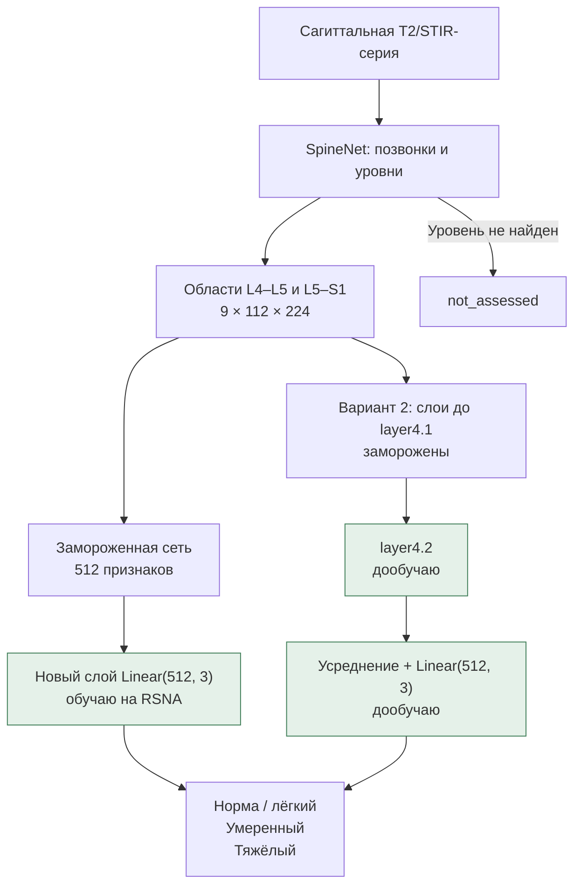

# ai-spine-med

В этом репозитории я делаю проект для университетской практики: адаптирую [SpineNet](https://github.com/rwindsor1/SpineNet) к оценке **центрального стеноза на L4–L5 и L5–S1**. Сравниваю исходную модель, новую голову при замороженной сети и дообучение последнего остаточного блока.

На входе — сагиттальная МРТ-серия поясницы, на выходе — одна из трёх категорий для каждого уровня: **норма / лёгкий, умеренный, тяжёлый**. Если нужную область найти не удалось, сохраняю `not_assessed`. В работе использую SpineNetV2; TotalSpineSeg — другой проект.

Первое сравнение сохранил в [метке practice-v1](https://github.com/Ja1rman/ai-spine-med/tree/practice-v1). После него добавил запуск на отдельной серии и [пять следующих экспериментов](docs/improvements.md). Старый тест остаётся отдельным завершённым результатом; новые варианты проверяю по train/CV/validation.

## Сравнение с аксиальными T2

Добавил аксиальные серии RSNA и сравнил три варианта: сагиттальный SpineNet с новой головой, аксиальный ResNet18 с обучаемым выбором срезов и объединение их признаков. Сети извлечения признаков оставил замороженными; обучал небольшие классификаторы и аксиальное внимание.

На одной и той же валидации получилось так: **582 общих обработанных уровня из 594**, 297 пациентов. Первые три варианта — ансамбли трёх seed, четвёртый — среднее вероятностей сагиттального и аксиального ансамблей с весами 50/50.

| Вариант | Macro-F1 | Тяжёлые: определены / всего |
| --- | ---: | ---: |
| Только сагиттальные | 0.691 | 30 / 42 |
| Только аксиальные | 0.509 | 16 / 42 |
| Вместе | 0.633 | 26 / 42 |
| Среднее вероятностей 50/50 | 0.637 | 28 / 42 |

Объединение признаков исправило 10 ошибок сагиттальной модели и добавило 15 новых. Разница macro-F1 — **−0.058**, парный 95% bootstrap-интервал **[−0.118; +0.002]**. По этому интервалу уверенного прироста нет; точечная оценка ниже.

После разбора ошибок отдельно проверил простое среднее готовых вероятностей. Новую сеть не обучал, веса и пороги не подбирал. Оно исправило 10 ошибок сагиттальной модели, но добавило 16. Тяжёлый стеноз получал оценку «норма / лёгкий» в 12 случаях против 6 у сагиттального варианта. Поэтому основным пока оставляю сагиттальный вариант. На L5–S1 все четыре варианта пропустили 3 тяжёлых случая из 3; ещё один тяжёлый случай на L4–L5 не обработан ни одним вариантом и остаётся в общем знаменателе 42.


[Отчёт по усреднению вероятностей: матрицы ошибок, уровни, bootstrap и команды запуска](docs/probability-mean.md). Проверку добавил после просмотра отдельных ошибок на validation, поэтому она тоже относится к разработке.

Для врачебной проверки трёх исходных вариантов собрал 146 приватных примеров: 128 с расхождением хотя бы одной модели с RSNA, 12 без оценки и 6 контрольных. К каждому добавил полные серии поясницы. Нужно понять, действительно ли аксиальная ветка смотрит на нужный уровень и канал. ImageNet-предобучение и работа по всему полю зрения — ограничения этого первого сравнения; вывод о бесполезности аксиальных МРТ из него не делаю.

[Подробный отчёт, матрицы ошибок, все seed и команды запуска](docs/multimodal.md). Протокол и код зафиксировал до обучения в коммите `ba6c2d5`; тест v1 сохранил отдельно без изменений. Новые CV и validation относятся к разработке: эти числа не являются новым независимым тестом.

## Что именно я обучаю

Сначала запускаю исходный SpineNet: он находит позвонки, определяет уровни и вырезает области дисков. В первом варианте получаю 512 признаков из его основной сети и обучаю поверх них новый слой `Linear(512, 3)`. В нём всего **1 539 обучаемых параметров**.

Во втором варианте дополнительно обучаю `layer4.2` — последний остаточный блок сети оценки признаков. Голову беру из первого эксперимента с тем же seed. Детектор, нумерацию и предыдущие слои не меняю, статистики BatchNorm оставляю исходными.



Оба варианта обучаю с seed `42`, `2024`, `3407`. Вход неизменяемой части сохраняю один раз, чтобы не пересчитывать её каждую эпоху. Подробности второго эксперимента — в [протоколе дообучения и теста](docs/fine-tuning.md).

## Данные

Я использую официальный [RSNA 2024 Lumbar Spine Degenerative Classification](https://www.kaggle.com/competitions/rsna-2024-lumbar-spine-degenerative-classification/data). Отбираю серию `Sagittal T2/STIR` и две метки центрального стеноза на исследование. Это группа T2-подобных последовательностей; обычную T2 и STIR по очищенным заголовкам надёжно разделить пока не получается.


Разбиение фиксированное: **1 382 / 297 / 295 исследований** для train / validation / test. Два уровня одного исследования всегда находятся в одной выборке. Основание для группировки по `study_id` — правило авторов не включать одного пациента повторно, описанное в [приложении LumbarDISC](https://pubs.rsna.org/doi/suppl/10.1148/ryai.250480/suppl_file/ryai250480suppa1.pdf). Отдельной таблицы связи пациентов в выгрузке нет.

Эпоху выбираю по валидации. Тест открываю только после фиксации протокола и контрольных сумм всех шести обученных checkpoint. Координаты из разметки RSNA не подставляю вместо автоматического поиска областей при сравнении.

## Итоговое сравнение на тесте

<!-- FINAL_RESULTS_START -->
На отложенном тесте оценил **588 из 590 уровней (99.7%)**.

| Модель | Seed | Macro-F1 на обработанных областях | Тяжёлые: определены / всего | Тяжёлый → норма/лёгкий | Тяжёлый → умеренный |
| --- | ---: | ---: | ---: | ---: | ---: |
| Исходный SpineNet | — | 0.632 | 24 / 40 | 9 | 7 |
| Новая голова | 42 | 0.705 | 30 / 40 | 5 | 5 |
| Новая голова | 2024 | 0.691 | 28 / 40 | 5 | 7 |
| Новая голова | 3407 | 0.690 | 30 / 40 | 5 | 5 |
| Последний блок + голова | 42 | 0.691 | 24 / 40 | 5 | 11 |
| Последний блок + голова | 2024 | 0.688 | 29 / 40 | 5 | 6 |
| Последний блок + голова | 3407 | 0.679 | 30 / 40 | 5 | 5 |

Среднее и стандартное отклонение macro-F1 по трём seed:

- Новая голова: **0.696 ± 0.008**.
- Последний блок + голова: **0.686 ± 0.006**.

Все **40 тяжёлых уровней обработаны**. Стандартное отклонение описывает разброс между запусками, а не неопределённость на новых пациентах.

Полную сеть классификации замерил на **mps**, по одной готовой области за раз. Для каждой модели — 32 измерения после 8 прогревочных запусков.

| Модель | Seed | Медиана, мс/область | 90-й процентиль, мс |
| --- | ---: | ---: | ---: |
| Исходный SpineNet | — | 280.8 | 387.3 |
| Новая голова | 42 | 249.0 | 275.1 |
| Новая голова | 2024 | 257.5 | 332.1 |
| Новая голова | 3407 | 247.3 | 276.8 |
| Последний блок + голова | 42 | 244.1 | 293.9 |
| Последний блок + голова | 2024 | 272.7 | 321.6 |
| Последний блок + голова | 3407 | 268.0 | 306.8 |

Отдельно во время извлечения тестовых признаков полный исходный конвейер — от чтения DICOM до оценок — занял в медиане **4.88 с на серию** (295 серий).
Общая часть без forward классификатора заняла в медиане 4.41 с на серию; сюда входят чтение, поиск уровней, подготовка областей и перенос результатов. Это не отдельный замер чистого детектора.

В замер классификации не входят чтение с диска, поиск уровней и загрузка весов. Во всех вариантах почти одинаковое число операций; небольшие различия времени не считаю доказательством ускорения после дообучения.
<!-- FINAL_RESULTS_END -->

На этом тесте вариант с новой головой оказался лучше по macro-F1 при каждом из трёх seed. Дообучение последнего блока улучшило валидацию, но это преимущество не перенеслось на тест. Поэтому пока считаю обучение одной головы более удачным вариантом для этой задачи.

У адаптации есть цена: исходная модель завысила степень у **11 из 507** обработанных областей категории «норма / лёгкий», новая голова — у **19–23**, последний блок с головой — у **22–31**. На **L5–S1 все семь моделей нашли только один из трёх тяжёлых случаев**, остальные два отнесли к норме/лёгкому. Дообучение здесь чаще распознаёт умеренную категорию, но обработанных умеренных случаев всего четыре — для уверенного вывода этого мало.

Оба замера времени проводил на одном Mac с моделями на MPS. Примерно **0.24–0.28 с на готовую область** и **4.88 с на МРТ-серию** относятся к разным частям обработки, их нельзя сравнивать напрямую.


<details>
<summary>Матрицы ошибок всех семи моделей на тесте</summary>


</details>

## Обучение и валидация

<!-- FINETUNE_VALIDATION_START -->
Выбранные модели после дообучения последнего блока (валидация):

| Seed | Обучено эпох | Выбранная эпоха | Macro-F1 | Тяжёлые: определены / всего |
| ---: | ---: | ---: | ---: | ---: |
| 42 | 10 | 10 | 0.697 | 25 / 42 |
| 2024 | 10 | 7 | 0.716 | 32 / 42 |
| 3407 | 9 | 6 | 0.695 | 29 / 42 |

Средний validation macro-F1 — **0.703 ± 0.012** (стандартное отклонение между seed). Эпоха 0 означает, что по валидации сохранилось исходное состояние этого запуска. Эта таблица использовалась для выбора эпохи, итоговую оценку даёт отдельный тест.
<!-- FINETUNE_VALIDATION_END -->


<details>
<summary>Первый эксперимент: новая голова при замороженной сети</summary>

У исходного SpineNet четыре категории центрального стеноза. Для сравнения с RSNA складываю вероятности «нет» и «лёгкий», а затем выбираю максимум из трёх категорий. Это исследовательское сопоставление шкал; клиническую эквивалентность врач ещё не проверял.

Новую голову обучаю три раза: seed **42, 2024, 3407**. Использую AdamW, learning rate `0.001`, batch size `64`, до 20 эпох и раннюю остановку по validation macro-F1. Веса классов считаю только по обучающим данным. Подробности зафиксировал в [протоколе эксперимента](docs/experiment.md).

<!-- RESULTS_START -->
На валидации обработано **588 из 594 целевых уровней (99.0%)**.

| Модель | Macro-F1 на обработанных областях | Найдено тяжёлых / все тяжёлые |
| --- | ---: | ---: |
| Исходный SpineNet | 0.589 | 19 / 42 (45.2%) |
| Новая голова, seed 42 | 0.679 | 26 / 42 (61.9%) |
| Новая голова, seed 2024 | 0.676 | 26 / 42 (61.9%) |
| Новая голова, seed 3407 | 0.682 | 26 / 42 (61.9%) |

Средний macro-F1 новой головы — **0.679 ± 0.003** по 3 запускам (среднее и стандартное отклонение). Валидация использовалась для выбора эпохи; это ещё не результат на отложенном тесте.
<!-- RESULTS_END -->

На валидации новая голова чаще правильно определяет умеренную и тяжёлую категории, но чаще завышает степень у «нормы / лёгкой»: 22–27 ошибок вместо 12 на 504 обработанных областях этой категории. На **L5–S1 исходная модель и все три варианта с новой головой не определили ни одного из трёх тяжёлых случаев валидации**. Этот уровень нужно разбирать отдельно; общий macro-F1 эту проблему скрывает.


Все модели сравниваю на одних и тех же автоматически извлечённых областях. Macro-F1 считаю только для областей, которые удалось извлечь. Отдельно показываю покрытие и долю найденных тяжёлых случаев среди всех тяжёлых, включая необработанные.


</details>

## Что попробовал после первого сравнения

Проверил ансамбль прежних голов, небольшую MLP-голову, ordinal-голову в стиле CORAL, подготовил галерею ошибок и добавил оценку неопределённости. Для новых голов сделал **36 обучений**: три архитектуры, три seed, три CV-разбиения внутри прежнего train и затем обучение на полном train.

| Голова | CV: среднее ансамбля по трём частям | Прежняя validation: ансамбль |
| --- | ---: | ---: |
| Линейная, новый протокол | 0.680 | 0.667 |
| MLP `512 → 64 → 3` | **0.689** | **0.693** |
| Ordinal / CORAL | 0.545 | 0.519 |

MLP выбрал по CV до проверки validation. Она находит **29 из 42** тяжёлых уровней против 26 у нового линейного ансамбля; оба завысили степень у 27 из 504 обработанных областей «норма / лёгкий». Но 95% bootstrap-интервал разницы macro-F1 MLP и линейного ансамбля — **[−0.003; +0.061]**. Поэтому считаю MLP кандидатом для следующей проверки, а не доказанным улучшением. На новом независимом тесте её ещё не оценивал.


Усреднение прежних трёх голов дало на validation 0.678 — явного выигрыша перед отдельными головами нет. Заданный ordinal-вариант не смог предсказывать умеренную категорию: обученные границы и выбранный `argmax` делают её недостижимой. Этот отрицательный результат сохранил вместе с остальными.


Для старого теста тоже посчитал 2 000 парных bootstrap-выборок по исследованиям, сохраняя оба уровня одного исследования вместе. Разница среднего macro-F1 трёх отдельных новых голов и исходного SpineNet — +0.063 с интервалом **[−0.015; +0.143]**. Здесь усредняю метрики, а не вероятности ансамбля. Стандартное отклонение по трём seed не показывало этой неопределённости по случаям.


Для врача подготовил локальный `reports/runs/error-review-v2/index.html`: **48 случаев**, исходный срез с автоматическими уровнями, три среза ROI, разметка и предсказания. На `comparison.html` добавил сопоставление старого ансамбля и новых моделей на тех же случаях. Рядом лежит пустой `doctor_review.csv`. В подборке есть восемь правильных контролей и два отказа поиска уровня. Все шесть контактных листов я просмотрел технически; анатомическую нумерацию и клиническую разметку врач пока не проверял. Из такой целевой подборки нельзя считать частоту ошибок в популяции.

Подробности, ограничения и команды повторения — в [отчёте следующих экспериментов](docs/improvements.md). Сравнивать 0.693 новой validation и 0.696 прежнего test как изменение качества нельзя: это разные выборки.

Графики строятся из результатов запуска. Я публикую только агрегированные числа и свои схемы. Срезы МРТ, вырезанные области, признаки и таблицы отдельных исследований остаются локально — правила RSNA запрещают распространять данные.

## Запуск на одной МРТ-серии

Пункт 7: `predict` принимает папку с одной сагиттальной T2/STIR МРТ-серией в DICOM. Для неё не нужны метки RSNA или таблица пациентов. Подходящую последовательность выбираю сам: модуль проверяет геометрию, но не подтверждает подтип последовательности по изображению. Можно передать одну обученную голову либо все три головы одной архитектуры для усреднения вероятностей.

```bash
ai-spine predict \
  --dicom-dir /path/to/one/sagittal/series \
  --checkpoint \
    reports/runs/head-v2/validation/mlp/seed-42/head.pt \
    reports/runs/head-v2/validation/mlp/seed-2024/head.pt \
    reports/runs/head-v2/validation/mlp/seed-3407/head.pt \
  --out reports/runs/my-series \
  --device auto
```

В выходной папке будут `predictions.csv` с двумя строками и `predictions.json` с вероятностями категорий, отказами, контрольными суммами моделей и временем. Выходную папку выбираю новую: готовый запуск не перезаписывается. Исходные DICOM UID, данные пациента и пути во входных файлах в отчёт не копируются. Вероятности пока не откалиброваны.

Рядом с весами сохраняю их исходные `manifest.json`, `summary.json`, а для v2 также `selection.json` и `folds.json`: модуль сверяет происхождение головы, encoder и предобработки. Checkpoint из CV для этого запуска не подходит. Старые головы `reports/runs/head-v1/runs/seed-42/head.pt` тоже поддержаны.

Проверил свежий запуск на обучающих сериях с обоими найденными уровнями и с одним пропущенным. Оценки совпали с предсказаниями по сохранённым 512 признакам, максимальная разница вероятностей — 0. При отсутствии уровня получается `not_assessed`, при сбое входа — явный отказ, а не «норма». Это исследовательский результат, не клиническое заключение.

## Как повторить

Я запускаю проект на macOS ARM64 с Python 3.12. Для извлечения признаков использую MPS, обучение выполняю на CPU. Во втором эксперименте короткий технический замер последнего блока оказался немного быстрее на CPU, чем на MPS. Список проверенных версий находится в `requirements-macos-arm64-py312.lock`.

```bash
python3.12 -m venv .venv
source .venv/bin/activate
python -m pip install -e '.[data,dev]'
ai-spine doctor
ai-spine fetch-assets
```

Исходники SpineNet и четыре файла весов скачиваются с закреплёнными SHA-256, отдельно от Git. В исходниках есть одна правка совместимости `np.bool` → `bool`; архитектура и веса исходной модели не меняются. NumPy ограничен версией 1.x из-за старого API в SpineNet. Для checkpoint используется ограниченный загрузчик PyTorch.

Для данных нужен аккаунт Kaggle с принятыми правилами конкурса и настроенный вход CLI (`kaggle auth login`). Токены храню вне репозитория.

```bash
python -m ai_spine_med.kaggle_download metadata --data-root data/rsna
python -m ai_spine_med.data --data-root data/rsna --out artifacts/rsna-v1 --seed 42
ai-spine download-cohort --workers 4
ai-spine extract-features --out artifacts/features-v1 --device auto
ai-spine roi-qc --features artifacts/features-v1 --out reports/runs/roi-qc-v1
ai-spine evaluate-baseline --features artifacts/features-v1 --out reports/runs/baseline-v1
ai-spine train-head --features artifacts/features-v1 --out reports/runs/head-v1
ai-spine report-figures --baseline reports/runs/baseline-v1 --training reports/runs/head-v1 --update-readme README.md
```

Второй вариант и финальный тест:

```bash
ai-spine cache-last-block --features artifacts/features-v1 --out artifacts/last-block-activations-v1 --device auto
ai-spine train-last-block --features artifacts/features-v1 --activations artifacts/last-block-activations-v1 --heads reports/runs/head-v1 --out reports/runs/last-block-v1 --device cpu
ai-spine freeze-selection --features artifacts/features-v1 --heads reports/runs/head-v1 --fine-tuned reports/runs/last-block-v1 --out reports/runs/selection-v1.json
ai-spine download-test --selection reports/runs/selection-v1.json
ai-spine extract-test --selection reports/runs/selection-v1.json --out artifacts/test-features-v1 --device auto
ai-spine evaluate-test --selection reports/runs/selection-v1.json --features artifacts/test-features-v1 --heads reports/runs/head-v1 --fine-tuned reports/runs/last-block-v1 --activations artifacts/test-activations-v1 --out reports/runs/test-v1 --device auto
ai-spine report-final --heads reports/runs/head-v1 --fine-tuned reports/runs/last-block-v1 --test-results reports/runs/test-v1 --update-readme README.md --protocol-doc docs/fine-tuning.md
```

Загрузчик получает нужные серии из официального архива и добавляет серию в локальную папку только после полной загрузки и проверки размера и CRC файлов. Повторный запуск продолжает работу с готовых серий. Извлечение признаков тоже можно продолжить: кэш проверяется по данным, разбиению, версии кода и весам. Обучение не начнётся, пока в кэше остаются необработанные серии.

Реестр `artifacts/rsna-v1` создаю один раз. Для продолжения прерванного запуска повторяю `download-cohort` и `extract-features`, не пересоздавая реестр: изменение его файлов считается новым экспериментом.

Локальные результаты:

| Каталог | Что сохраняю |
| --- | --- |
| `artifacts/rsna-v1/` | Разбиение, серии, метки, контрольные суммы |
| `artifacts/features-v1/` | Области, 512 признаков, исходные logits, статусы всех целевых уровней |
| `reports/runs/baseline-v1/` | Метрики и предсказания исходного SpineNet на валидации |
| `reports/runs/head-v1/` | Веса новой головы, история обучения и метрики каждого seed |
| `artifacts/last-block-activations-v1/` | Вход последнего блока для train и validation |
| `reports/runs/last-block-v1/` | Веса последнего блока и головы, история трёх запусков |
| `reports/runs/selection-v1.json` | Зафиксированные до теста модели и протокол |
| `artifacts/test-features-v1/`, `reports/runs/test-v1/` | Области теста и предсказания всех семи моделей |
| `docs/images/`, `docs/results.json`, `docs/test-results.json` | Публичные графики и агрегированные результаты |

Быстрый запуск исходного SpineNet на отдельной серии:

```bash
ai-spine smoke --dicom-dir data/rsna/train_images/STUDY/SERIES --out reports/runs/single-case
```

Загрузчик проверяет геометрию DICOM, сортирует срезы по физическим координатам и сохраняет масштаб при ресемплинге. Некорректный вход получает отказ. Результаты самого первого запуска сохранил в [проверке этапов 1–2](docs/verification.md).

## Проверки и ограничения

```bash
python -m pytest -q
ruff check src tests
ruff format --check src tests
```

Тестами проверяю чтение DICOM, разбиение данных, загрузку, кэш, объединение классов, учёт отказов и восстановление предсказаний из сохранённых весов. Качество классификации проверяю отдельно по разметке RSNA.

На L5–S1 в train всего **13 тяжёлых случаев**, в validation и test — по **3**. По ним нельзя сделать устойчивый вывод о качестве. Обучение классификатора также не исправляет ошибки нумерации и пропуски детектора: это отдельная часть работы. Визуальная проверка областей пока техническая, без подтверждения врача.

В основе проекта — SpineNet от Visual Geometry Group, University of Oxford. [Лицензию использованной версии](third_party/SpineNet-LICENCE.md) сохранил без изменений: она ограничивает применение исходной модели, весов и результатов некоммерческими исследованиями. Данные RSNA использую по [условиям конкурса](https://www.kaggle.com/competitions/rsna-2024-lumbar-spine-degenerative-classification/rules). Дообучение не снимает эти ограничения и не даёт медицинскую сертификацию. Для коммерческого продукта потребуются права на компоненты, клиническая валидация и отдельная регуляторная работа.
