# ai-spine-med

В этом репозитории я делаю проект для университетской практики: адаптирую [SpineNet](https://github.com/rwindsor1/SpineNet) к оценке **центрального стеноза на L4–L5 и L5–S1**. Сравниваю исходную модель, новую голову при замороженной сети и дообучение последнего остаточного блока.

На входе — сагиттальная МРТ-серия поясницы, на выходе — одна из трёх категорий для каждого уровня: **норма / лёгкий, умеренный, тяжёлый**. Если нужную область найти не удалось, сохраняю `not_assessed`. В работе использую SpineNetV2; TotalSpineSeg — другой проект.

Первое сравнение сохранил в [метке practice-v1](https://github.com/Ja1rman/ai-spine-med/tree/practice-v1). После него добавил запуск на отдельной серии, [пять следующих экспериментов](docs/improvements.md) и аксиальную ветку. Старые результаты не перезаписываю: перенос на другой датасет сравниваю отдельно на новых отложенных пациентах и прежнем тесте RSNA.

В [последнем сравнении на тесте](docs/localization-test.md) сагиттальный ансамбль остаётся основным: macro-F1 **0.702** против **0.536** у лучшей аксиальной ветки. На L5–S1 пока ни один вариант не распознаёт тяжёлый стеноз достаточно надёжно; ниже отдельно привожу число таких случаев и ошибки.

## Сравнение с аксиальными T2

Добавил аксиальные серии RSNA и сравнил три варианта: сагиттальный SpineNet с новой головой, аксиальный ResNet18 с обучаемым выбором срезов и объединение их признаков. Сети извлечения признаков оставил замороженными; обучал небольшие классификаторы и аксиальное внимание.

На одной и той же валидации получилось так: **582 общих обработанных уровня из 594**, 297 пациентов. Первые три варианта — ансамбли трёх seed, четвёртый — среднее вероятностей сагиттального и аксиального ансамблей с весами 50/50.

| Вариант | Macro-F1 | Тяжёлые: определены / всего |
| --- | ---: | ---: |
| Только сагиттальные | 0.691 | 30 / 42 |
| Только аксиальные | 0.509 | 16 / 42 |
| Вместе | 0.633 | 26 / 42 |
| Среднее вероятностей 50/50 | 0.637 | 28 / 42 |

Объединение признаков исправило 10 ошибок сагиттальной модели и добавило 15 новых. Разница macro-F1 — **−0.058**, парный 95% bootstrap-интервал **[−0.118; +0.002]**. По этому интервалу уверенного прироста нет; точечная оценка ниже.

После разбора ошибок отдельно проверил простое среднее готовых вероятностей. Новую сеть не обучал, веса и пороги не подбирал. Оно исправило 10 ошибок сагиттальной модели, но добавило 16. Тяжёлый стеноз получал оценку «норма / лёгкий» в 12 случаях против 6 у сагиттального варианта. Поэтому основным пока оставляю сагиттальный вариант. На L5–S1 все четыре варианта пропустили 3 тяжёлых случая из 3; ещё один тяжёлый случай на L4–L5 не обработан ни одним вариантом и остаётся в общем знаменателе 42.

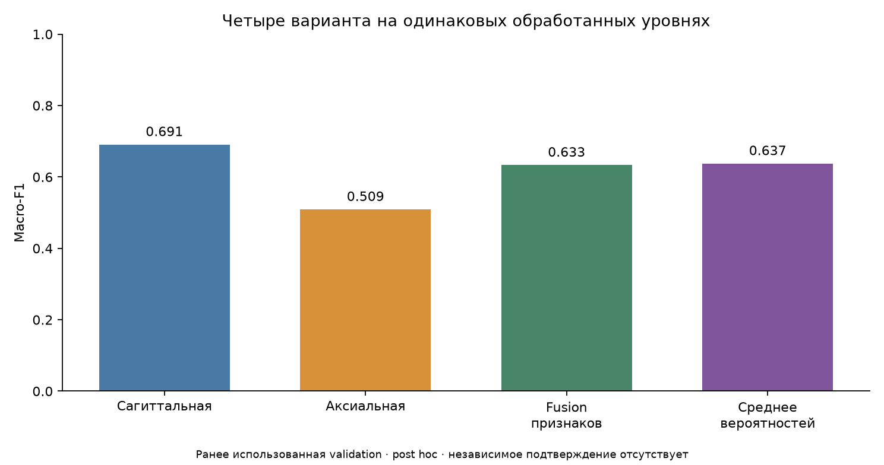

[Отчёт по усреднению вероятностей: матрицы ошибок, уровни, bootstrap и команды запуска](docs/probability-mean.md). Проверку добавил после просмотра отдельных ошибок на validation, поэтому она тоже относится к разработке.

Для врачебной проверки трёх исходных вариантов собрал 146 приватных примеров: 128 с расхождением хотя бы одной модели с RSNA, 12 без оценки и 6 контрольных. К каждому добавил полные серии поясницы. Нужно понять, действительно ли аксиальная ветка смотрит на нужный уровень и канал. ImageNet-предобучение и работа по всему полю зрения — ограничения этого первого сравнения; вывод о бесполезности аксиальных МРТ из него не делаю.

[Подробный отчёт, матрицы ошибок, все seed и команды запуска](docs/multimodal.md). Протокол и код зафиксировал до обучения в коммите `ba6c2d5`; тест v1 сохранил отдельно без изменений. Эти CV и validation относятся к разработке.

## Дообучение аксиальной модели на другом наборе

Взял [Medical Lumbar Spine 3D Axial MRI](https://data.mendeley.com/datasets/wjxkrkxhb8/1): 500 пациентов, 12 345 аксиальных DICOM и 2491 XML с разметкой. Использую только центральный канал на L4–L5 и L5–S1. Принял рабочее соответствие `Normal → норма/лёгкий`, `Stenosis → умеренный`, `Severe Stenosis → тяжёлый`; клиническое соответствие этих шкал ещё нужно проверить с врачом.

Пациентов разделил на 350 / 75 / 75 для обучения, валидации и теста. Продолжил обучение трёх прежних аксиальных моделей: разморозил последний блок ResNet18, сохранил attention и классификатор. Предыдущие слои, нормализаторы и статистики BatchNorm оставил исходными. В обучение добавил фиксированные 350 исследований из прежнего RSNA train, чтобы проверить перенос с сохранением качества на исходных данных.

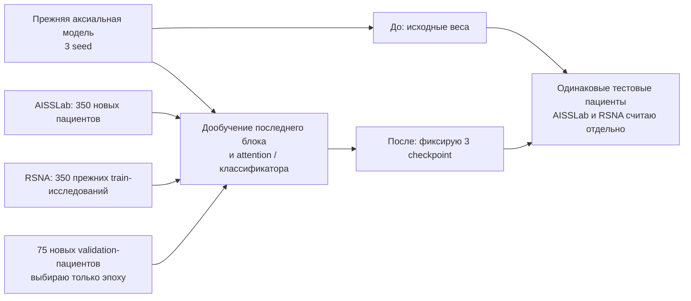

Если врачебной метки нет, всё равно сохраняю прогноз модели. В обучение по эталонам и в расчёт точности такой уровень не включаю. Это отдельно от ситуации, когда снимки вообще не удалось обработать.

Улучшения в этом эксперименте не получил. Сравнил среднее вероятностей трёх моделей до и после дообучения:

| Отложенная выборка | Macro-F1 до → после | Тяжёлые: найдены до → после / всего |
| --- | ---: | ---: |
| AISSLab: 75 новых пациентов | 0.347 → 0.334 | 4 → 1 / 14 |
| RSNA: 295 прежних тестовых пациентов | 0.496 → 0.415 | 15 → 7 / 40 |

На AISSLab устойчивого изменения не выявил: 95% интервал разницы F1 — [−0.108; +0.076]. На RSNA качество ухудшилось: интервал [−0.146; −0.016] целиком ниже нуля. Поэтому прежние веса оставляю основными, новые сохраняю отдельно как результат эксперимента. Всего получил 740 оценок; для проверки точности доступны 739 врачебных меток.

[Полный отчёт: все seed, матрицы ошибок, уровни и доверительные интервалы](docs/axial-transfer.md).

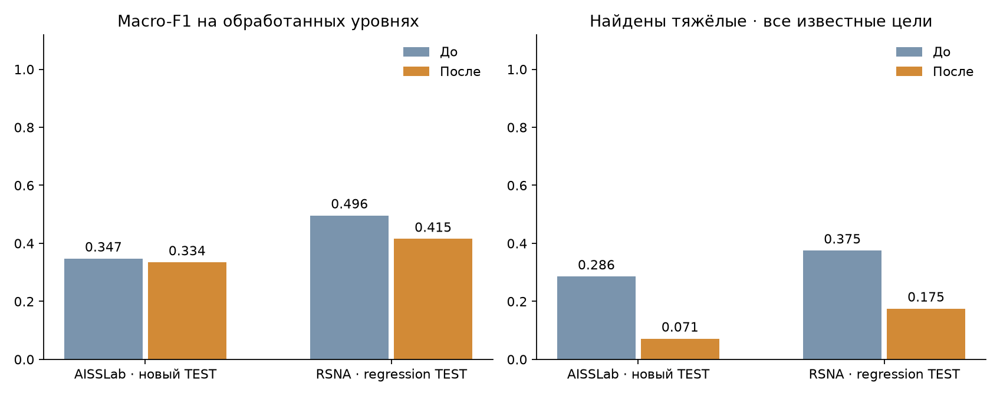

Команды запуска: `ai-spine axial-transfer prepare`, затем `cache`, `train`, `evaluate` и `report`. Исходный архив предварительно сохраняю в `data/external/aisslab-axial-v1/source.zip`; при подготовке проверяется его закреплённая контрольная сумма. Веса, снимки и индивидуальные прогнозы остаются локально. Подробный протокол — [axial-transfer-v4.json](configs/axial-transfer-v4.json).

## Почему перенос не помог

Проверил XML, порядок срезов и карты внимания. Ошибок импорта 993 целевых меток не нашёл, но эквивалентность шкал остаётся неподтверждённой: в AISSLab классы точно разделяются AP-диаметром, а RSNA использует modified Lee.

Аксиальная ветка сейчас оценивает всю серию и сама распределяет внимание. Отдельного определения уровней в ней нет. Пик среднего внимания около L5–S1 на новом наборе попадает в ±10 мм от размеченного среза в 19/75 случаев до дообучения и в 13/75 после. Это близость к опорным срезам, не клиническая точность локализации. L5–S1 плохо работал ещё до переноса; потеря найденных тяжёлых после переноса произошла на L4–L5.

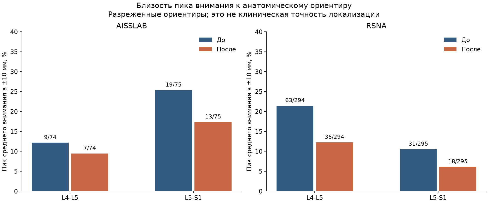

[Полный разбор: шкалы, подозрительные AP=0, выбор срезов и опыты с фиксированными весами](docs/axial-diagnosis.md). По итогам разбора решил проверить явную локализацию, а соответствие шкал оставить для врачебной проверки. Дополнительное обучение на несогласованных классах не запускал.

## Явный выбор уровня и области канала

Сделал следующий эксперимент: отдельно обучил выбор срезов L4–L5/L5–S1 и предсказание центра области канала. Координаты уровней взял из RSNA и AISSLab, центры размеченных прямоугольников — только из XML AISSLab. Это ориентиры области канала, а не его сегментационные маски. Степени AISSLab в обучение не включал. Классификатор обучил только на RSNA, по автоматически выбранным областям 50×50 мм. На тесте ни уровень, ни центр не задаю эталонной разметкой.

На RSNA test локализатор выбрал срез в ±10 мм от ориентира L5–S1 в **273/295 случаях**; простой позиционный baseline — в 203/295. В RSNA это приблизительный ориентир уровня по subarticular-разметке, а не проверенный центр канала. На AISSLab получилось 72/75, при этом позиционный baseline там лучше — 74/75.

По оценке степени получил macro-F1 на прежнем RSNA test **0.531** против **0.496** у исходной аксиальной ветки и **0.415** после переноса v4. Прирост относительно исходной ветки неубедителен: парный 95% интервал разницы F1 — [−0.046; +0.115]. Тяжёлых L5–S1 по-прежнему найдено **0/3**, а общее число найденных тяжёлых осталось 15/40. Поэтому задачу L5–S1 решённой не считаю. Прежний сагиттальный ансамбль на 588 общих целях сильнее: 0.702 против 0.532 у нового варианта. На AISSLab F1 — 0.406 при прежнем исследовательском сопоставлении классов; это отдельная оценка переноса.

Для нумерации по сагиттальной серии подготовил проверяемый геометрический переход из сохранённых результатов SpineNet. Прямой перенос в текущем RSNA не включил: общая система координат серий не подтверждена. Здесь работает аксиальный локализатор.

[Отчёт с доверительными интервалами, сравнением с сагиттальной моделью и графиками](docs/localized-stenosis.md). Это новый pipeline с несколькими изменениями и разбор уже использованных тестовых пациентов, а не новое независимое подтверждение качества. Локализатор один с фиксированным seed; классификатор степени обучил с тремя seed.

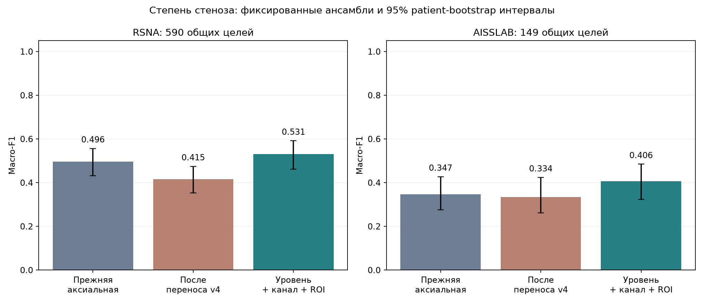

Запуск по этапам: `python -m ai_spine_med.axial_localizer_workflow --help`. Протокол — [axial-localizer-v6.json](configs/axial-localizer-v6.json). Веса и галерея реальных областей остаются локально; прежние модели не заменяю.

## Обучение локализации только по XML

Отдельно проверил, можно ли обучить выбор уровня только по XML AISSLab, без сагиттальных снимков и анатомической разметки RSNA. Взял 350 обучающих пациентов AISSLab: у них есть 695 ориентиров L4–L5 и L5–S1. Для сравнения заново обучил смешанный вариант AISSLab + RSNA. Каждый вариант повторил с тремя seed, ответы усреднил. Сеть центра области оставил прежней: она уже училась только по XML. Классификатор степени в этом опыте не менял.

Эпоху обоих вариантов выбирал только по AISSLab validation; RSNA validation проверил после фиксации всех шести моделей. Ниже — попадание в ±10 мм от размеченного среза:

| Валидационные данные | Только XML AISSLab | AISSLab + RSNA |
| --- | ---: | ---: |
| AISSLab, L4–L5 | 74/74 · 100.0% | 73/74 · 98.6% |
| AISSLab, L5–S1 | 74/75 · 98.7% | 75/75 · 100.0% |
| RSNA, L4–L5 | 202/294 · 68.7% | 244/294 · 83.0% |
| RSNA, L5–S1 | 217/294 · 73.8% | 262/294 · 89.1% |

На AISSLab обученная модель выбирает срез лучше позиционного ориентира без обучения: тот находил 66/74 и 68/75. Но перенос на RSNA у варианта только с XML хуже, поэтому от смешанного обучения пока не отказываюсь. В RSNA сравниваю с приблизительными ориентирами уровня, а не с проверенной разметкой центрального канала. Ещё три RSNA validation-исследования исходный обработчик не смог обработать; в таблицу обработанных случаев они не входят.

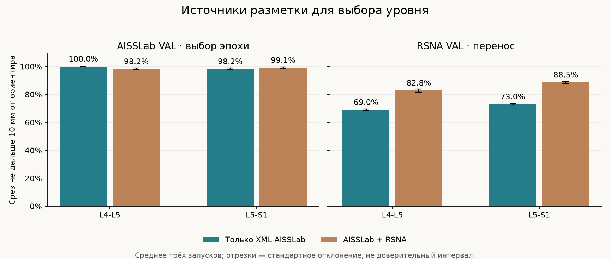

Это сравнение источников обучения на прежней валидации: меняются также объём данных, нормализация, позиционный prior и число обновлений весов. Результат не доказывает преимущество одного формата разметки и ничего нового не говорит о точности степени стеноза. TEST в этом опыте не использовал.

[Отчёт с разбросом между запусками и парными интервалами](docs/xml-localizer.md), [протокол](configs/xml-localizer-v7.json). Повторить: `python -m ai_spine_med.xml_localizer_ablation --device mps`; для нового запуска нужна отдельная пустая папка `--out`.

## Как выбор уровня влияет на степень стеноза

Подставил обе локализации в один и тот же классификатор v6. Для каждой ветки сначала усредняю вероятности срезов трёх локализаторов, затем нахожу центр области прежней сетью, получаю ROI 50×50 мм и оцениваю степень теми же тремя классификаторами. Нового обучения здесь нет. Проверил всю прежнюю валидацию: 297 RSNA и 75 AISSLab пациентов, включая исходные сбои обработки.

| Валидация RSNA | Только XML: macro-F1 | Смешанная: macro-F1 | Тяжёлые найдены: XML / смешанная |
| --- | ---: | ---: | ---: |
| Оба уровня | 0.548 | 0.585 | 23/42 / 23/42 |
| L4–L5 | 0.560 | 0.594 | 23/39 / 22/39 |
| L5–S1 | 0.354 | 0.433 | 0/3 / 1/3 |

Смешанный вариант численно выше по F1, но уверенного преимущества не получил: парный 95% интервал разницы — [−0.023; +0.098] для обоих уровней и [−0.083; +0.254] для L5–S1. Это сравнение двух локализаторов при фиксированном классификаторе, а не новый независимый тест системы.

На L5–S1 смешанная локализация изменила 12 ответов: 8 ошибок исправила, 4 правильных ответа потеряла. Один тяжёлый случай стал определяться верно, но умеренный стеноз теперь не найден ни в одном из 6 случаев; XML-only находил 1/6. Два оставшихся тяжёлых обе ветки относят к норме/лёгкой степени. Поэтому L5–S1 пока остаётся проблемным уровнем.

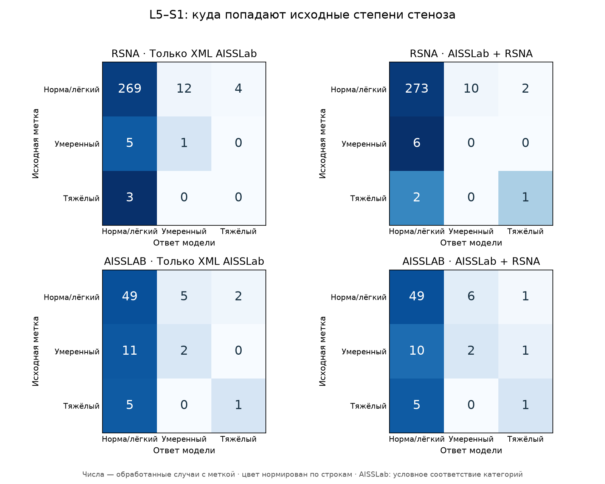

На AISSLab macro-F1 обоих уровней — 0.374 / 0.414, а L5–S1 почти не меняется: 0.411 / 0.410, тяжёлых найдено по 1/6. Эти результаты сохраняю отдельно: соответствие степеней AISSLab категориям RSNA пока условное.

Проверил и сам расчёт: когда обе ветки выбирают одинаковый срез, центр области, признаки и вероятности совпадают точно — таких целей 326 из 738 обработанных. Для врача собрал локальное сравнение исходных срезов и реальных ROI по трём тяжёлым L5–S1 и нескольким изменившимся ответам. Снимки и индивидуальные CSV остаются вне Git.

[Полный отчёт с покрытием, интервалами и матрицами ошибок](docs/localization-severity.md), [протокол](configs/localization-severity-v8.json). Запуск: `python -m ai_spine_med.localization_severity_validation --device mps`, затем `python -m ai_spine_med.localization_severity_report`. Классификаторы учились на ROI прежнего v6; здесь проверяю их чувствительность к замене локализации, а не оптимальное переобучение под каждый вариант.

## Отдельное дообучение под каждый локализатор

Затем дообучил классификаторы отдельно на областях XML-only и смешанного локализатора. В обеих ветках взял одни и те же 1380 пациентов RSNA TRAIN — 2760 обработанных уровней. Локализаторы, сеть центра и ResNet18 зафиксировал; обновлял только небольшой MLP классификации степени. Для каждой ветки сделал три запуска с одинаковых соответствующих весов v6 и сохранил прежнюю нормализацию признаков. Валидационные области переиспользовал из предыдущего опыта.

| Локализация | RSNA macro-F1 до → после | L5–S1 macro-F1 до → после | L5–S1: умеренные / тяжёлые после |
| --- | ---: | ---: | ---: |
| Только XML AISSLab | 0.548 → 0.576 | 0.354 → 0.357 | 1/6 / 0/3 |
| AISSLab + RSNA | 0.585 → 0.593 | 0.433 → 0.434 | 0/6 / 1/3 |

На L5–S1 обе ветки исправили по два случая с исходной меткой «норма/лёгкая степень». Число найденных умеренных и тяжёлых случаев не изменилось. Небольшой рост F1 здесь связан с уменьшением ложных тревог, а не с улучшением распознавания этих степеней стеноза.

Смешанный вариант нашёл ещё три тяжёлых L4–L5: 22/39 → 25/39. Но ложных ответов «тяжёлый» на обоих уровнях стало 20 вместо 16. Уверенного общего прироста пока нет: парные 95% интервалы разницы F1 включают ноль — [−0.004; +0.064] для XML-only и [−0.019; +0.038] для смешанной ветки. Эта валидация также использовалась для выбора эпох, поэтому независимым подтверждением результата она не является.

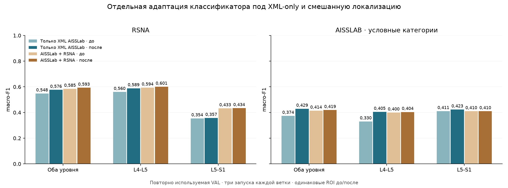

На AISSLab общий F1 изменился с 0.374 до 0.429 у XML-only и с 0.414 до 0.419 у смешанной ветки. Категории этого набора по-прежнему считаю условно сопоставленными с RSNA; в обучение степени они не входят.

Для XML-only выбраны эпохи 0/6/15, для смешанного варианта — 3/1/1. Эпоха 0 означает, что исходные веса этого запуска оказались лучше продолжения обучения. На L5–S1 в TRAIN всего 13 тяжёлых случаев, в VAL — 3; выводы по этому уровню оставляю для дальнейшего разбора с врачом. Новые веса и индивидуальные ответы сохранил отдельно от прежних.

[Отчёт с результатами каждого запуска, ошибками L5–S1 и интервалами](docs/localization-finetuning.md), [протокол дообучения](configs/localization-finetuning-v9.json). Подготовка данных: `python -m ai_spine_med.localization_finetuning_data --device mps`, обучение: `python -m ai_spine_med.localization_finetuning --device mps`, отчёт: `python -m ai_spine_med.localization_finetuning_report`. Для повторных запусков нужны отдельные папки вывода.

## Последние аксиальные модели против сагиттальной на тесте

Проверил оба классификатора v9 на тех же 295 тестовых пациентах RSNA, что и сагиттальный ансамбль. Веса и выбранные на валидации эпохи оставил прежними. Для каждого варианта усреднил вероятности трёх запусков; лучший seed по тесту не выбирал. Сагиттальные ответы взял из сохранённого и проверенного опыта v1.

Все модели получили одинаковые 590 целей. Обе аксиальные ветки обработали их полностью, а SpineNet не нашёл S1 у двух пациентов. Поэтому основное сравнение — на **588 общих уровнях**: 295 L4–L5 и 293 L5–S1.

| Модель | Macro-F1, оба уровня | Тяжёлые найдены | Macro-F1, L5–S1 | L5–S1: умеренные / тяжёлые |
| --- | ---: | ---: | ---: | ---: |
| Сагиттальная, новая голова | **0.702** | **30/40** | **0.505** | 1/4 / **1/3** |
| Аксиальная, смешанная локализация | 0.536 | 19/40 | 0.437 | **2/4** / 0/3 |
| Аксиальная, XML-only | 0.513 | 14/40 | 0.391 | 1/4 / 0/3 |

На обоих уровнях вместе сагиттальная модель заметно сильнее: 95% интервалы парной разницы F1 с каждой аксиальной веткой целиком выше нуля. Разница между самими аксиальными ветками неубедительна: смешанная − XML-only **+0.023 [−0.040; +0.085]**. Дополнительно оставил только 293 пациентов с обоими обработанными уровнями — 586 целей; порядок моделей сохранился.

На L5–S1 всего 4 умеренных и 3 тяжёлых случая в общем наборе. Смешанный вариант нашёл больше умеренных, но обе аксиальные ветки пропустили все три тяжёлых. Ни одна не нашла тяжёлый случай, пропущенный сагиттальной моделью. Поэтому оснований менять основной вариант или считать проблему L5–S1 решённой нет.

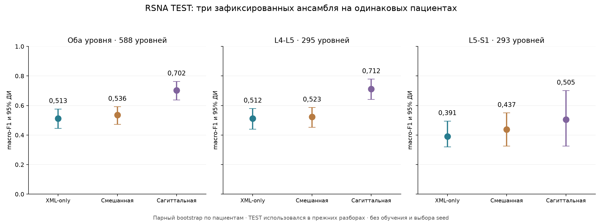

Этот TEST уже использовал в прежних разборах. Сейчас не обучал на нём модели и ничего не подбирал, но независимым новым подтверждением этот результат не считаю. Для следующей проверки понадобится ещё не просмотренная выборка.

[Отчёт с покрытием, матрицами ошибок и интервалами](docs/localization-test.md), [протокол проверки](configs/localization-test-v10.json). Локально сохранил таблицу всех 295 L5–S1 и изображения областей для трёх тяжёлых случаев, двух отказов SpineNet и одного расхождения ответов.

Запуск проверки: `python -m ai_spine_med.localization_test --device mps`, затем `python -m ai_spine_med.localization_test_report`. При повторном инференсе задаю новую папку через `--out`, чтобы сохранить прежний запуск; отчёту передаю путь к её `summary.json` через `--summary`. Для CPU использую `--device cpu`. Нужны локальные данные и зафиксированные веса v1/v6/v7/v9; в Git они не входят.

## Что именно я обучаю

Сначала запускаю исходный SpineNet: он находит позвонки, определяет уровни и вырезает области дисков. В первом варианте получаю 512 признаков из его основной сети и обучаю поверх них новый слой `Linear(512, 3)`. В нём всего **1 539 обучаемых параметров**.

Во втором варианте дополнительно обучаю `layer4.2` — последний остаточный блок сети оценки признаков. Голову беру из первого эксперимента с тем же seed. Детектор, нумерацию и предыдущие слои не меняю, статистики BatchNorm оставляю исходными.

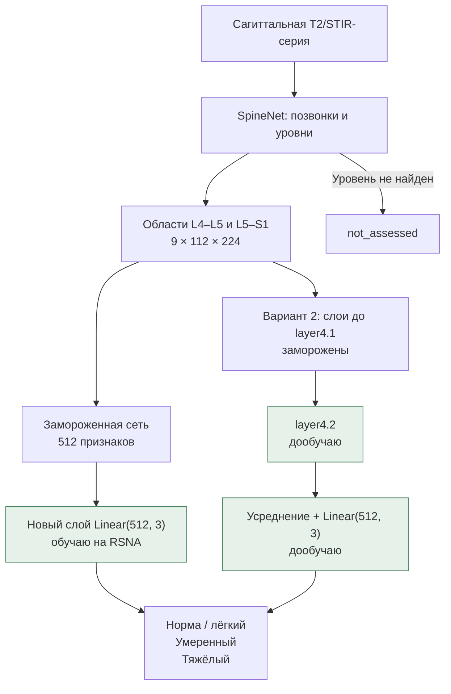

Оба варианта обучаю с seed `42`, `2024`, `3407`. Вход неизменяемой части сохраняю один раз, чтобы не пересчитывать её каждую эпоху. Подробности второго эксперимента — в [протоколе дообучения и теста](docs/fine-tuning.md).

## Данные

Я использую официальный [RSNA 2024 Lumbar Spine Degenerative Classification](https://www.kaggle.com/competitions/rsna-2024-lumbar-spine-degenerative-classification/data). Отбираю серию `Sagittal T2/STIR` и две метки центрального стеноза на исследование. Это группа T2-подобных последовательностей; обычную T2 и STIR по очищенным заголовкам надёжно разделить пока не получается.

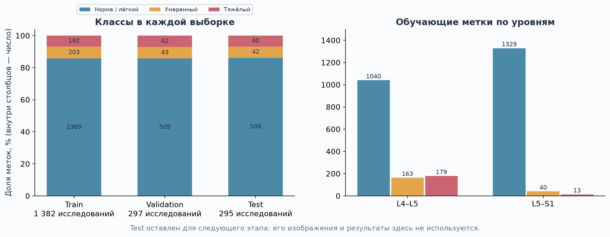

Разбиение фиксированное: **1 382 / 297 / 295 исследований** для train / validation / test. Два уровня одного исследования всегда находятся в одной выборке. Основание для группировки по `study_id` — правило авторов не включать одного пациента повторно, описанное в [приложении LumbarDISC](https://pubs.rsna.org/doi/suppl/10.1148/ryai.250480/suppl_file/ryai250480suppa1.pdf). Отдельной таблицы связи пациентов в выгрузке нет.

Эпоху выбираю по валидации. В первом сравнении открыл тест после фиксации протокола и контрольных сумм всех шести обученных checkpoint. Позднейшие сравнения на том же TEST отмечаю отдельно как повторные исследовательские проверки. Координаты из разметки RSNA не подставляю вместо автоматического поиска областей при сравнении.

## Итоговое сравнение на тесте

<!-- FINAL_RESULTS_START -->
На отложенном тесте оценил **588 из 590 уровней (99.7%)**.

| Модель | Seed | Macro-F1 на обработанных областях | Тяжёлые: определены / всего | Тяжёлый → норма/лёгкий | Тяжёлый → умеренный |
| --- | ---: | ---: | ---: | ---: | ---: |
| Исходный SpineNet | — | 0.632 | 24 / 40 | 9 | 7 |
| Новая голова | 42 | 0.705 | 30 / 40 | 5 | 5 |
| Новая голова | 2024 | 0.691 | 28 / 40 | 5 | 7 |
| Новая голова | 3407 | 0.690 | 30 / 40 | 5 | 5 |
| Последний блок + голова | 42 | 0.691 | 24 / 40 | 5 | 11 |
| Последний блок + голова | 2024 | 0.688 | 29 / 40 | 5 | 6 |
| Последний блок + голова | 3407 | 0.679 | 30 / 40 | 5 | 5 |

Среднее и стандартное отклонение macro-F1 по трём seed:

- Новая голова: **0.696 ± 0.008**.
- Последний блок + голова: **0.686 ± 0.006**.

Все **40 тяжёлых уровней обработаны**. Стандартное отклонение описывает разброс между запусками, а не неопределённость на новых пациентах.

Полную сеть классификации замерил на **mps**, по одной готовой области за раз. Для каждой модели — 32 измерения после 8 прогревочных запусков.

| Модель | Seed | Медиана, мс/область | 90-й процентиль, мс |
| --- | ---: | ---: | ---: |
| Исходный SpineNet | — | 280.8 | 387.3 |
| Новая голова | 42 | 249.0 | 275.1 |
| Новая голова | 2024 | 257.5 | 332.1 |
| Новая голова | 3407 | 247.3 | 276.8 |
| Последний блок + голова | 42 | 244.1 | 293.9 |
| Последний блок + голова | 2024 | 272.7 | 321.6 |
| Последний блок + голова | 3407 | 268.0 | 306.8 |

Отдельно во время извлечения тестовых признаков полный исходный конвейер — от чтения DICOM до оценок — занял в медиане **4.88 с на серию** (295 серий).
Общая часть без forward классификатора заняла в медиане 4.41 с на серию; сюда входят чтение, поиск уровней, подготовка областей и перенос результатов. Это не отдельный замер чистого детектора.

В замер классификации не входят чтение с диска, поиск уровней и загрузка весов. Во всех вариантах почти одинаковое число операций; небольшие различия времени не считаю доказательством ускорения после дообучения.
<!-- FINAL_RESULTS_END -->

На этом тесте вариант с новой головой оказался лучше по macro-F1 при каждом из трёх seed. Дообучение последнего блока улучшило валидацию, но это преимущество не перенеслось на тест. Поэтому пока считаю обучение одной головы более удачным вариантом для этой задачи.

У адаптации есть цена: исходная модель завысила степень у **11 из 507** обработанных областей категории «норма / лёгкий», новая голова — у **19–23**, последний блок с головой — у **22–31**. На **L5–S1 все семь моделей нашли только один из трёх тяжёлых случаев**, остальные два отнесли к норме/лёгкому. Дообучение здесь чаще распознаёт умеренную категорию, но обработанных умеренных случаев всего четыре — для уверенного вывода этого мало.

Оба замера времени проводил на одном Mac с моделями на MPS. Примерно **0.24–0.28 с на готовую область** и **4.88 с на МРТ-серию** относятся к разным частям обработки, их нельзя сравнивать напрямую.

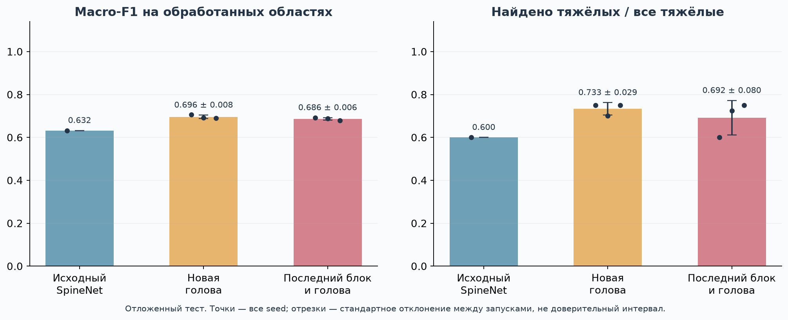

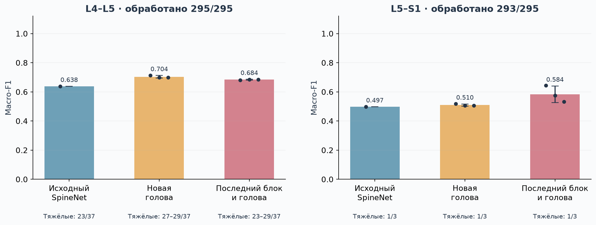

<details>
<summary>Матрицы ошибок всех семи моделей на тесте</summary>

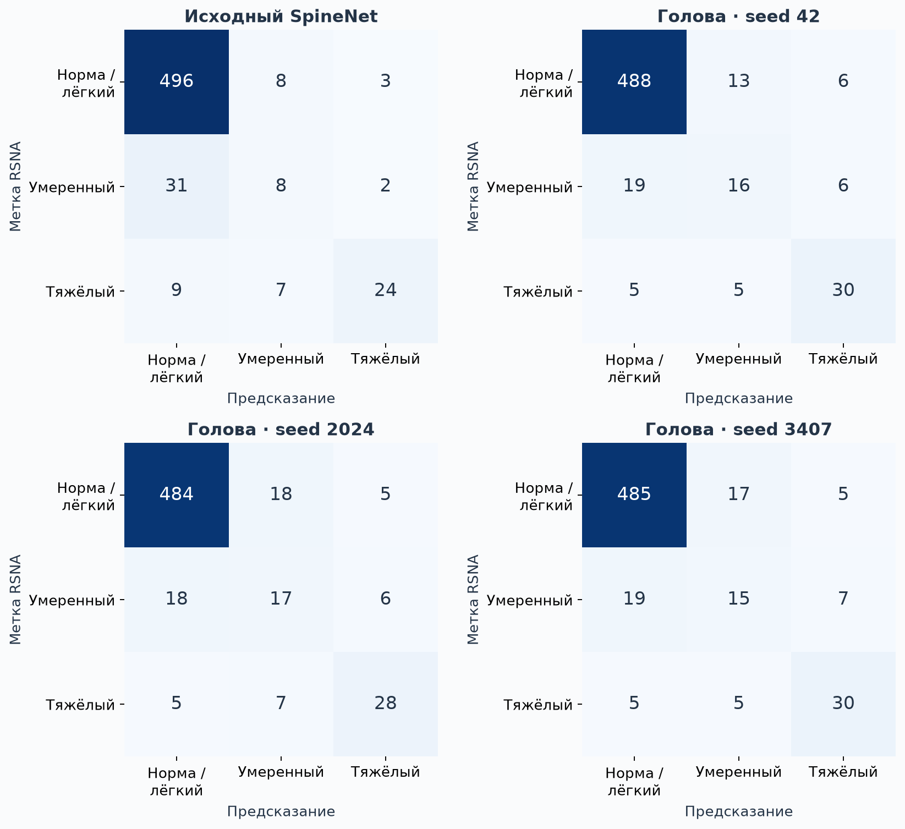

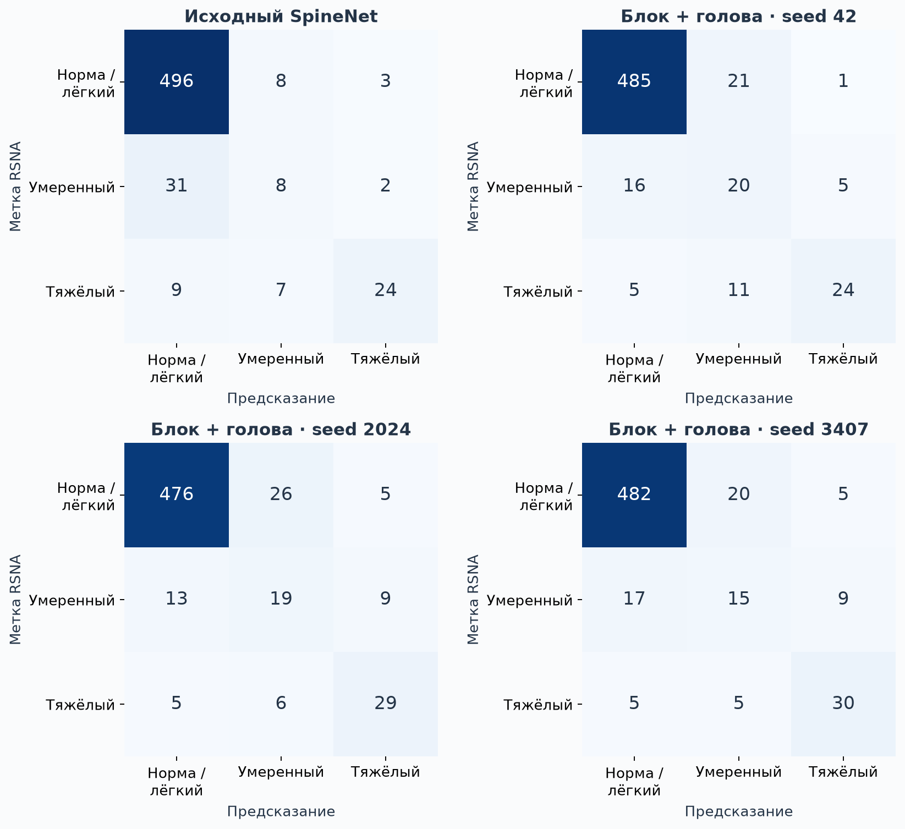

</details>

## Обучение и валидация

<!-- FINETUNE_VALIDATION_START -->
Выбранные модели после дообучения последнего блока (валидация):

| Seed | Обучено эпох | Выбранная эпоха | Macro-F1 | Тяжёлые: определены / всего |
| ---: | ---: | ---: | ---: | ---: |
| 42 | 10 | 10 | 0.697 | 25 / 42 |
| 2024 | 10 | 7 | 0.716 | 32 / 42 |
| 3407 | 9 | 6 | 0.695 | 29 / 42 |

Средний validation macro-F1 — **0.703 ± 0.012** (стандартное отклонение между seed). Эпоха 0 означает, что по валидации сохранилось исходное состояние этого запуска. Эта таблица использовалась для выбора эпохи, итоговую оценку даёт отдельный тест.
<!-- FINETUNE_VALIDATION_END -->

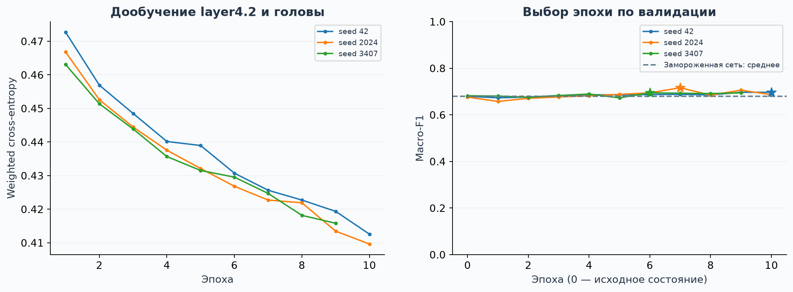

<details>
<summary>Первый эксперимент: новая голова при замороженной сети</summary>

У исходного SpineNet четыре категории центрального стеноза. Для сравнения с RSNA складываю вероятности «нет» и «лёгкий», а затем выбираю максимум из трёх категорий. Это исследовательское сопоставление шкал; клиническую эквивалентность врач ещё не проверял.

Новую голову обучаю три раза: seed **42, 2024, 3407**. Использую AdamW, learning rate `0.001`, batch size `64`, до 20 эпох и раннюю остановку по validation macro-F1. Веса классов считаю только по обучающим данным. Подробности зафиксировал в [протоколе эксперимента](docs/experiment.md).

<!-- RESULTS_START -->
На валидации обработано **588 из 594 целевых уровней (99.0%)**.

| Модель | Macro-F1 на обработанных областях | Найдено тяжёлых / все тяжёлые |
| --- | ---: | ---: |
| Исходный SpineNet | 0.589 | 19 / 42 (45.2%) |
| Новая голова, seed 42 | 0.679 | 26 / 42 (61.9%) |
| Новая голова, seed 2024 | 0.676 | 26 / 42 (61.9%) |
| Новая голова, seed 3407 | 0.682 | 26 / 42 (61.9%) |

Средний macro-F1 новой головы — **0.679 ± 0.003** по 3 запускам (среднее и стандартное отклонение). Валидация использовалась для выбора эпохи; это ещё не результат на отложенном тесте.
<!-- RESULTS_END -->

На валидации новая голова чаще правильно определяет умеренную и тяжёлую категории, но чаще завышает степень у «нормы / лёгкой»: 22–27 ошибок вместо 12 на 504 обработанных областях этой категории. На **L5–S1 исходная модель и все три варианта с новой головой не определили ни одного из трёх тяжёлых случаев валидации**. Этот уровень нужно разбирать отдельно; общий macro-F1 эту проблему скрывает.

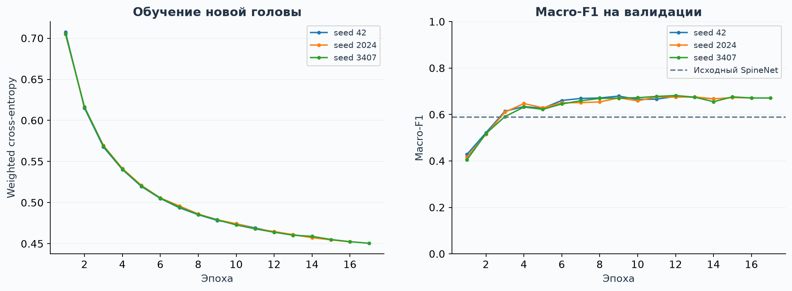

Все модели сравниваю на одних и тех же автоматически извлечённых областях. Macro-F1 считаю только для областей, которые удалось извлечь. Отдельно показываю покрытие и долю найденных тяжёлых случаев среди всех тяжёлых, включая необработанные.

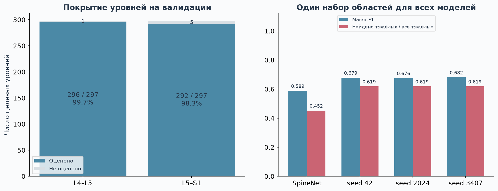

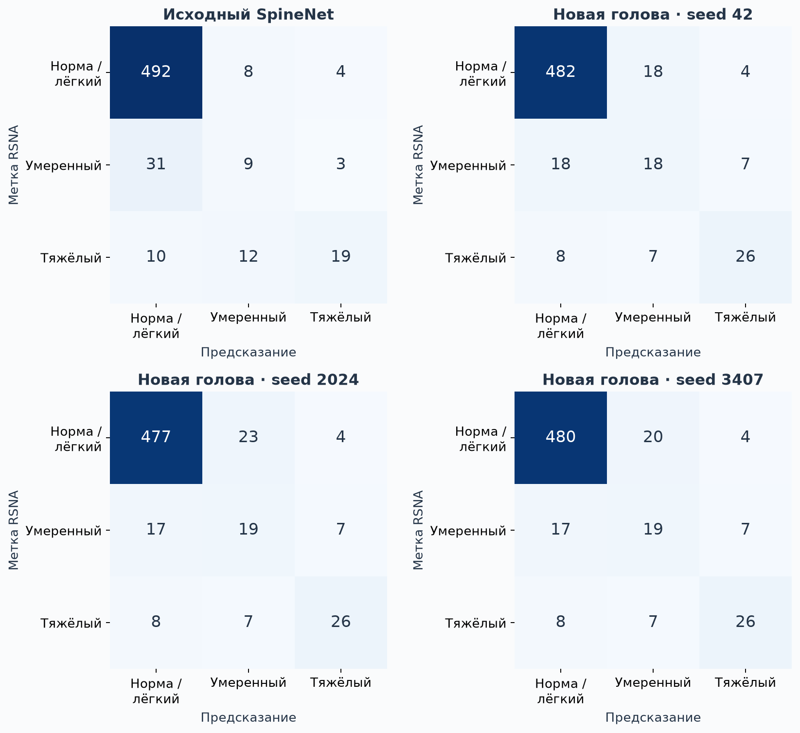

</details>

## Что попробовал после первого сравнения

Проверил ансамбль прежних голов, небольшую MLP-голову, ordinal-голову в стиле CORAL, подготовил галерею ошибок и добавил оценку неопределённости. Для новых голов сделал **36 обучений**: три архитектуры, три seed, три CV-разбиения внутри прежнего train и затем обучение на полном train.

| Голова | CV: среднее ансамбля по трём частям | Прежняя validation: ансамбль |
| --- | ---: | ---: |
| Линейная, новый протокол | 0.680 | 0.667 |
| MLP `512 → 64 → 3` | **0.689** | **0.693** |
| Ordinal / CORAL | 0.545 | 0.519 |

MLP выбрал по CV до проверки validation. Она находит **29 из 42** тяжёлых уровней против 26 у нового линейного ансамбля; оба завысили степень у 27 из 504 обработанных областей «норма / лёгкий». Но 95% bootstrap-интервал разницы macro-F1 MLP и линейного ансамбля — **[−0.003; +0.061]**. Поэтому считаю MLP кандидатом для следующей проверки, а не доказанным улучшением. На новом независимом тесте её ещё не оценивал.

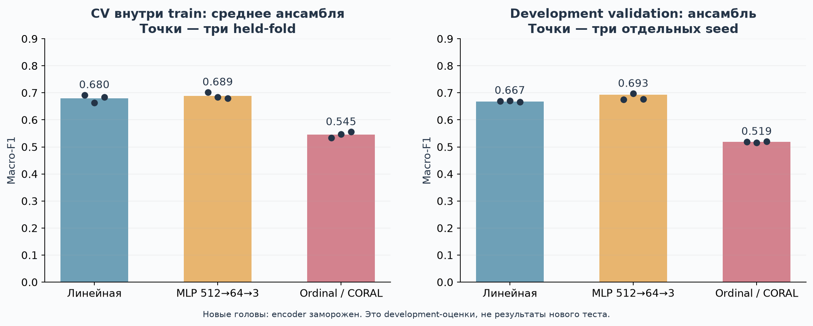

Усреднение прежних трёх голов дало на validation 0.678 — явного выигрыша перед отдельными головами нет. Заданный ordinal-вариант не смог предсказывать умеренную категорию: обученные границы и выбранный `argmax` делают её недостижимой. Этот отрицательный результат сохранил вместе с остальными.

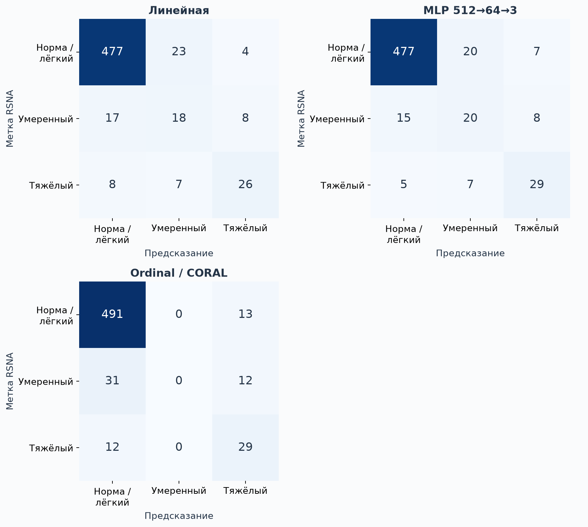

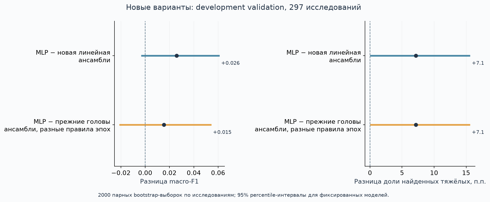

Для старого теста тоже посчитал 2 000 парных bootstrap-выборок по исследованиям, сохраняя оба уровня одного исследования вместе. Разница среднего macro-F1 трёх отдельных новых голов и исходного SpineNet — +0.063 с интервалом **[−0.015; +0.143]**. Здесь усредняю метрики, а не вероятности ансамбля. Стандартное отклонение по трём seed не показывало этой неопределённости по случаям.

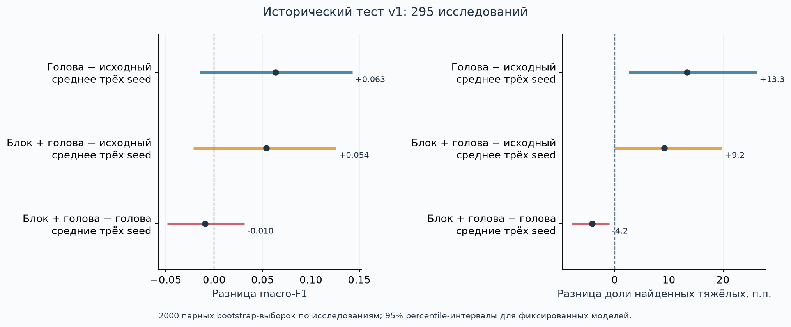

Для врача подготовил локальный `reports/runs/error-review-v2/index.html`: **48 случаев**, исходный срез с автоматическими уровнями, три среза ROI, разметка и предсказания. На `comparison.html` добавил сопоставление старого ансамбля и новых моделей на тех же случаях. Рядом лежит пустой `doctor_review.csv`. В подборке есть восемь правильных контролей и два отказа поиска уровня. Все шесть контактных листов я просмотрел технически; анатомическую нумерацию и клиническую разметку врач пока не проверял. Из такой целевой подборки нельзя считать частоту ошибок в популяции.

Подробности, ограничения и команды повторения — в [отчёте следующих экспериментов](docs/improvements.md). Сравнивать 0.693 новой validation и 0.696 прежнего test как изменение качества нельзя: это разные выборки.

Графики строятся из результатов запуска. Я публикую только агрегированные числа и свои схемы. Срезы МРТ, вырезанные области, признаки и таблицы отдельных исследований остаются локально — правила RSNA запрещают распространять данные.

## Запуск на одной МРТ-серии

Пункт 7: `predict` принимает папку с одной сагиттальной T2/STIR МРТ-серией в DICOM. Для неё не нужны метки RSNA или таблица пациентов. Подходящую последовательность выбираю сам: модуль проверяет геометрию, но не подтверждает подтип последовательности по изображению. Можно передать одну обученную голову либо все три головы одной архитектуры для усреднения вероятностей.

```bash
ai-spine predict \
  --dicom-dir /path/to/one/sagittal/series \
  --checkpoint \
    reports/runs/head-v2/validation/mlp/seed-42/head.pt \
    reports/runs/head-v2/validation/mlp/seed-2024/head.pt \
    reports/runs/head-v2/validation/mlp/seed-3407/head.pt \
  --out reports/runs/my-series \
  --device auto
```

В выходной папке будут `predictions.csv` с двумя строками и `predictions.json` с вероятностями категорий, отказами, контрольными суммами моделей и временем. Выходную папку выбираю новую: готовый запуск не перезаписывается. Исходные DICOM UID, данные пациента и пути во входных файлах в отчёт не копируются. Вероятности пока не откалиброваны.

Рядом с весами сохраняю их исходные `manifest.json`, `summary.json`, а для v2 также `selection.json` и `folds.json`: модуль сверяет происхождение головы, encoder и предобработки. Checkpoint из CV для этого запуска не подходит. Старые головы `reports/runs/head-v1/runs/seed-42/head.pt` тоже поддержаны.

Проверил свежий запуск на обучающих сериях с обоими найденными уровнями и с одним пропущенным. Оценки совпали с предсказаниями по сохранённым 512 признакам, максимальная разница вероятностей — 0. При отсутствии уровня получается `not_assessed`, при сбое входа — явный отказ, а не «норма». Это исследовательский результат, не клиническое заключение.

## Как повторить

Я запускаю проект на macOS ARM64 с Python 3.12. Для извлечения признаков использую MPS, обучение выполняю на CPU. Во втором эксперименте короткий технический замер последнего блока оказался немного быстрее на CPU, чем на MPS. Список проверенных версий находится в `requirements-macos-arm64-py312.lock`.

```bash
python3.12 -m venv .venv
source .venv/bin/activate
python -m pip install -e '.[data,dev]'
ai-spine doctor
ai-spine fetch-assets
```

Исходники SpineNet и четыре файла весов скачиваются с закреплёнными SHA-256, отдельно от Git. В исходниках есть одна правка совместимости `np.bool` → `bool`; архитектура и веса исходной модели не меняются. NumPy ограничен версией 1.x из-за старого API в SpineNet. Для checkpoint используется ограниченный загрузчик PyTorch.

Для данных нужен аккаунт Kaggle с принятыми правилами конкурса и настроенный вход CLI (`kaggle auth login`). Токены храню вне репозитория.

```bash
python -m ai_spine_med.kaggle_download metadata --data-root data/rsna
python -m ai_spine_med.data --data-root data/rsna --out artifacts/rsna-v1 --seed 42
ai-spine download-cohort --workers 4
ai-spine extract-features --out artifacts/features-v1 --device auto
ai-spine roi-qc --features artifacts/features-v1 --out reports/runs/roi-qc-v1
ai-spine evaluate-baseline --features artifacts/features-v1 --out reports/runs/baseline-v1
ai-spine train-head --features artifacts/features-v1 --out reports/runs/head-v1
ai-spine report-figures --baseline reports/runs/baseline-v1 --training reports/runs/head-v1 --update-readme README.md
```

Второй вариант и финальный тест:

```bash
ai-spine cache-last-block --features artifacts/features-v1 --out artifacts/last-block-activations-v1 --device auto
ai-spine train-last-block --features artifacts/features-v1 --activations artifacts/last-block-activations-v1 --heads reports/runs/head-v1 --out reports/runs/last-block-v1 --device cpu
ai-spine freeze-selection --features artifacts/features-v1 --heads reports/runs/head-v1 --fine-tuned reports/runs/last-block-v1 --out reports/runs/selection-v1.json
ai-spine download-test --selection reports/runs/selection-v1.json
ai-spine extract-test --selection reports/runs/selection-v1.json --out artifacts/test-features-v1 --device auto
ai-spine evaluate-test --selection reports/runs/selection-v1.json --features artifacts/test-features-v1 --heads reports/runs/head-v1 --fine-tuned reports/runs/last-block-v1 --activations artifacts/test-activations-v1 --out reports/runs/test-v1 --device auto
ai-spine report-final --heads reports/runs/head-v1 --fine-tuned reports/runs/last-block-v1 --test-results reports/runs/test-v1 --update-readme README.md --protocol-doc docs/fine-tuning.md
```

Загрузчик получает нужные серии из официального архива и добавляет серию в локальную папку только после полной загрузки и проверки размера и CRC файлов. Повторный запуск продолжает работу с готовых серий. Извлечение признаков тоже можно продолжить: кэш проверяется по данным, разбиению, версии кода и весам. Обучение не начнётся, пока в кэше остаются необработанные серии.

Реестр `artifacts/rsna-v1` создаю один раз. Для продолжения прерванного запуска повторяю `download-cohort` и `extract-features`, не пересоздавая реестр: изменение его файлов считается новым экспериментом.

Локальные результаты:

| Каталог | Что сохраняю |
| --- | --- |
| `artifacts/rsna-v1/` | Разбиение, серии, метки, контрольные суммы |
| `artifacts/features-v1/` | Области, 512 признаков, исходные logits, статусы всех целевых уровней |
| `reports/runs/baseline-v1/` | Метрики и предсказания исходного SpineNet на валидации |
| `reports/runs/head-v1/` | Веса новой головы, история обучения и метрики каждого seed |
| `artifacts/last-block-activations-v1/` | Вход последнего блока для train и validation |
| `reports/runs/last-block-v1/` | Веса последнего блока и головы, история трёх запусков |
| `reports/runs/selection-v1.json` | Зафиксированные до теста модели и протокол |
| `artifacts/test-features-v1/`, `reports/runs/test-v1/` | Области теста и предсказания всех семи моделей |
| `docs/images/`, `docs/results.json`, `docs/test-results.json` | Публичные графики и агрегированные результаты |

Быстрый запуск исходного SpineNet на отдельной серии:

```bash
ai-spine smoke --dicom-dir data/rsna/train_images/STUDY/SERIES --out reports/runs/single-case
```

Загрузчик проверяет геометрию DICOM, сортирует срезы по физическим координатам и сохраняет масштаб при ресемплинге. Некорректный вход получает отказ. Результаты самого первого запуска сохранил в [проверке этапов 1–2](docs/verification.md).

## Проверки и ограничения

```bash
python -m pytest -q
ruff check src tests
ruff format --check src tests
```

Тестами проверяю чтение DICOM, разбиение данных, загрузку, кэш, объединение классов, учёт отказов и восстановление предсказаний из сохранённых весов. Качество классификации проверяю отдельно по разметке RSNA.

На L5–S1 в train всего **13 тяжёлых случаев**, в validation и test — по **3**. По ним нельзя сделать устойчивый вывод о качестве. Обучение классификатора также не исправляет ошибки нумерации и пропуски детектора: это отдельная часть работы. Визуальная проверка областей пока техническая, без подтверждения врача.

В основе проекта — SpineNet от Visual Geometry Group, University of Oxford. [Лицензию использованной версии](third_party/SpineNet-LICENCE.md) сохранил без изменений: она ограничивает применение исходной модели, весов и результатов некоммерческими исследованиями. Данные RSNA использую по [условиям конкурса](https://www.kaggle.com/competitions/rsna-2024-lumbar-spine-degenerative-classification/rules). Дообучение не снимает эти ограничения и не даёт медицинскую сертификацию. Для коммерческого продукта потребуются права на компоненты, клиническая валидация и отдельная регуляторная работа.
