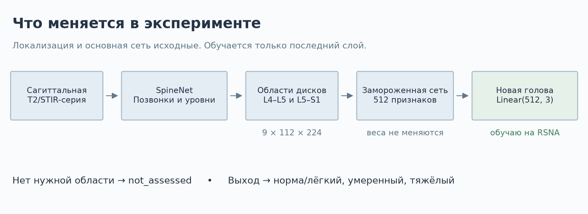

# ai-spine-med

В этом репозитории я делаю проект для университетской практики: адаптирую [SpineNet](https://github.com/rwindsor1/SpineNet) к оценке **центрального стеноза на L4–L5 и L5–S1** и сравниваю результат с исходной моделью.

На входе — сагиттальная МРТ-серия поясницы, на выходе — одна из трёх категорий для каждого уровня: **норма / лёгкий, умеренный, тяжёлый**. Если нужную область найти не удалось, сохраняю `not_assessed`. В работе использую SpineNetV2; TotalSpineSeg — другой проект.

## Что именно я обучаю

Сначала запускаю исходный SpineNet: он находит позвонки, определяет уровни и вырезает области дисков. Затем получаю 512 признаков из его основной сети и обучаю поверх них новый слой `Linear(512, 3)`. В нём всего **1 539 обучаемых параметров**. Детектор и основную сеть на этом этапе не меняю.



Признаки сохраняю один раз. После этого трижды обучаю один и тот же классификатор с разными seed — повторно прогонять все МРТ через SpineNet уже не нужно. Следующим этапом смогу сравнить эту голову с дообучением последнего блока сети.

## Данные

Я использую официальный [RSNA 2024 Lumbar Spine Degenerative Classification](https://www.kaggle.com/competitions/rsna-2024-lumbar-spine-degenerative-classification/data). Отбираю серию `Sagittal T2/STIR` и две метки центрального стеноза на исследование. Это группа T2-подобных последовательностей; обычную T2 и STIR по очищенным заголовкам надёжно разделить пока не получается.


Разбиение фиксированное: **1 382 / 297 / 295 исследований** для train / validation / test. Два уровня одного исследования всегда находятся в одной выборке. Основание для группировки по `study_id` — правило авторов не включать одного пациента повторно, описанное в [приложении LumbarDISC](https://pubs.rsna.org/doi/suppl/10.1148/ryai.250480/suppl_file/ryai250480suppa1.pdf). Отдельной таблицы связи пациентов в выгрузке нет.

Тест оставляю для итогового сравнения следующего этапа. Сейчас скачиваю и обрабатываю только train и validation. Координаты из разметки RSNA не использую вместо автоматического поиска областей на валидации.

## Сравнение

У исходного SpineNet четыре категории центрального стеноза. Для сравнения с RSNA складываю вероятности «нет» и «лёгкий», а затем выбираю максимум из трёх категорий. Это исследовательское сопоставление шкал; клиническую эквивалентность врач ещё не проверял.

Новую голову обучаю три раза: seed **42, 2024, 3407**. Использую AdamW, learning rate `0.001`, batch size `64`, до 20 эпох и раннюю остановку по validation macro-F1. Веса классов считаю только по обучающим данным. Подробности зафиксировал в [протоколе эксперимента](docs/experiment.md).

<!-- RESULTS_START -->
Сейчас выполняю полный проход по train и validation. Код извлечения признаков и обучения готов; итоговых метрик пока нет. Добавлю результаты и графики после завершения обработки.
<!-- RESULTS_END -->

Все модели сравниваю на одних и тех же автоматически извлечённых областях. Macro-F1 считаю только для областей, которые удалось извлечь. Отдельно показываю покрытие и долю найденных тяжёлых случаев среди всех тяжёлых, включая необработанные.

Графики строятся из результатов запуска. Я публикую только агрегированные числа и свои схемы. Срезы МРТ, вырезанные области, признаки и таблицы отдельных исследований остаются локально — правила RSNA запрещают распространять данные.

## Как повторить

Я запускаю проект на macOS ARM64 с Python 3.12. Для извлечения признаков использую MPS, новую голову обучаю на CPU. CPU и CUDA также можно выбрать явно. Список проверенных версий находится в `requirements-macos-arm64-py312.lock`.

```bash
python3.12 -m venv .venv
source .venv/bin/activate
python -m pip install -e '.[data,dev]'
ai-spine doctor
ai-spine fetch-assets
```

Исходники SpineNet и четыре файла весов скачиваются с закреплёнными SHA-256, отдельно от Git. В исходниках есть одна правка совместимости `np.bool` → `bool`; архитектура и веса исходной модели не меняются. NumPy ограничен версией 1.x из-за старого API в SpineNet. Для checkpoint используется ограниченный загрузчик PyTorch.

Для данных нужен аккаунт Kaggle с принятыми правилами конкурса и настроенный вход CLI (`kaggle auth login`). Токены храню вне репозитория.

```bash
python -m ai_spine_med.kaggle_download metadata --data-root data/rsna
python -m ai_spine_med.data --data-root data/rsna --out artifacts/rsna-v1 --seed 42
ai-spine download-cohort --workers 4
ai-spine extract-features --out artifacts/features-v1 --device auto
ai-spine roi-qc --features artifacts/features-v1 --out reports/runs/roi-qc-v1
ai-spine evaluate-baseline --features artifacts/features-v1 --out reports/runs/baseline-v1
ai-spine train-head --features artifacts/features-v1 --out reports/runs/head-v1
ai-spine report-figures --baseline reports/runs/baseline-v1 --training reports/runs/head-v1 --update-readme README.md
```

Загрузчик получает нужные серии из официального архива и добавляет серию в локальную папку только после полной загрузки и проверки размера и CRC файлов. Повторный запуск продолжает работу с готовых серий. Извлечение признаков тоже можно продолжить: кэш проверяется по данным, разбиению, версии кода и весам. Обучение не начнётся, пока в кэше остаются необработанные серии.

Реестр `artifacts/rsna-v1` создаю один раз. Для продолжения прерванного запуска повторяю `download-cohort` и `extract-features`, не пересоздавая реестр: изменение его файлов считается новым экспериментом.

Локальные результаты:

| Каталог | Что сохраняю |
| --- | --- |
| `artifacts/rsna-v1/` | Разбиение, серии, метки, контрольные суммы |
| `artifacts/features-v1/` | Области, 512 признаков, исходные logits, статусы всех целевых уровней |
| `reports/runs/baseline-v1/` | Метрики и предсказания исходного SpineNet на валидации |
| `reports/runs/head-v1/` | Веса новой головы, история обучения и метрики каждого seed |
| `docs/images/`, `docs/results.json` | Публичные графики и агрегированные результаты |

Быстрый запуск исходного SpineNet на отдельной серии:

```bash
ai-spine smoke --dicom-dir data/rsna/train_images/STUDY/SERIES --out reports/runs/single-case
```

Загрузчик проверяет геометрию DICOM, сортирует срезы по физическим координатам и сохраняет масштаб при ресемплинге. Некорректный вход получает отказ. Результаты самого первого запуска сохранил в [проверке этапов 1–2](docs/verification.md).

## Проверки и ограничения

```bash
python -m pytest -q
ruff check src tests
ruff format --check src tests
```

Тестами проверяю чтение DICOM, разбиение данных, загрузку, кэш, объединение классов, учёт отказов и восстановление предсказаний из сохранённых весов. Качество классификации проверяю отдельно по разметке RSNA.

На L5–S1 в train всего **13 тяжёлых случаев**, в validation — **3**. По ним нельзя сделать устойчивый вывод о качестве. Новая голова также не исправляет ошибки нумерации и пропуски детектора: это отдельная часть работы. Визуальная проверка областей пока техническая, без подтверждения врача.

Это исследовательский модуль. SpineNet распространяется по [некоммерческой лицензии](https://github.com/rwindsor1/SpineNet/blob/main/LICENCE.md), данные RSNA — по [условиям конкурса](https://www.kaggle.com/competitions/rsna-2024-lumbar-spine-degenerative-classification/rules). Дообучение не снимает эти ограничения и не даёт медицинскую сертификацию. Для коммерческого продукта потребуются права на компоненты, клиническая валидация и отдельная регуляторная работа.
