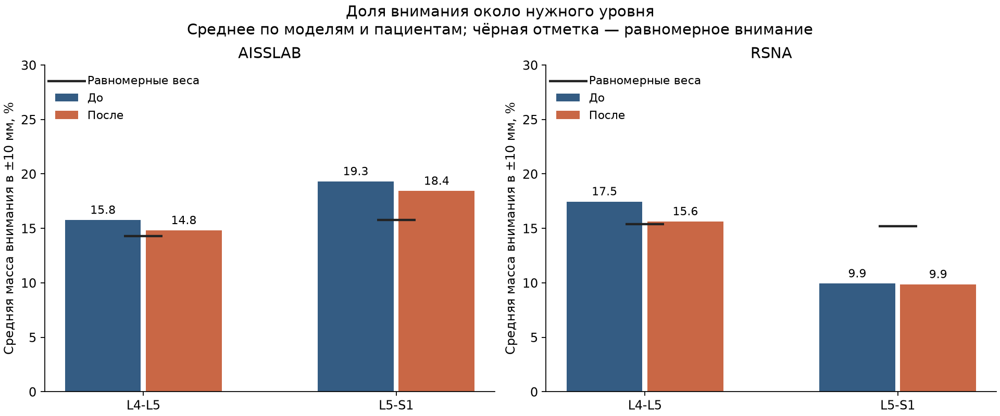
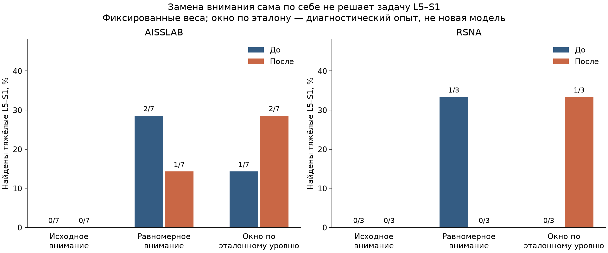

# Почему дообучение аксиальной модели не помогло

Проверил исходную разметку, геометрию серий, карты внимания всех шести checkpoint и несколько способов изменить выбор срезов без обучения. Выяснилось, что автоматический перенос меток работает правильно, но совместимость шкал не установлена, а аксиальное внимание плохо выделяет нужный уровень. Проблема L5–S1 была ещё у исходной модели. Единственную причину ухудшения этим аудитом установить нельзя.

Это разбор уже просмотренных тестовых данных, а не новый независимый тест. Исходные метки, веса и [результаты эксперимента](axial-transfer.md) не менял. Все повторно полученные вероятности совпали с сохранёнными: максимальная разница — 0.

## Разметка: ошибки импорта нет, эквивалентность шкал под вопросом

Проверил все 2491 XML и их связи с DICOM, включая 993 метки L4–L5/L5–S1. Сохранённые степени и уровни совпадают с XML. Центральный канал не перепутан с боковым карманом или межпозвонковым отверстием. У каждого размеченного уровня одна CCS-аннотация, поэтому правило выбора максимальной степени здесь фактически не применяется. Размеры XML совпадают с DICOM, рамки находятся внутри изображения.

В исходных XML нашёл точное соответствие класса и AP-диаметра:

| CCS-класс | Аннотаций на всех пяти уровнях | AP, мм |
| --- | ---: | ---: |
| Normal | 2026 | 12.01–23.23 |
| Stenosis | 345 | 10.01–11.96 |
| Severe Stenosis | 120 | 0–9.97 |

Эта закономерность выполняется на всех 2491 аннотациях. Значений ровно 10 или 12 мм нет, поэтому включение границ по данным определить нельзя. Это наблюдение в XML; оно не доказывает, что авторы получали степени только порогами AP. [Описание AISSLab](https://data.mendeley.com/datasets/wjxkrkxhb8/1) перечисляет AP и классы, но не устанавливает их соответствие RSNA.

У RSNA для центрального стеноза используется modified Lee; исходные normal и mild объединены. Поэтому принятое `Stenosis → Moderate` пока остаётся допущением. Одинакового числа классов недостаточно, чтобы считать задачи одинаковыми. Источник: [инструкция RSNA, Appendix S3, PDF-страница 23](https://pubs.rsna.org/doi/suppl/10.1148/ryai.250480/suppl_file/ryai250480suppa1.pdf).

Нашёл два целевых случая с `AP=0`, оба L4–L5 нового TEST. Значение требует уточнения, но непустая рамка не доказывает, что степень severe неверна. На целевых уровнях TRAIN/validation таких записей нет — через обучение они повлиять не могли. Если исключить их только для проверки чувствительности, F1 нового теста меняется с **0.316 до 0.340**, а найденные тяжёлые — с **2/12 до 1/12**. Это показывает неустойчивость небольшого нового теста; падение на прежнем RSNA эти записи не объясняют. Основные оценки не пересчитывал с новой разметкой.

Высота рамки, умноженная на PixelSpacing, не совпадает с полем AP ни на одной из 993 целей с допуском 0.05 мм. Рамка — область интереса, а не измерительная линейка; пересчитывать из неё степень нельзя.

## Выбор уровня: внимание не заменяет локализатор

Текущая аксиальная ветка получает все срезы исследования и выдаёт два набора весов внимания. В ней нет обученного детектора дисков, проверки нумерации или областей канала. SpineNet используется в сагиттальной ветке; аксиальный классификатор не получает от него анатомические уровни.

Восстановил порядок срезов по DICOM-заголовкам и сравнил с сохранёнными активациями: полное совпадение во всех 370 исследованиях. В XML нет инверсий на 1991 последовательной паре пяти уровней. Все 149 опорных XML-срезов нового теста сохранились после ограничения до 96 срезов; в RSNA пропущены 5 из 1178 ссылок на аннотированные срезы. Массовое исчезновение нижнего уровня этим не объясняется.

Для AISSLab ориентир — срез с явной CCS-аннотацией. Для RSNA взял аксиальные subarticular-координаты того же уровня как приблизительный ориентир диска. Это не разметка степени центрального стеноза. Общую систему координат сагиттальной и аксиальной серии по FrameOfReferenceUID подтвердить не удалось; переносить между ними точки без проверки регистрации не стал.

Пик **средней карты внимания трёх моделей** находится в пределах ±10 мм от опорного уровня так часто:

| Выборка | Уровень | До | После |
| --- | --- | ---: | ---: |
| AISSLab | L4–L5 | 9/74 | 7/74 |
| AISSLab | L5–S1 | 19/75 | 13/75 |
| RSNA | L4–L5 | 63/294 | 36/294 |
| RSNA | L5–S1 | 31/295 | 18/295 |


Это близость к разреженному ориентиру, не клиническая точность локализации: соседние срезы тоже могут быть полезны. В RSNA максимум L5–S1 до/после находится в другой, не проверяемой по аннотациям серии в 9/22 случаях. Такие случаи отдельно учитываю как непроверяемые, а не объявляю ошибочными.

Результат не сводится к одному пику: на RSNA около L5–S1 сосредоточено в среднем **9.9% внимания** до и после, при **15.2% для равномерных весов**. Это сильный сигнал, что свободное внимание не научилось надёжно выделять данный уровень. Однако вес внимания сам по себе не доказывает причинную важность среза для диагноза.



## Что происходит, если задать нужные срезы вручную

С теми же фиксированными весами ограничил внимание окрестностью ±10 мм от размеченного уровня. Эталонные координаты использовал только в этом диагностическом опыте. Сохранил отношения весов внутри окна, сам классификатор и признаки не дообучал; область канала на изображении не вырезал.

| Тяжёлые L5–S1 | Исходное внимание, до → после | Окно по эталонному уровню, до → после |
| --- | ---: | ---: |
| AISSLab | 0/7 → 0/7 | 1/7 → 2/7 |
| RSNA | 0/3 → 0/3 | 0/3 → 1/3 |



Выбор уровня действительно влияет на ответы, но одного ограничения окна недостаточно. Это не готовое улучшение: на одних и тех же 589 размеченных целях RSNA общий F1 при таком ограничении падает с 0.496 до 0.399 у исходных весов и с 0.415 до 0.384 у дообученных. У оставшейся одной цели нет аксиального ориентира. Этот опыт не используется для выбора новой основной модели.

Отдельно проверил равномерное внимание, перестановку двух attention-выходов и только перестановку признака номера уровня. Изменение attention заметно меняет ответы; перестановка одного номера уровня почти не помогает. Полные числа сохранены в [агрегированном JSON](axial-diagnosis-results.json). Эти вмешательства объясняют поведение фиксированной модели, но не заменяют обучение на правильных областях.

## Что объясняет ухудшение и что пока остаётся гипотезой

L5–S1 уже до переноса был слабым местом: на новых данных все 75 уровней исходный ансамбль назвал нормой, включая 7 severe. В исходном RSNA TRAIN только 13 тяжёлых L5–S1, после прежней проверки сагиттальных областей — 12; в выбранный replay попали всего 2. В новом TRAIN есть 29 severe этого уровня, но они размечены по другой, пока не согласованной шкале.

Потеря найденных тяжёлых после дообучения произошла на L4–L5: **4→1 из 7** на AISSLab и **15→7 из 37** на RSNA. Модель стала чаще выбирать норму. Совместное обучение содержит 80.8% нормальных целей; даже с применёнными весами норме соответствует около 59.6% суммарной весовой массы функции потерь.

Эпоху выбирал по macro-F1 только нового validation, где всего 11 severe на двух уровнях. У seed 42 F1 вырос с 0.287 до 0.437, но validation NLL ухудшился с 1.169 до 1.200 при падающей ошибке обучения. Старый validation не ограничивал выбор эпохи. Это совместимо с переобучением и потерей качества прежней задачи, но не доказывает единственную причину.

Проверки checkpoint, исходных весов, порядка классов/уровней, замороженных нормализаторов и BatchNorm прошли. Dropout на оценке выключен. Ошибок сохранения модели или расчёта вероятностей не нашёл.

## Что я бы менял следующим

1. Сначала обучал бы явный выбор уровня по имеющимся координатам RSNA и XML AISSLab, затем классификатор по области нужного диска и канала. На тесте области должен находить обученный локализатор; эталонные координаты годятся только для отдельного диагностического сравнения.
2. Где есть сагиттальная серия, использовал бы SpineNet для нумерации, а перенос на аксиальные срезы проверял по геометрии или регистрации. Если надёжно установить уровень не удалось, сохранял бы отказ. Отсутствие метки степени не мешает получить прогноз, но такой прогноз не становится эталоном.
3. С врачом проверил бы небольшую выборку AISSLab по правилам RSNA: оба целевых уровня, все три класса, два случая AP=0 и возможную переходную анатомию. Без этого не менял бы автоматически соответствие классов.
4. Следующее обучение контролировал бы отдельно по двум уровням и двум наборам на train/validation, включая сохранение качества RSNA. Эти тестовые пациенты уже участвовали в диагностике; для нового независимого подтверждения потребуется другой отложенный набор.

## Как повторить

Все снимки, индивидуальные карты внимания, опорные точки и галерея остаются в `reports/runs/axial-diagnosis-v5/` и не публикуются. В репозитории — код, агрегаты и графики.

```bash
python -m ai_spine_med.axial_attention_diagnosis --device mps
python -m ai_spine_med.axial_localization_audit
python -m ai_spine_med.axial_diagnosis_report
python -m ai_spine_med.axial_label_audit --out reports/runs/axial-diagnosis-v5
python -m ai_spine_med.axial_diagnosis_report --public-summary docs/axial-diagnosis-results.json
```

Аудит разметки и галерея имеют отдельные команды `python -m ai_spine_med.axial_label_audit --help` и `python -m ai_spine_med.axial_diagnosis_gallery --help`. Последовательность использует уже подготовленные приватные данные и зафиксированные веса; обучение не запускается.
