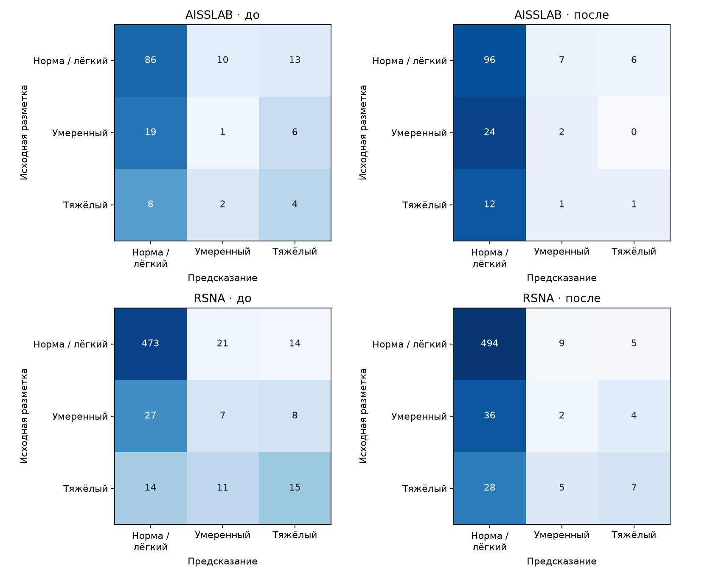
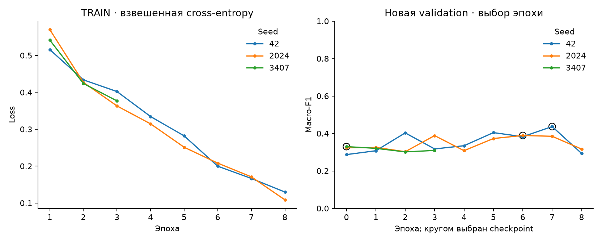

# Дообучение аксиальной модели на AISSLab

Я взял три ранее обученные аксиальные модели и дообучил последний блок ResNet18, механизм внимания и классификатор. Остальные слои, статистики BatchNorm и исходные нормализаторы оставил фиксированными. В обучение добавил заранее выбранные исследования из старого RSNA TRAIN, чтобы сохранить качество на исходных данных.

Использовал [Medical Lumbar Spine 3D Axial MRI, Kwon et al., 2026](https://data.mendeley.com/datasets/wjxkrkxhb8/1), DOI: 10.17632/wjxkrkxhb8.1, лицензия CC BY 4.0. Из исходных DICOM и XML подготовил набор для этого эксперимента; авторскую разметку сопоставил с тремя классами по правилу ниже.

Для эксперимента принял соответствие Normal / Stenosis / Severe классам 0 / 1 / 2. Клиническая эквивалентность шкал AISSLab и RSNA не установлена: здесь проверяю это исследовательское допущение. Отсутствующую аннотацию не считаю нормой; целевая степень — максимум явно размеченного центрального стеноза для уровня. Я сохраняю прогноз для неразмеченного уровня, но точность считаю только по врачебной разметке. Новый набор содержит аксиальные снимки. Прогнозы SpineNet не использую как эталон.

Пациентов разделил до обучения. Все серии и оба уровня пациента остаются в одной части. Эпоху выбирал только по новой validation; исходная эпоха 0 тоже участвовала. Все три checkpoint зафиксировал до TEST. Предсказания сравниваю на одних и тех же целях и обработанных областях, без обрезки по эталонным координатам.

| Часть AISSLab | Пациентов |
| --- | ---: |
| train | 350 |
| validation | 75 |
| test | 75 |

| Выборка | Уровней без врачебной метки | Из них с прогнозом | Без обработки |
| --- | ---: | ---: | ---: |
| AISSLAB | 1 | 1 | 0 |
| RSNA | 0 | 0 | 0 |

В обучение вошли 700 исследований, из них 350 — из исходного RSNA TRAIN. Эпоха 0 выбрана у 1 из трёх моделей; в этих случаях итоговый вариант сохранил исходные веса.

## Результаты

В основной таблице усредняю вероятности всех трёх seed с равными весами, затем выбираю класс. Это отличается от среднего трёх значений F1.

| Выборка | Вариант | Macro-F1 | Найдены тяжёлые / всего | Обработано / с известной меткой | Без метки |
| --- | --- | ---: | ---: | ---: | ---: |
| AISSLAB | До | 0.347 | 4 / 14 | 149 / 149 | 1 |
| AISSLAB | После | 0.334 | 1 / 14 | 149 / 149 | 1 |
| RSNA | До | 0.496 | 15 / 40 | 590 / 590 | 0 |
| RSNA | После | 0.415 | 7 / 40 | 590 / 590 | 0 |

AISSLab TEST — новые отложенные пациенты при принятом сопоставлении шкал. Результаты прежнего RSNA TEST уже использовались в проекте; здесь это фиксированная проверка сохранения качества, а не новое независимое клиническое подтверждение.

| Выборка | Seed | F1 до | F1 после | Выбранная эпоха |
| --- | ---: | ---: | ---: | ---: |
| AISSLAB | 42 | 0.349 | 0.409 | 7 |
| AISSLAB | 2024 | 0.384 | 0.334 | 6 |
| AISSLAB | 3407 | 0.400 | 0.400 | 0 |
| RSNA | 42 | 0.467 | 0.384 | 7 |
| RSNA | 2024 | 0.475 | 0.439 | 6 |
| RSNA | 3407 | 0.452 | 0.452 | 0 |

| Выборка | Δ F1 ансамбля: после − до | Парный 95% интервал |
| --- | ---: | --- |
| AISSLAB | -0.013 | [-0.108; 0.076] |
| RSNA | -0.081 | [-0.146; -0.016] |

Bootstrap выполняю отдельно внутри каждой выборки: 2000 повторов по пациентам, оба уровня и отказы остаются вместе. Цели без эталонной метки исключаю из bootstrap и явно сохраняю в учёте покрытия. Интервалы описывают выборку для фиксированных моделей, не неопределённость шкал, разметки или повторного обучения.

На AISSLAB устойчивого изменения macro-F1 не выявил: 95% интервал разницы включает ноль. Тяжёлых случаев нашёл 4 до и 1 после дообучения из 14.

На RSNA macro-F1 снизился; 95% интервал разницы целиком ниже нуля. Тяжёлых случаев нашёл 15 до и 7 после дообучения из 40.

Из-за ухудшения на отложенной выборке прежние веса оставляю основными. Новые сохраняю отдельно как результат эксперимента. Причина ухудшения пока не установлена: соответствие шкал, выбор срезов и ошибки на конкретных уровнях нужно проверять отдельно.

## Уровни и отказы

| Выборка | Уровень | Вариант | Известно / обработано | Тяжёлые: найдены / всего | Тяжёлый → норма | Тяжёлый → умеренный | Тяжёлый без ответа |
| --- | --- | --- | ---: | ---: | ---: | ---: | ---: |
| AISSLAB | L4-L5 | До | 74 / 74 | 4 / 7 | 1 | 2 | 0 |
| AISSLAB | L4-L5 | После | 74 / 74 | 1 / 7 | 5 | 1 | 0 |
| AISSLAB | L5-S1 | До | 75 / 75 | 0 / 7 | 7 | 0 | 0 |
| AISSLAB | L5-S1 | После | 75 / 75 | 0 / 7 | 7 | 0 | 0 |
| RSNA | L4-L5 | До | 295 / 295 | 15 / 37 | 11 | 11 | 0 |
| RSNA | L4-L5 | После | 295 / 295 | 7 / 37 | 25 | 5 | 0 |
| RSNA | L5-S1 | До | 295 / 295 | 0 / 3 | 3 | 0 | 0 |
| RSNA | L5-S1 | После | 295 / 295 | 0 / 3 | 3 | 0 | 0 |

Macro-F1 считаю по обработанным целям с фиксированными классами 0, 1, 2. Для найденных тяжёлых случаев использую все известные тяжёлые цели, включая отказы. Необработанному случаю класс не присваиваю.

| Выборка | Причина отсутствия оценки | Целей |
| --- | --- | ---: |
| AISSLAB | Нет | 0 |
| RSNA | Нет | 0 |

Полученные числа относятся к этому исследовательскому протоколу и этим пациентам. Они не подтверждают клиническую пригодность или возможность сертификации сами по себе.
