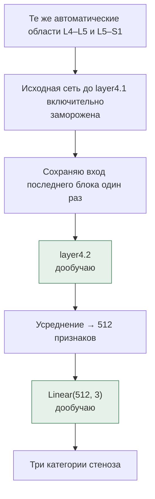

# Дообучение последнего блока и отложенный тест

Это пункты 5–6 моего плана. После обучения новой головы я проверил, поможет ли изменение последнего остаточного блока. Параметры эксперимента сохранил в [finetune-v1.json](../configs/finetune-v1.json) до открытия теста.

## Что меняю

Обучаю `grading_model.layer4.2` — последний из трёх остаточных блоков `layer4` — и классификатор `Linear(512, 3)`. Детектор, нумерацию позвонков и предыдущие слои оставляю исходными. Это дообучение одного остаточного блока, а не всей стадии `layer4`.

Для каждого seed (`42`, `2024`, `3407`) беру исходные веса блока и соответствующую голову из первого эксперимента. Статистики BatchNorm не обновляю, чтобы небольшие батчи не меняли нормализацию всей модели. Параметры BatchNorm внутри последнего блока обучаются вместе с его свёртками.

AdamW: learning rate блока `1e-5`, головы `1e-4`, weight decay `1e-4`, batch size `16`. Не больше десяти эпох; останавливаюсь после трёх эпох без улучшения validation macro-F1. Веса классов считаю только по обучающей выборке. Аугментаций в этом сравнении нет.

Начальную модель тоже считаю кандидатом — это эпоха 0. Если дообучение не улучшит валидацию, сохраню исходное состояние этого запуска. Для каждого seed выбираю эпоху по валидации; при равном качестве оставляю более раннюю. Все три результата показываю, удачный seed отдельно не выбираю.

Во втором варианте дополнительно обучается и голова. Поэтому это сравнение двух способов адаптации; отдельно вклад изменения свёрток и дополнительных шагов обучения головы этим экспериментом не измеряю.

## Как сравниваю

После обучения фиксирую контрольные суммы протокола и всех шести checkpoint: три замороженные головы и три дообученных варианта. Только после этого загружаю 295 отложенных исследований. Тестовые метки не используются в обучении, выборе эпохи или изменении параметров.

На тесте сравниваю исходный SpineNet, три замороженные головы и три дообученных варианта. Все получают одинаковые автоматически найденные области. Исходные четыре категории SpineNet привожу к трём суммой вероятностей «нет» и «лёгкий» до выбора максимума.

Считаю macro-F1, ошибки между категориями и отдельно пропуски тяжёлого стеноза: отнесение к норме/лёгкому, к умеренному или отказ обработки. Показываю результаты по уровням и всем seed, среднее и стандартное отклонение. Покрытие считаю от всех 590 запланированных уровней; пропущенную область не превращаю в «норму».

Время общего поиска уровней и подготовки областей учитываю отдельно от классификации. Для сравнения скорости классификаторов использую одно устройство, одинаковый размер батча и прогрев, дожидаюсь завершения вычислений на GPU. Загрузка весов и подготовка кэша не входят в время обычного предсказания.

Снимки, области, активации и таблицы отдельных исследований остаются локально. В репозитории будут только код, протокол, агрегированные результаты и графики. Нумерацию и клиническую шкалу по-прежнему должен проверить врач; дообучение не меняет лицензию SpineNet и не даёт сертификацию.

## Обучение и валидация

<!-- FINETUNE_VALIDATION_START -->
Выбранные модели после дообучения последнего блока (валидация):

| Seed | Обучено эпох | Выбранная эпоха | Macro-F1 | Тяжёлые: определены / всего |
| ---: | ---: | ---: | ---: | ---: |
| 42 | 10 | 10 | 0.697 | 25 / 42 |
| 2024 | 10 | 7 | 0.716 | 32 / 42 |
| 3407 | 9 | 6 | 0.695 | 29 / 42 |

Средний validation macro-F1 — **0.703 ± 0.012** (стандартное отклонение между seed). Эпоха 0 означает, что по валидации сохранилось исходное состояние этого запуска. Эта таблица использовалась для выбора эпохи, итоговую оценку даёт отдельный тест.
<!-- FINETUNE_VALIDATION_END -->

## Отложенный тест

<!-- FINETUNE_RESULTS_START -->
На отложенном тесте оценил **588 из 590 уровней (99.7%)**.

| Модель | Seed | Macro-F1 на обработанных областях | Тяжёлые: определены / всего | Тяжёлый → норма/лёгкий | Тяжёлый → умеренный |
| --- | ---: | ---: | ---: | ---: | ---: |
| Исходный SpineNet | — | 0.632 | 24 / 40 | 9 | 7 |
| Новая голова | 42 | 0.705 | 30 / 40 | 5 | 5 |
| Новая голова | 2024 | 0.691 | 28 / 40 | 5 | 7 |
| Новая голова | 3407 | 0.690 | 30 / 40 | 5 | 5 |
| Последний блок + голова | 42 | 0.691 | 24 / 40 | 5 | 11 |
| Последний блок + голова | 2024 | 0.688 | 29 / 40 | 5 | 6 |
| Последний блок + голова | 3407 | 0.679 | 30 / 40 | 5 | 5 |

Среднее и стандартное отклонение macro-F1 по трём seed:

- Новая голова: **0.696 ± 0.008**.
- Последний блок + голова: **0.686 ± 0.006**.

Все **40 тяжёлых уровней обработаны**. Стандартное отклонение описывает разброс между запусками, а не неопределённость на новых пациентах.

Полную сеть классификации замерил на **mps**, по одной готовой области за раз. Для каждой модели — 32 измерения после 8 прогревочных запусков.

| Модель | Seed | Медиана, мс/область | 90-й процентиль, мс |
| --- | ---: | ---: | ---: |
| Исходный SpineNet | — | 280.8 | 387.3 |
| Новая голова | 42 | 249.0 | 275.1 |
| Новая голова | 2024 | 257.5 | 332.1 |
| Новая голова | 3407 | 247.3 | 276.8 |
| Последний блок + голова | 42 | 244.1 | 293.9 |
| Последний блок + голова | 2024 | 272.7 | 321.6 |
| Последний блок + голова | 3407 | 268.0 | 306.8 |

Отдельно во время извлечения тестовых признаков полный исходный конвейер — от чтения DICOM до оценок — занял в медиане **4.88 с на серию** (295 серий).
Общая часть без forward классификатора заняла в медиане 4.41 с на серию; сюда входят чтение, поиск уровней, подготовка областей и перенос результатов. Это не отдельный замер чистого детектора.

В замер классификации не входят чтение с диска, поиск уровней и загрузка весов. Во всех вариантах почти одинаковое число операций; небольшие различия времени не считаю доказательством ускорения после дообучения.
<!-- FINETUNE_RESULTS_END -->

На тесте новая голова оказалась лучше последнего блока с головой по macro-F1 при каждом из трёх seed. Дополнительное дообучение улучшило валидацию, но не дало преимущества на отложенных исследованиях. Это результат зафиксированного сравнения, параметры обучения по тесту я не менял.

Новая голова находит 28–30 из 40 тяжёлых уровней против 24 у исходного SpineNet. При этом ошибочно повышает категорию «норма / лёгкий» в 19–23 случаях из 507 вместо 11 у исходной модели; последний блок с головой — в 22–31. На L5–S1 все семь моделей определили только один из трёх тяжёлых случаев. Умеренных случаев здесь обработано всего четыре, поэтому более высокий macro-F1 дообученного блока на этом уровне пока не даёт надёжного вывода.

Оба замера времени выполнял на одном Mac с моделями на MPS. Полный классификатор работает примерно за 0.24–0.28 с на готовую область; исходный конвейер от DICOM до оценок — за 4.88 с на серию в медиане. Существенного преимущества одного варианта по скорости это сравнение не показало.

После обучения загрузил веса всех трёх дообученных моделей заново: вероятности на валидации полностью совпали с сохранёнными, максимальная разница — 0. Проверка также подтвердила, что параметры блока и головы изменились, а статистики BatchNorm остались исходными. Итоговые семь таблиц тестовых предсказаний отдельно проверил независимым пересчётом через NumPy и scikit-learn: метрики, матрицы ошибок, общий набор случаев и контрольные суммы совпали.
