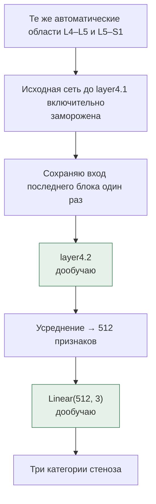

# Дообучение последнего блока и отложенный тест

Это пункты 5–6 плана. Первый вариант с замороженной сетью уже обучен: теперь проверяю, поможет ли изменение последнего остаточного блока. Параметры этого эксперимента сохраняю в [finetune-v1.json](../configs/finetune-v1.json) до открытия теста.

## Что меняю

Обучаю `grading_model.layer4.2` — последний из трёх остаточных блоков `layer4` — и классификатор `Linear(512, 3)`. Детектор, нумерацию позвонков и предыдущие слои оставляю исходными. Это дообучение одного остаточного блока, а не всей стадии `layer4`.

Для каждого seed (`42`, `2024`, `3407`) беру исходные веса блока и соответствующую голову из первого эксперимента. Статистики BatchNorm не обновляю, чтобы небольшие батчи не меняли нормализацию всей модели. Параметры BatchNorm внутри последнего блока обучаются вместе с его свёртками.

AdamW: learning rate блока `1e-5`, головы `1e-4`, weight decay `1e-4`, batch size `16`. Не больше десяти эпох; останавливаюсь после трёх эпох без улучшения validation macro-F1. Веса классов считаю только по обучающей выборке. Аугментаций в этом сравнении нет.

Начальную модель тоже считаю кандидатом — это эпоха 0. Если дообучение не улучшит валидацию, сохраню исходное состояние этого запуска. Для каждого seed выбираю эпоху по валидации; при равном качестве оставляю более раннюю. Все три результата показываю, удачный seed отдельно не выбираю.

## Как сравниваю

После обучения фиксирую контрольные суммы протокола и всех шести checkpoint: три замороженные головы и три дообученных варианта. Только после этого загружаю 295 отложенных исследований. Тестовые метки не используются в обучении, выборе эпохи или изменении параметров.

На тесте сравниваю исходный SpineNet, три замороженные головы и три дообученных варианта. Все получают одинаковые автоматически найденные области. Исходные четыре категории SpineNet привожу к трём суммой вероятностей «нет» и «лёгкий» до выбора максимума.

Считаю macro-F1, ошибки между категориями и отдельно пропуски тяжёлого стеноза: отнесение к норме/лёгкому, к умеренному или отказ обработки. Показываю результаты по уровням и всем seed, среднее и стандартное отклонение. Покрытие считаю от всех 590 запланированных уровней; пропущенную область не превращаю в «норму».

Время общего поиска уровней и подготовки областей учитываю отдельно от классификации. Для сравнения скорости классификаторов использую одно устройство, одинаковый размер батча и прогрев, дожидаюсь завершения вычислений на GPU. Загрузка весов и подготовка кэша не входят в время обычного предсказания.

Снимки, области, активации и таблицы отдельных исследований остаются локально. В репозитории будут только код, протокол, агрегированные результаты и графики. Нумерацию и клиническую шкалу по-прежнему должен проверить врач; дообучение не меняет лицензию SpineNet и не даёт сертификацию.

<!-- FINETUNE_RESULTS_START -->
Эксперимент выполняется. Тест ещё не открыт.
<!-- FINETUNE_RESULTS_END -->
