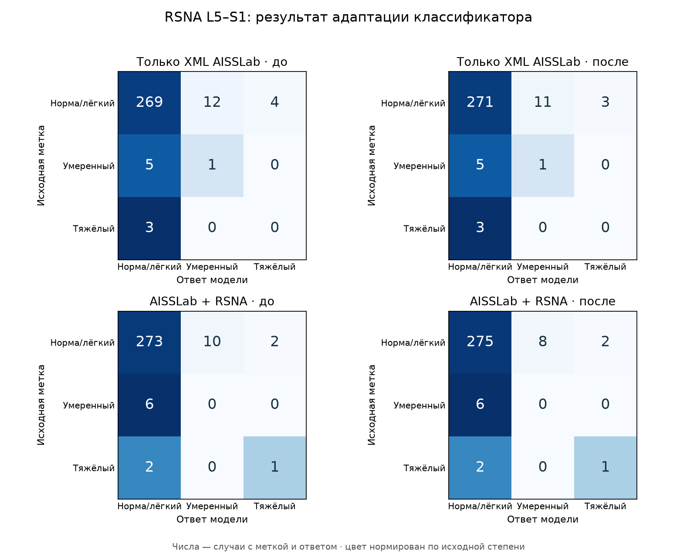

# Дообучение классификатора под два варианта локализации

Я отдельно адаптировал три классификатора степени стеноза под ROI локализатора, обученного только по XML AISSLab, и под ROI смешанного локализатора AISSLab + RSNA. Для каждой ветки сравнил прежние ответы v8 и ответы после адаптации на той же валидации. Локализаторы, сеть центра, размер области 50×50 мм и извлечение признаков оставил прежними.

Обучение степени использует только RSNA TRAIN. AISSLab здесь нужен для дополнительной проверки переноса; его категории не участвовали в обучении или выборе эпох.

После адаптации на RSNA L5–S1 macro-F1 составляет 0,357 с XML-only и 0,434 со смешанной локализацией. Тяжёлых найдено 0/3 и 1/3; умеренных — 1/6 и 0/6.

У смешанной ветки после дообучения больше найденных тяжёлых L4–L5: 22/39 → 25/39. Одновременно ложных ответов «тяжёлый» на RSNA стало больше: 16 → 20 на обоих уровнях вместе. Поэтому прирост найденных тяжёлых нужно оценивать вместе с ложными тревогами.

Каждый запуск начал с классификатора v6 с тем же seed; среднее и стандартное отклонение признаков v6 зафиксировал. Обновлял все слои небольшого MLP, оставив ResNet18 замороженным. AdamW: learning rate 0,0001, weight decay 0,0001, batch 64; максимум 15 эпох и patience 4. Исходную эпоху 0 тоже разрешил выбирать. Критерий — общий macro-F1 RSNA VAL, при равенстве остаётся более ранняя эпоха. Для двух веток использовал общий обработанный RSNA TRAIN, одинаковые классовые веса, порядок batch и seeds.

## RSNA: до и после

Macro-F1 и счётчики находок в таблицах относятся ко всему доступному набору каждой модели. Парные разницы, интервалы и переходы ответов рассчитаны на случаях с меткой и результатом всех четырёх моделей; исключения видны в разделе покрытия.

| Уровень | Локализация | До, macro-F1 | После, macro-F1 | После − до, 95% ДИ | Умеренные до → после | Тяжёлые до → после |
|---|---|---:|---:|---:|---:|---:|
| Оба уровня | Только XML AISSLab | 0,548 | 0,576 | 0,028 [-0,004; 0,064] | 8/43 → 11/43 | 23/42 → 23/42 |
| Оба уровня | AISSLab + RSNA | 0,585 | 0,593 | 0,008 [-0,019; 0,038] | 11/43 → 10/43 | 23/42 → 26/42 |
| L4-L5 | Только XML AISSLab | 0,560 | 0,589 | 0,029 [-0,010; 0,073] | 7/37 → 10/37 | 23/39 → 23/39 |
| L4-L5 | AISSLab + RSNA | 0,594 | 0,601 | 0,007 [-0,026; 0,041] | 11/37 → 10/37 | 22/39 → 25/39 |
| L5-S1 | Только XML AISSLab | 0,354 | 0,357 | 0,003 [0,000; 0,011] | 1/6 → 1/6 | 0/3 → 0/3 |
| L5-S1 | AISSLab + RSNA | 0,433 | 0,434 | 0,001 [0,000; 0,003] | 0/6 → 0/6 | 1/3 → 1/3 |


## После адаптации: смешанная против XML-only

| Данные | Уровень | XML-only, macro-F1 | Смешанная, macro-F1 | Смешанная − XML, 95% ДИ |
|---|---|---:|---:|---:|
| RSNA | Оба уровня | 0,576 | 0,593 | 0,017 [-0,041; 0,080] |
| RSNA | L4-L5 | 0,589 | 0,601 | 0,012 [-0,053; 0,084] |
| RSNA | L5-S1 | 0,357 | 0,434 | 0,077 [-0,088; 0,268] |
| AISSLAB · условные категории | Оба уровня | 0,429 | 0,419 | -0,010 [-0,073; 0,047] |
| AISSLAB · условные категории | L4-L5 | 0,405 | 0,404 | -0,001 [-0,100; 0,102] |
| AISSLAB · условные категории | L5-S1 | 0,423 | 0,410 | -0,013 [-0,045; 0,004] |

## L5–S1: отдельные ошибки

| Данные | Ветка | До/после | Метки: норма / умеренный / тяжёлый | Умеренные найдены | Тяжёлые найдены | Тяжёлый → норма | Тяжёлый → умеренный | Ложный тяжёлый | Не обработано с меткой |
|---|---|---|---:|---:|---:|---:|---:|---:|---:|
| RSNA | Только XML AISSLab | До | 288/6/3 | 1/6 | 0/3 | 3 | 0 | 4 | 3 |
| RSNA | Только XML AISSLab | После | 288/6/3 | 1/6 | 0/3 | 3 | 0 | 3 | 3 |
| RSNA | AISSLab + RSNA | До | 288/6/3 | 0/6 | 1/3 | 2 | 0 | 2 | 3 |
| RSNA | AISSLab + RSNA | После | 288/6/3 | 0/6 | 1/3 | 2 | 0 | 2 | 3 |
| AISSLAB | Только XML AISSLab | До | 56/13/6 | 2/13 | 1/6 | 5 | 0 | 2 | 0 |
| AISSLAB | Только XML AISSLab | После | 56/13/6 | 2/13 | 1/6 | 5 | 0 | 1 | 0 |
| AISSLAB | AISSLab + RSNA | До | 56/13/6 | 2/13 | 1/6 | 5 | 0 | 2 | 0 |
| AISSLAB | AISSLab + RSNA | После | 56/13/6 | 2/13 | 1/6 | 5 | 0 | 2 | 0 |

RSNA L5–S1, Только XML AISSLab: после адаптации исправлено 2 ошибок, испорчено 0 правильных ответов. Среди тяжёлых: найдено дополнительно 0, потеряно 0, обе версии пропустили 3.
Все 2 исправления относятся к исходной метке «норма/лёгкая степень». Снизилось число ложных тревог; распознавание умеренного и тяжёлого L5–S1 не улучшилось.

RSNA L5–S1, AISSLab + RSNA: после адаптации исправлено 2 ошибок, испорчено 0 правильных ответов. Среди тяжёлых: найдено дополнительно 0, потеряно 0, обе версии пропустили 2.
Все 2 исправления относятся к исходной метке «норма/лёгкая степень». Снизилось число ложных тревог; распознавание умеренного и тяжёлого L5–S1 не улучшилось.



Строки — исходная метка, столбцы — ответ модели. Матрицы включают только обработанные случаи с меткой; ошибки обработки и отсутствующие метки сохраняются отдельно.

## Покрытие

| Данные | Запрошено | Без метки | Обработано с меткой XML / смешанная | Общих для сравнения четырёх моделей |
|---|---:|---:|---:|---:|
| RSNA | 594 | 0 | 588 / 588 | 588 |
| AISSLAB | 150 | 1 | 149 / 149 | 149 |

## На чём дообучал

В обеих ветках один и тот же набор из 1380 пациентов и 2760 обработанных уровней RSNA TRAIN. Число меток норма/лёгкий / умеренный / тяжёлый: 2366/203/191; отдельно L5–S1: 1327/40/13. Пропуски извлечения исключены из градиентного обучения, но сохранены в учёте.

| Локализация | Выбранные эпохи: 42 / 2024 / 3407 | Число запрошенных TRAIN уровней |
|---|---:|---:|
| Только XML AISSLab | 0/6/15 | 2764 |
| AISSLab + RSNA | 3/1/1 | 2764 |

Нулевая эпоха означает, что для этого запуска исходные веса оказались лучшими по заданному критерию. Все исходные и выбранные оценки отдельных запусков сохранены в JSON; ансамбль не обязан улучшаться, даже когда F1 каждого выбранного запуска не ниже исходного.

## Как трактовать результат

У каждой ветки три фиксированных запуска (42, 2024, 3407); финальный ответ — равное усреднение вероятностей, а не выбор удачного запуска. До и после используются одни и те же ROI. После адаптации сравниваются системы с классификаторами, обученными под свою локализацию; это уже не проверка одной только замены среза.

RSNA VAL участвует в выборе эпохи классификаторов и уже использовалась в предыдущих экспериментах. Это результат разработки на повторно используемой валидации, а не оценка на независимом тесте. TEST в этом эксперименте не оценивал. Число тяжёлых L5–S1 мало, поэтому рядом с F1 показываю абсолютные счётчики и все переходы категорий.

95% интервалы рассчитаны 2000 парными bootstrap-повторами по пациентам; оба уровня остаются вместе. Они описывают вариацию состава этой выборки для фиксированных моделей, не исправляют смещение от выбора эпох на VAL и не учитывают неопределённость разметки, новое обучение или другую клинику.

Категории AISSLab сопоставлены с RSNA условно: исходная шкала не подтверждена как эквивалентная. Эти результаты не объединяю с RSNA. Для вывода о тяжёлом L5–S1 врачу по-прежнему нужно проверить степень стеноза, выбранный срез и попадание канала в ROI.

Агрегаты: [localization-finetuning-results.json](localization-finetuning-results.json). Предыдущее сравнение с неизменным классификатором: [localization-severity.md](localization-severity.md). Снимки, индивидуальные ответы и веса остаются в игнорируемых локальных папках.

## Повторить

Протокол: [localization-finetuning-v9.json](../configs/localization-finetuning-v9.json). Готовые кэши и обученные веса защищены от перезаписи; команды предназначены для нового запуска.

```bash
python -m ai_spine_med.localization_finetuning_data --device mps
python -m ai_spine_med.localization_finetuning --device mps
python -m ai_spine_med.localization_finetuning_report
```
