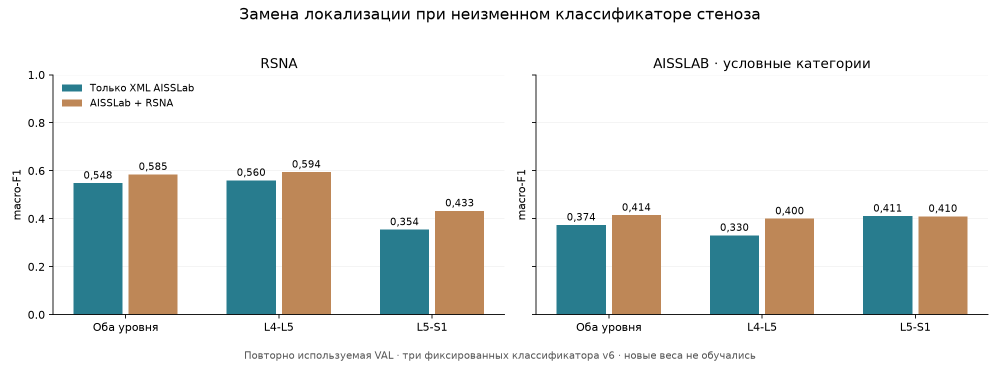

# Как локализация влияет на оценку стеноза

Я подставил два варианта выбора уровней L4–L5 и L5–S1 в одну и ту же систему оценки степени стеноза. В первом локализатор обучался только по XML AISSLab, во втором — по AISSLab и RSNA. Модель центра области, размер ROI 50×50 мм, обработку изображений, исходный ResNet18 и три классификатора v6 оставил без изменений. Нового обучения здесь нет.

Убедительного различия по общему macro-F1 RSNA в этом сравнении нет: интервал разницы включает ноль.

На RSNA тяжёлые L5–S1: 0/3 с XML и 1/3 со смешанной локализацией; умеренные L5–S1: 1/6 и 0/6. Тяжёлые L4–L5: 23/39 и 22/39. Поэтому один общий macro-F1 не заменяет разбор ошибок по отдельным степеням и уровням.

При замене XML-локализации на смешанную ответ RSNA L5–S1 изменился в 12 случаях: 8 исходно ошибочных ответов стали правильными, 4 правильных — ошибочными.

## RSNA: основное сравнение

В таблице macro-F1 и найденные тяжёлые случаи посчитаны на полном доступном наборе каждой ветки. Разница macro-F1 и 95% интервал — на одних и тех же пациентах с меткой и результатом обеих веток. Два уровня пациента остаются вместе в bootstrap.

| Уровень | XML, macro-F1 | Смешанная, macro-F1 | Смешанная − XML, 95% ДИ | Тяжёлые найдены: XML / смешанная |
|---|---:|---:|---:|---:|
| Оба уровня | 0,548 | 0,585 | 0,036 [-0,023; 0,098] | 23/42 / 23/42 |
| L4-L5 | 0,560 | 0,594 | 0,034 [-0,031; 0,102] | 23/39 / 22/39 |
| L5-S1 | 0,354 | 0,433 | 0,078 [-0,083; 0,254] | 0/3 / 1/3 |



## Отдельно L5–S1

| Данные и локализация | Метки: норма / умеренный / тяжёлый | Умеренный найден | Тяжёлый найден | Тяжёлый → норма | Тяжёлый → умеренный | Тяжёлый не обработан |
|---|---:|---:|---:|---:|---:|---:|
| RSNA · Только XML AISSLab | 288/6/3 | 1/6 | 0/3 | 3 | 0 | 0 |
| RSNA · AISSLab + RSNA | 288/6/3 | 0/6 | 1/3 | 2 | 0 | 0 |
| AISSLAB · Только XML AISSLab | 56/13/6 | 2/13 | 1/6 | 5 | 0 | 0 |
| AISSLAB · AISSLab + RSNA | 56/13/6 | 2/13 | 1/6 | 5 | 0 | 0 |

На RSNA среди общих обработанных тяжёлых L5–S1: только XML нашёл 0, только смешанный вариант — 1, оба нашли 0, оба пропустили 2.


На AISSLAB среди общих обработанных тяжёлых L5–S1: только XML нашёл 0, только смешанный вариант — 0, оба нашли 1, оба пропустили 5.


Строки матриц — исходная метка, столбцы — ответ модели. Порядок: норма/лёгкий, умеренный, тяжёлый. Матрицы включают только обработанные случаи с известной меткой; пропуски обработки остаются в таблице и JSON.

## AISSLab: дополнительная проверка

Соответствие Normal / Stenosis / Severe Stenosis категориям RSNA остаётся условным. Эти результаты показываю отдельно и не объединяю с RSNA.

| Уровень | XML, macro-F1 | Смешанная, macro-F1 | Смешанная − XML, 95% ДИ |
|---|---:|---:|---:|
| Оба уровня | 0,374 | 0,414 | 0,041 [-0,004; 0,093] |
| L4-L5 | 0,330 | 0,400 | 0,069 [0,000; 0,151] |
| L5-S1 | 0,411 | 0,410 | -0,001 [-0,035; 0,034] |

## Покрытие

| Данные | Запрошено | Без метки | Обработано с меткой: XML / смешанная | Общих для парного сравнения |
|---|---:|---:|---:|---:|
| RSNA | 594 | 0 | 588 / 588 | 588 |
| AISSLAB | 150 | 1 | 149 / 149 | 149 |

## Что означает этот эксперимент

Каждая ветка сначала усредняет вероятности срезов трёх локализаторов, затем выбирает срез и строит ROI. Степень стеноза определяется равным усреднением вероятностей трёх уже обученных классификаторов v6. Метки степени не участвуют в выборе среза или вырезании ROI.

Классификаторы v6 обучались на ROI прежнего локализатора v6 и только на RSNA TRAIN. Здесь проверяется их чувствительность к замене локализации, а не лучший возможный классификатор для каждой ветки. Отдельное переобучение классификаторов на новых ROI могло бы дать другие результаты.

Это повторно используемая валидация, а не независимый тест. AISSLab VAL уже участвовал в выборе эпох локализаторов, RSNA VAL — в выборе эпох классификаторов v6. TEST не оценивал, веса не обновлял, пороги по этим результатам не подбирал. Интервалы получены 2000 парными bootstrap-повторами по пациентам для фиксированных моделей: они не учитывают неопределённость врачебной разметки и нового обучения.

Попадание в нужный уровень ещё не гарантирует правильную степень стеноза: важны конкретный срез, положение центра и содержимое ROI. Проверка с врачом нужна прежде всего для пропущенных тяжёлых L5–S1. При малом числе тяжёлых случаев счётчики информативнее одного процента.

Агрегированные результаты: [localization-severity-results.json](localization-severity-results.json). Предыдущий этап: [сравнение локализаторов](xml-localizer.md). Снимки и ответы по отдельным пациентам остаются в локальных игнорируемых папках.

## Повторить

Протокол: [localization-severity-v8.json](../configs/localization-severity-v8.json).

```bash
python -m ai_spine_med.localization_severity_validation --device mps
python -m ai_spine_med.localization_severity_report
```
