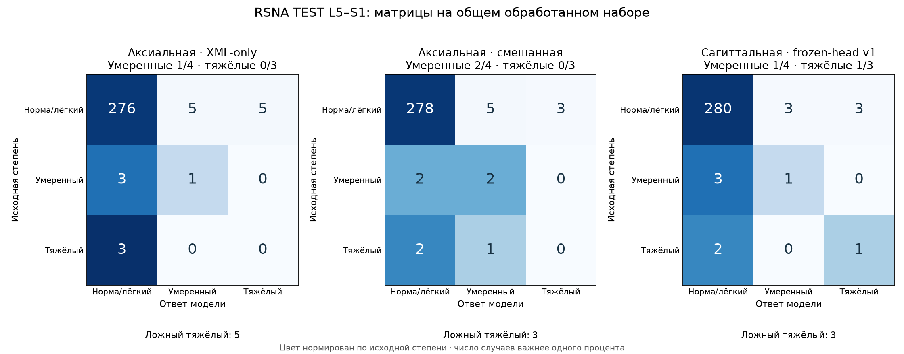

# Проверка последних аксиальных моделей на RSNA TEST

Я проверил два отдельно дообученных аксиальных классификатора v9: под XML-only и под смешанную локализацию AISSLab + RSNA. Для сравнения взял прежний сагиттальный ансамбль frozen-head v1. У всех трёх вариантов усреднил вероятности заранее заданных запусков 42, 2024 и 3407; лучший запуск по тесту не выбирал.

Основное сравнение — на **588 общих уровнях у 295 пациентов**, где все три модели получили ответ и есть исходная метка. Полное число запрошенных уровней и отказы каждой модели сохранил отдельно. Модели, эпохи, нормализация и способ усреднения здесь не меняются.

На общей выборке macro-F1: Аксиальная · XML-only — **0,513**; Аксиальная · смешанная — **0,536**; Сагиттальная · frozen-head v1 — **0,702**.

Это продолжение на прежнем TEST: его пациенты уже участвовали в прошлых разборах ошибок. Результат показывает поведение зафиксированных моделей на одинаковых пациентах, но не является новым независимым подтверждением.

## Сравнение на одинаковых пациентах и уровнях

F1 ниже рассчитан только на общем обработанном наборе. В каждой строке уровня у всех моделей одинаковые пациенты и метки. Для обоих уровней вместе bootstrap сохраняет уровни одного пациента вместе.

| Уровень | Модель | Macro-F1, 95% ДИ | Умеренные найдены | Тяжёлые найдены | Ложный тяжёлый |
|---|---|---:|---:|---:|---:|
| Оба уровня | Аксиальная · XML-only | 0,513 [0,445; 0,577] | 9/41 | 14/40 | 18 |
| Оба уровня | Аксиальная · смешанная | 0,536 [0,472; 0,592] | 7/41 | 19/40 | 20 |
| Оба уровня | Сагиттальная · frozen-head v1 | 0,702 [0,638; 0,763] | 16/41 | 30/40 | 11 |
| L4-L5 | Аксиальная · XML-only | 0,512 [0,439; 0,579] | 8/37 | 14/37 | 13 |
| L4-L5 | Аксиальная · смешанная | 0,523 [0,452; 0,586] | 5/37 | 19/37 | 17 |
| L4-L5 | Сагиттальная · frozen-head v1 | 0,712 [0,641; 0,779] | 15/37 | 29/37 | 8 |
| L5-S1 | Аксиальная · XML-only | 0,391 [0,320; 0,495] | 1/4 | 0/3 | 5 |
| L5-S1 | Аксиальная · смешанная | 0,437 [0,325; 0,550] | 2/4 | 0/3 | 3 |
| L5-S1 | Сагиттальная · frozen-head v1 | 0,505 [0,325; 0,701] | 1/4 | 1/3 | 3 |


## Парные разницы

Положительная разница означает больший macro-F1 у первой модели. Интервал, пересекающий ноль, не показывает убедительного различия в этом сравнении.

| Уровень | Сравнение | Разница macro-F1, 95% ДИ |
|---|---|---:|
| Оба уровня | Аксиальная · XML-only − Сагиттальная · frozen-head v1 | -0,190 [-0,274; -0,111] |
| Оба уровня | Аксиальная · смешанная − Сагиттальная · frozen-head v1 | -0,167 [-0,256; -0,079] |
| Оба уровня | Аксиальная · смешанная − Аксиальная · XML-only | 0,023 [-0,040; 0,085] |
| L4-L5 | Аксиальная · XML-only − Сагиттальная · frozen-head v1 | -0,200 [-0,290; -0,114] |
| L4-L5 | Аксиальная · смешанная − Сагиттальная · frozen-head v1 | -0,189 [-0,285; -0,094] |
| L4-L5 | Аксиальная · смешанная − Аксиальная · XML-only | 0,011 [-0,059; 0,077] |
| L5-S1 | Аксиальная · XML-only − Сагиттальная · frozen-head v1 | -0,115 [-0,361; 0,125] |
| L5-S1 | Аксиальная · смешанная − Сагиттальная · frozen-head v1 | -0,068 [-0,322; 0,173] |
| L5-S1 | Аксиальная · смешанная − Аксиальная · XML-only | 0,047 [-0,029; 0,156] |

## L5–S1 отдельно

| Модель | Метки: норма / умеренный / тяжёлый | Умеренные найдены | Тяжёлые найдены | Тяжёлый → норма | Тяжёлый → умеренный | Ложный тяжёлый |
|---|---:|---:|---:|---:|---:|---:|
| Аксиальная · XML-only | 286/4/3 | 1/4 | 0/3 | 3 | 0 | 5 |
| Аксиальная · смешанная | 286/4/3 | 2/4 | 0/3 | 2 | 1 | 3 |
| Сагиттальная · frozen-head v1 | 286/4/3 | 1/4 | 1/3 | 2 | 0 | 3 |

L5–S1, «Аксиальная · XML-only» против «Сагиттальная · frozen-head v1»: ошибок исправлено: 6; правильных ответов потеряно: 11. Среди тяжёлых первая модель дополнительно нашла 0, потеряла 1; обе пропустили 2.

L5–S1, «Аксиальная · смешанная» против «Сагиттальная · frozen-head v1»: ошибок исправлено: 6; правильных ответов потеряно: 8. Среди тяжёлых первая модель дополнительно нашла 0, потеряла 1; обе пропустили 2.

L5–S1, «Аксиальная · смешанная» против «Аксиальная · XML-only»: ошибок исправлено: 6; правильных ответов потеряно: 3. Среди тяжёлых первая модель дополнительно нашла 0, потеряла 0; обе пропустили 3.



Строки — исходная степень, столбцы — ответ. Числа — случаи; цвет нормирован внутри исходной степени. Здесь только общий обработанный набор, а не вся запрошенная выборка. При небольшом числе умеренных и тяжёлых L5–S1 один ответ сильно меняет метрики; высокая точность нормы не означает, что стеноз этого уровня решён.

## Покрытие всех запрошенных целей

Отказы обработки не превращал в «норму». F1 полного набора условен на тех случаях, которые конкретная модель обработала; поэтому напрямую сравнивать эти F1 вместо парного набора выше нельзя.

| Уровень | Модель | Запрошено | Без метки | Обработано с меткой | Не обработано с меткой | F1 обработанных | Тяжёлые найдены / всех запрошенных тяжёлых |
|---|---|---:|---:|---:|---:|---:|---:|
| Оба уровня | Аксиальная · XML-only | 590 | 0 | 590 | 0 | 0,512 | 14/40 |
| Оба уровня | Аксиальная · смешанная | 590 | 0 | 590 | 0 | 0,535 | 19/40 |
| Оба уровня | Сагиттальная · frozen-head v1 | 590 | 0 | 588 | 2 | 0,702 | 30/40 |
| L4-L5 | Аксиальная · XML-only | 295 | 0 | 295 | 0 | 0,512 | 14/37 |
| L4-L5 | Аксиальная · смешанная | 295 | 0 | 295 | 0 | 0,523 | 19/37 |
| L4-L5 | Сагиттальная · frozen-head v1 | 295 | 0 | 295 | 0 | 0,712 | 29/37 |
| L5-S1 | Аксиальная · XML-only | 295 | 0 | 295 | 0 | 0,384 | 0/3 |
| L5-S1 | Аксиальная · смешанная | 295 | 0 | 295 | 0 | 0,428 | 0/3 |
| L5-S1 | Сагиттальная · frozen-head v1 | 295 | 0 | 293 | 2 | 0,505 | 1/3 |

На L5–S1 число исходных меток норма/лёгкий / умеренный / тяжёлый: 287/5/3 во всей запрошенной выборке и 286/4/3 в общем наборе. Исключённые из парного сравнения метки не потеряны: они входят в таблицу покрытия и полные метрики.

Число уровней, исключённых из общего сравнения: 2. Полные и парные метрики, исходные числа классов и индивидуальные результаты трёх запусков сохранены в JSON. Отдельные запуски показаны для воспроизводимости, а не для выбора удачного seed.

## Дополнительная проверка: у каждого пациента обработаны оба уровня

В основном парном наборе исключается только конкретный необработанный уровень. Поэтому число пациентов на L4–L5 и L5–S1 может различаться. Дополнительно оставил набор из 293 пациентов, у которых все три модели обработали оба уровня: 586 целей. Это отдельный анализ чувствительности покрытия; модели и критерии не менял.

| Уровень | Модель | Macro-F1, 95% ДИ | Тяжёлые найдены |
|---|---|---:|---:|
| Оба уровня | Аксиальная · XML-only | 0,514 [0,449; 0,579] | 14/40 |
| Оба уровня | Аксиальная · смешанная | 0,537 [0,477; 0,596] | 19/40 |
| Оба уровня | Сагиттальная · frozen-head v1 | 0,704 [0,638; 0,763] | 30/40 |
| L4-L5 | Аксиальная · XML-only | 0,514 [0,441; 0,585] | 14/37 |
| L4-L5 | Аксиальная · смешанная | 0,524 [0,456; 0,590] | 19/37 |
| L4-L5 | Сагиттальная · frozen-head v1 | 0,715 [0,642; 0,777] | 29/37 |
| L5-S1 | Аксиальная · XML-only | 0,391 [0,320; 0,495] | 0/3 |
| L5-S1 | Аксиальная · смешанная | 0,437 [0,325; 0,550] | 0/3 |
| L5-S1 | Сагиттальная · frozen-head v1 | 0,505 [0,325; 0,701] | 1/3 |

## Что именно проверял

Аксиальные модели используют замороженные локализаторы v7, прежнюю сеть центра и область 50×50 мм. Классификаторы v9 ранее отдельно адаптировал только на RSNA TRAIN; эпохи выбраны по RSNA VAL. Сагиттальный вариант — обученная голова на признаках SpineNet, а не исходный SpineNet без адаптации. Сейчас не дообучал веса, не подбирал пороги и не выбирал эпохи или seed по TEST. Истинные степени не используются при выборе среза и ROI.

95% интервалы — 2000 парных bootstrap-повторов по пациентам. Они описывают разброс состава этой выборки для фиксированных моделей; не учитывают ошибки меток, новые клиники, разброс повторного обучения или историю использования TEST. Для независимой оценки нужен ещё не просмотренный набор.

Агрегаты: [localization-test-results.json](localization-test-results.json). Предыдущее сравнение на валидации: [localization-finetuning.md](localization-finetuning.md). Снимки, веса и индивидуальные ответы сохраняю локально; в Git попадают только код и агрегаты.

## Пересобрать отчёт

```bash
python -m ai_spine_med.localization_test_report
```

Команда читает уже полученные тестовые ответы и не запускает обучение.
