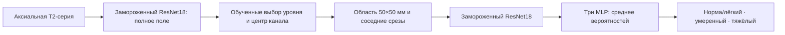
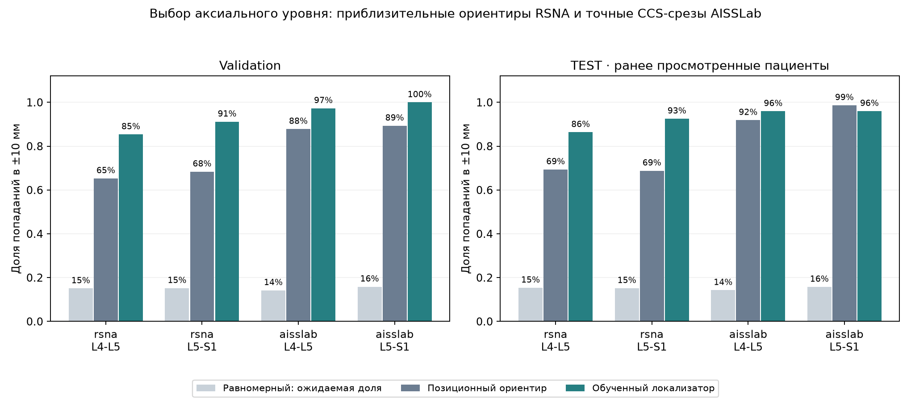
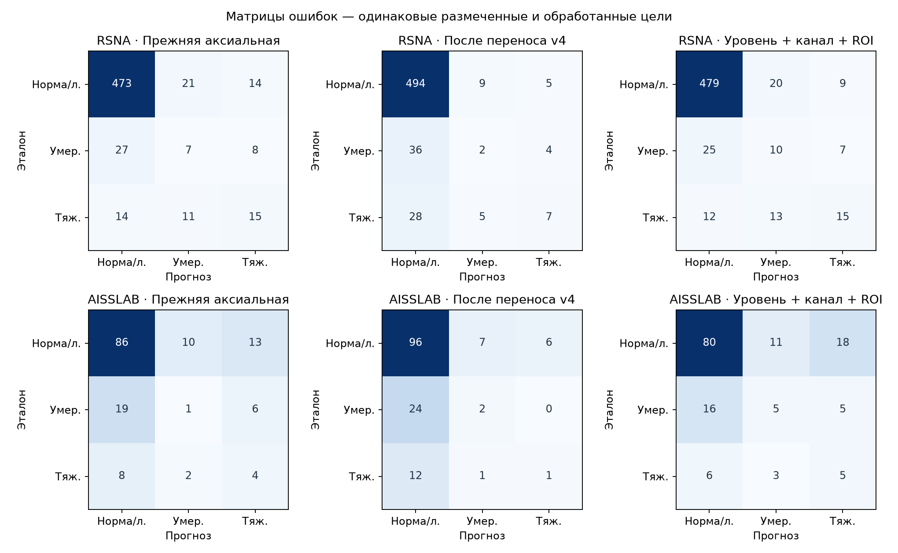

# Явная локализация аксиальных уровней и классификация по области канала

Проверил схему «найти уровень → найти канал → вырезать область → оценить степень». На одинаковых обработанных целях RSNA macro-F1 вырос относительно прежней аксиальной модели на 0.035; парный 95% интервал разницы [-0.046; 0.115]. Интервал пересекает ноль; уверенного изменения по этому сравнению нет.

Тяжёлых случаев RSNA нашёл 15 из 40; прежняя аксиальная модель находила 15 из 40. Для L5–S1 получилось 0/3 на RSNA и 0/7 на AISSLab. Попадание в нужный уровень само по себе ещё не означает правильную оценку степени стеноза.

Это исследовательское продолжение на прежних разбиениях. Эти тестовые пациенты уже участвовали в разборе ошибок, поэтому результат не считаю новым независимым подтверждением. Прежние модели и их отчёты сохранил.

Одновременно изменились локализация, физическая область, обучаемый классификатор и состав данных для оценки степени. Это сравнение целых схем, а не отдельная абляция выбора срезов. Разницу F1 нельзя приписать одному из этих изменений.

## Что изменил

Локализатор обучил по анатомическим ориентирам RSNA и XML AISSLab. Он выбирает аксиальный срез для L4–L5 и L5–S1. Отдельная небольшая сеть находит центр канала; её учил только по точным рамкам AISSLab, без использования AP-диаметра или степени стеноза. Аксиальные subarticular-точки RSNA служат приблизительными ориентирами уровня, а не разметкой центрального канала.

Из предсказанных координат получаю физическую область 50×50 мм и до трёх соседних центров в ±10 мм, только в той же серии. Положение центра переношу через DICOM-геометрию. Признаки извлекает исходный замороженный ImageNet ResNet18; обучается MLP 514→64→3 с номером уровня. Для степени использовал **только RSNA TRAIN**, эпоху выбирал только по RSNA validation. Метки степени AISSLab в обучение не входят.



Где есть сагиттальная серия, подготовил проверку переноса нумерации SpineNet. Без подтверждённой общей системы координат перенос блокируется. В текущем RSNA надёжный общий FrameOfReferenceUID не подтверждён; в этом эксперименте работает аксиальный локализатор. Сагиттальные точки вслепую не проецируются.

## Локализация на validation

| Данные и уровень | Позиционный ориентир: ±10 мм | Обученный локализатор: ±10 мм | ±5 мм |
| --- | ---: | ---: | ---: |
| rsna/L4-L5 | 65.3% | 85.4% | 70.7% |
| rsna/L5-S1 | 68.4% | 91.2% | 74.5% |
| aisslab/L4-L5 | 87.8% | 97.3% | 81.1% |
| aisslab/L5-S1 | 89.3% | 100.0% | 81.3% |

Средний по четырём группам hit ±10 мм — **93.5%**. Медианная ошибка центра на AISSLab validation — **4.28 мм** (149 размеченных срезов). Центр проверен на заранее известном XML-срезе: это ещё не полная точность цепочки на автоматически выбранном срезе и не проверка центра на RSNA.



## Локализация на TEST

Здесь срез и центр уже выбирает модель; аннотации используются только после прогноза для оценки. В знаменателе — все уровни с анатомическим ориентиром. Непроверяемая серия считается непопаданием, а отсутствие анатомической координаты не означает отсутствия метки степени стеноза.

| Данные и уровень | Позиционный ориентир: ±10 мм | Локализатор: найдено / ориентиров | ±10 мм | Непроверяемая серия |
| --- | ---: | ---: | ---: | ---: |
| rsna/L4-L5 | 69.4% | 254 / 294 | 86.4% | 8 |
| rsna/L5-S1 | 68.8% | 273 / 295 | 92.5% | 5 |
| aisslab/L4-L5 | 91.9% | 71 / 74 | 95.9% | 0 |
| aisslab/L5-S1 | 98.7% | 72 / 75 | 96.0% | 0 |

На AISSLab L5–S1 простой позиционный ориентир оказался лучше обученного локализатора. Поэтому улучшение выбора уровня не обобщаю на все группы.

На AISSLab отдельно проверил центр канала после автоматического выбора среза:

| Уровень | Медианная ошибка в плоскости, мм | Медианная 3D-ошибка, мм | 3D-ошибка ≤10 мм |
| --- | ---: | ---: | ---: |
| L4-L5 | 3.75 | 5.49 | 93.2% |
| L5-S1 | 4.58 | 6.01 | 86.7% |

Это сравнение с точками и рамками AISSLab. В RSNA истинной аксиальной разметки центра центрального канала здесь нет, поэтому точность переноса этого центра требует отдельной проверки врачом.

## Степень стеноза на RSNA TEST

Для сравнения трёх аксиальных вариантов оставил **590 общих размеченных и обработанных уровней из 590**. Отказы не превращал в норму; полное покрытие каждой модели приведено ниже.

| Модель | Macro-F1 | Тяжёлые: найдены / всего |
| --- | ---: | ---: |
| Прежняя аксиальная | 0.496 | 15 / 40 |
| После переноса v4 | 0.415 | 7 / 40 |
| Уровень + канал + ROI | 0.531 | 15 / 40 |

Результат по уровням на этой же общей выборке:

| Уровень и модель | Macro-F1 | Тяжёлые: найдены / всего | Тяжёлый → норма/лёгкий |
| --- | ---: | ---: | ---: | ---: |
| L4-L5, Прежняя аксиальная | 0.481 | 15 / 37 | 11 |
| L4-L5, После переноса v4 | 0.398 | 7 / 37 | 25 |
| L4-L5, Уровень + канал + ROI | 0.519 | 15 / 37 | 10 |
| L5-S1, Прежняя аксиальная | 0.328 | 0 / 3 | 3 |
| L5-S1, После переноса v4 | 0.329 | 0 / 3 | 3 |
| L5-S1, Уровень + канал + ROI | 0.429 | 0 / 3 | 2 |

Классификатор обучил на 2760 размеченных областях RSNA TRAIN; для выбора эпохи использовал 588 областей RSNA validation. Число целей TRAIN по классам «норма/лёгкий, умеренный, тяжёлый»: [2366, 203, 191]. Нормализацию и веса классов вычислял только по TRAIN.

| Seed | Выбранная эпоха | Macro-F1 на RSNA validation | Macro-F1 на RSNA TEST |
| --- | ---: | ---: | ---: |
| 42 | 4 | 0.568 | 0.534 |
| 2024 | 5 | 0.571 | 0.551 |
| 3407 | 3 | 0.574 | 0.544 |

Дополнительно сравнил с заранее выбранным сагиттальным ансамблем трёх frozen-head моделей v1 на **588 общих целях**. Лучший seed по новому тесту не выбирал.

| Модель | Macro-F1 | Тяжёлые: найдены / всего |
| --- | ---: | ---: |
| Прежняя аксиальная | 0.497 | 15 / 40 |
| Уровень + канал + ROI | 0.532 | 15 / 40 |
| Сагиттальный ансамбль | 0.702 | 30 / 40 |


## AISSLab: отдельная проверка переноса

В прежнем аудите классы AISSLab точно совпали с диапазонами AP-диаметра; их соответствие шкале modified Lee в RSNA пока не проверено врачом. Ниже сохраняю прежнее условное соответствие трёх классов только для исследовательского сравнения; эти числа не доказывают клиническую точность на AISSLab.

| Модель | Macro-F1 | Тяжёлые: найдены / всего |
| --- | ---: | ---: |
| Прежняя аксиальная | 0.347 | 4 / 14 |
| После переноса v4 | 0.334 | 1 / 14 |
| Уровень + канал + ROI | 0.406 | 5 / 14 |

## Покрытие и неопределённость

| Данные и модель | Получено прогнозов / запрошено | Есть эталон | Обработано с эталоном | Не обработано с эталоном |
| --- | ---: | ---: | ---: | ---: |
| rsna, Прежняя аксиальная | 590 / 590 | 590 | 590 | 0 |
| rsna, После переноса v4 | 590 / 590 | 590 | 590 | 0 |
| rsna, Уровень + канал + ROI | 590 / 590 | 590 | 590 | 0 |
| rsna, Сагиттальный ансамбль | 588 / 590 | 590 | 588 | 2 |
| aisslab, Прежняя аксиальная | 150 / 150 | 149 | 149 | 0 |
| aisslab, После переноса v4 | 150 / 150 | 149 | 149 | 0 |
| aisslab, Уровень + канал + ROI | 150 / 150 | 149 | 149 | 0 |

Прогноз без врачебной метки сохраняю, но в F1 и матрицы ошибок его не включаю. Интервалы получены 2000 парными bootstrap-перевыборками пациентов: оба уровня одного пациента всегда остаются вместе. Они описывают разброс на этих пациентах для фиксированных моделей, не неопределённость разметки и не качество в новой клинике. Локализатор обучен один раз с seed 42; три seed относятся только к классификатору степени. Разброс обучения локализатора здесь не оценён.



На L5–S1 тяжёлых случаев в RSNA TEST — 3. Даже несколько верных ответов не позволяют считать проблему этого уровня решённой. Отдельно требуется врачебная проверка нумерации, видимости канала в автоматически полученных областях и соответствия шкал. Для нового независимого подтверждения нужен ещё не просмотренный набор пациентов.

## Как повторить

Все исходные снимки, координаты, индивидуальные CSV и веса сохраняю локально. В репозитории публикую код, [агрегированные результаты](localized-stenosis-results.json) и графики.

Параметры зафиксировал в [протоколе эксперимента](../configs/axial-localizer-v6.json). Полная последовательность для подготовленных исходных данных:

```bash
python -m ai_spine_med.axial_localizer_workflow prepare --device mps
python -m ai_spine_med.axial_localizer_workflow localizer --device mps
python -m ai_spine_med.axial_localizer_workflow features --device mps
python -m ai_spine_med.axial_localizer_workflow severity --device mps
python -m ai_spine_med.axial_localizer_workflow prepare-test --device mps
python -m ai_spine_med.axial_localizer_workflow test-features --device mps
python -m ai_spine_med.axial_localizer_workflow evaluate --device mps
python -m ai_spine_med.axial_localizer_workflow score
python -m ai_spine_med.axial_localizer_workflow report
```

Отчёт можно пересобрать отдельно, без обучения: `python -m ai_spine_med.localized_stenosis_report`.

Источник внешних анатомических данных: Kwon et al., 2026, [Medical Lumbar Spine 3D Axial MRI, v1](https://data.mendeley.com/datasets/wjxkrkxhb8/1), [DOI:10.17632/wjxkrkxhb8.1](https://doi.org/10.17632/wjxkrkxhb8.1), CC BY 4.0.
