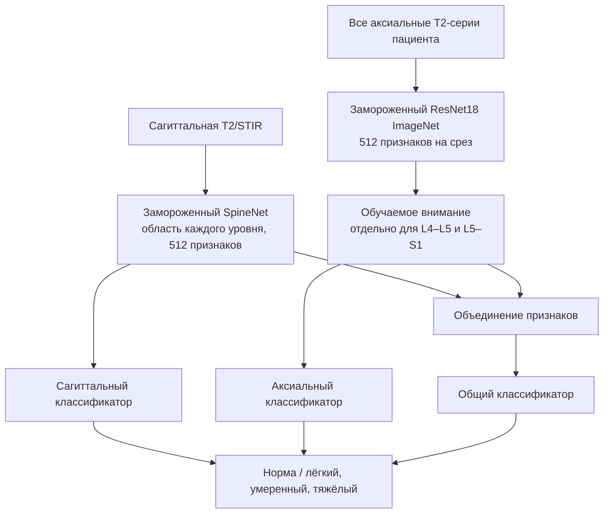
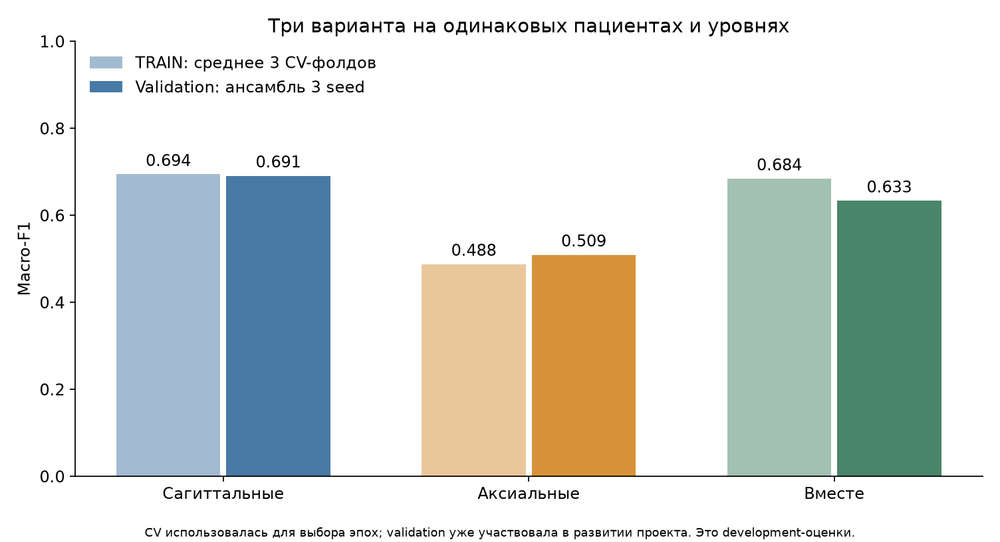
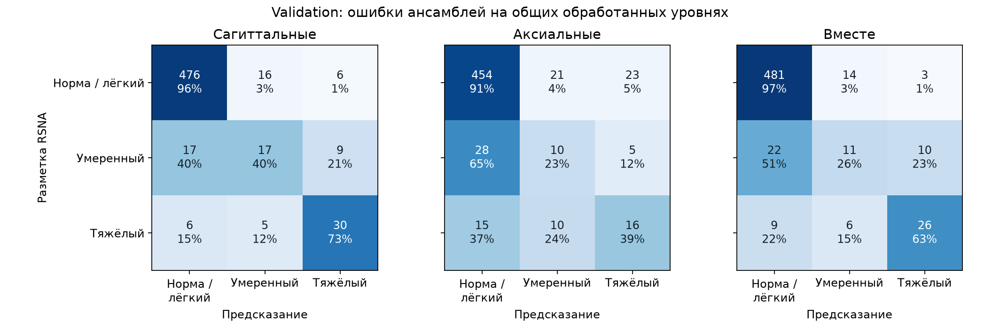
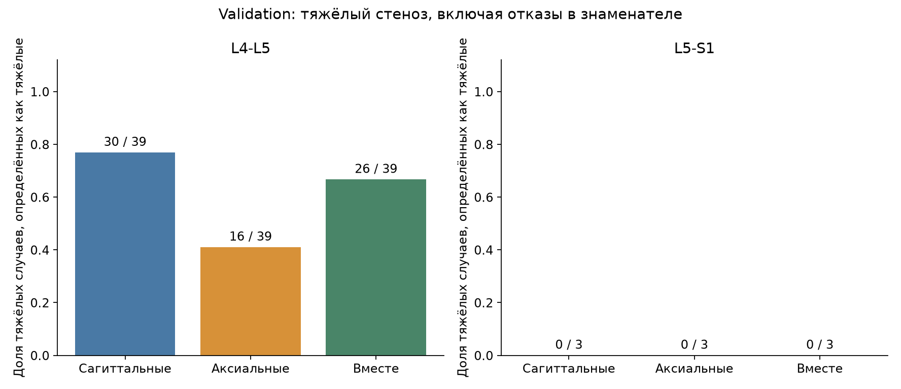
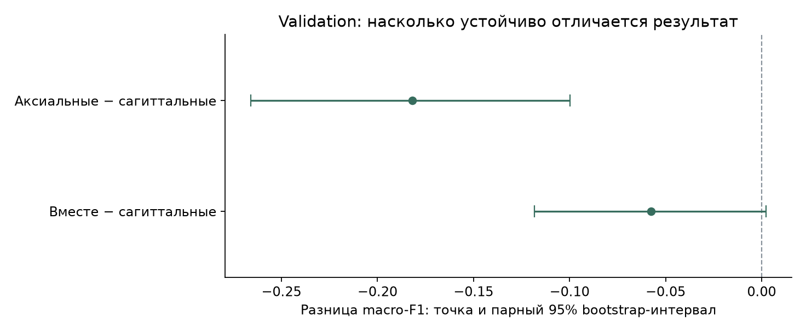

# Сагиттальные и аксиальные T2

Я проверил, помогает ли аксиальная T2-серия определять степень центрального стеноза на L4–L5 и L5–S1. Для этого обучил три варианта на одинаковых пациентах и доступных уровнях: по сагиттальным снимкам, по аксиальным и по их сочетанию.

Старое сравнение на тесте сохранил без изменений. Здесь использую только прежние train и validation. Validation уже использовалась в предыдущих экспериментах, поэтому эти числа считаю результатами разработки. Для независимого подтверждения нужны новые пациенты.

## Как устроены варианты



Аксиальному варианту сагиттальные снимки не нужны. Он получает все аксиальные срезы пациента и их относительное положение по оси «выше–ниже» внутри совместимой системы координат. Обучаемое внимание собирает признаки для каждого из двух уровней. Координаты из разметки RSNA для выбора срезов не использую, включая обучение. Внимание пока не проверено врачом и само по себе не доказывает правильную анатомическую локализацию. Наличие обработанной аксиальной серии также не подтверждает, что в её поле зрения действительно присутствуют оба нужных уровня: это отдельно надо проверить.

Для аксиальных снимков использую соседний, текущий и следующий срез как три канала; соседей беру только из той же серии, при близкой ориентации и расстоянии. Интенсивность ограничиваю 1-м и 99-м процентилями внутри серии. Сохраняю всё поле зрения, привожу размер к 224×224 и применяю нормализацию ImageNet. При разных системах координат не считаю серии совмещёнными: нормирую положение внутри каждой группы и объединяю признаки как набор. Группы упорядочиваю по идентификатору серии, срезы внутри группы — по физическому положению. Если срезов больше 96, беру 96 равномерно по этому фиксированному порядку. Не подбираю их по тяжести или координатам врача.

Это первое лёгкое сравнение: обе сети извлечения признаков заморожены, обучаются внимание и небольшие классификаторы. У SpineNet медицинское предобучение, а у ResNet18 — ImageNet; их архитектуры тоже различаются. Результат этого эксперимента не показывает предельные возможности аксиальных МРТ.

## Как сравниваю

Сохраняю исходное разбиение пациентов. Обе области и все серии одного пациента остаются вместе. Для трёх вариантов использую одинаковые обработанные пары «пациент–уровень», а недоступные области отдельно учитываю как отказы. Основной macro-F1 вычисляю по общей обработанной части; наличие обеих модальностей и полное покрытие проверяю отдельно.

На исходном train провожу три CV-разбиения и три запуска каждого варианта: seed 42, 2024 и 3407. Нормализацию признаков и веса классов считаю только по обучающей части каждого фолда. По CV выбираю эпоху, затем обучаю финальную модель на всём train фиксированное число эпох и один раз оцениваю validation. Ансамбль — простое среднее вероятностей трёх seed. Веса ансамбля и пороги по результатам не подбираю.

CV также используется для выбора эпох, поэтому её оценки тоже относятся к разработке. Не называю их независимым тестом.

## Полученные результаты

| Вариант | CV: средний macro-F1 ансамбля | Validation: macro-F1 ансамбля | F1 умеренного | Тяжёлые: найдены / всего | Обработано / запрошено |
| --- | ---: | ---: | ---: | ---: | ---: |
| Сагиттальные | 0.694 | 0.691 | 0.420 | 30 / 42 | 582 / 594 |
| Аксиальные | 0.488 | 0.509 | 0.238 | 16 / 42 | 582 / 594 |
| Вместе | 0.684 | 0.633 | 0.297 | 26 / 42 | 582 / 594 |

Общие обработанные уровни: train **2728 / 2764**, validation **582 / 594**. В таблице три варианта сравниваются на одном и том же наборе. Отказы не считаю нормой; для тяжёлых случаев оставляю их в полном знаменателе.


На validation объединение изменило macro-F1 относительно сагиттального варианта на **-0.058**. Парный 95% bootstrap-интервал разницы: **[-0.118; +0.002]**. Интервал включает ноль, поэтому устойчивый прирост по этим данным пока не установлен.










Каждый отдельный запуск:

| Вариант | Seed | Эпохи финального обучения | Validation macro-F1 |
| --- | ---: | ---: | ---: |
| Сагиттальные | 42 | 10 | 0.604 |
| Сагиттальные | 2024 | 5 | 0.670 |
| Сагиттальные | 3407 | 6 | 0.703 |
| Аксиальные | 42 | 4 | 0.481 |
| Аксиальные | 2024 | 10 | 0.423 |
| Аксиальные | 3407 | 8 | 0.516 |
| Вместе | 42 | 4 | 0.650 |
| Вместе | 2024 | 5 | 0.677 |
| Вместе | 3407 | 5 | 0.605 |

Объединение исправило **10** ошибок сагиттального варианта, но добавило **15** новых. Это описание тех же обработанных уровней, не дополнительная оценка точности.

На L5–S1 все три ансамбля пропустили три тяжёлых случая из трёх; примеров слишком мало для надёжной оценки чувствительности, но проблему оставляю видимой.


Неопределённость разницы оцениваю парным bootstrap по пациентам, 2000 повторов. Оба уровня и отказы пациента попадают в повтор вместе. Интервалы относятся к этим фиксированным моделям и этим пациентам; они не учитывают неопределённость разметки и перенос на другую клинику. Числа и интервалы сохранены в [агрегированных результатах](multimodal-results.json).

Вероятности классов не откалиброваны; не трактую их как вероятность правильного клинического решения.

По кривым обучения вижу признаки переобучения аксиального и общего вариантов: потери на обучающей части снижаются, а на отложенных CV-пациентах к остановке растут. Сохранены более ранние checkpoints с лучшим macro-F1, а не последние эпохи. Веса классов применяются только к training loss, поэтому абсолютные значения training и held loss напрямую не сравниваю.

Моя рабочая гипотеза: общие ImageNet-признаки по всему полю зрения дают слишком слабый сигнал о нужной области и уровне. Это ещё не установленная причина. Сначала хочу проверить с врачом выбранные срезы, затем решать, нужны ли локализация канала, более подходящее предобучение или дообучение аксиальной сети. Эти варианты в текущий эксперимент не подмешиваю.

## Как повторить

Официальный набор RSNA и доступ Kaggle нужны локально. Новые файлы не содержат тестовых пациентов.

```bash
mkdir -p .cache/axial-v3
curl --fail --location https://download.pytorch.org/models/resnet18-f37072fd.pth   --output .cache/axial-v3/resnet18-f37072fd.pth
ai-spine prepare-axial
ai-spine download-axial
ai-spine extract-axial --device auto
ai-spine multimodal-experiment
ai-spine report-multimodal
ai-spine multimodal-review
```

Для извлечения аксиальных признаков использую официальные веса `resnet18-f37072fd.pth` из [PyTorch](https://docs.pytorch.org/vision/stable/models/generated/torchvision.models.resnet18.html). Файл должен лежать в `.cache/axial-v3/`; его контрольная сумма проверяется перед загрузкой. Исходный сагиттальный cache готовлю командами из основного README. Все checkpoint, индивидуальные предсказания и медицинские изображения остаются локально.

Полный заранее заданный протокол — [multimodal-v3.json](../configs/multimodal-v3.json). Команда `multimodal-review` создаёт приватную галерею из 24 примеров: шесть исправленных объединением ошибок, шесть новых ошибок, шесть общих ошибок и шесть правильных контрольных примеров. Это целевой разбор с видимыми метками и ответами, а не независимая врачебная оценка точности. Для проверки нумерации и степени стеноза врачу также нужна полная DICOM-серия: трёх выбранных срезов и сагиттальной вырезки может быть недостаточно.

Галерея находится локально в `reports/runs/multimodal-review-v3/index.html`, пустые поля для врача — в соседнем `doctor_review.csv`. При повторном запуске выбираю новый `--out`, чтобы сохранить уже введённые ответы. Изменение моделей не меняет ограничения лицензии исходного SpineNet.
