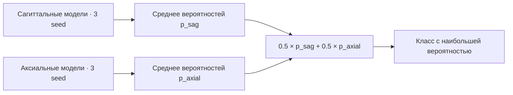
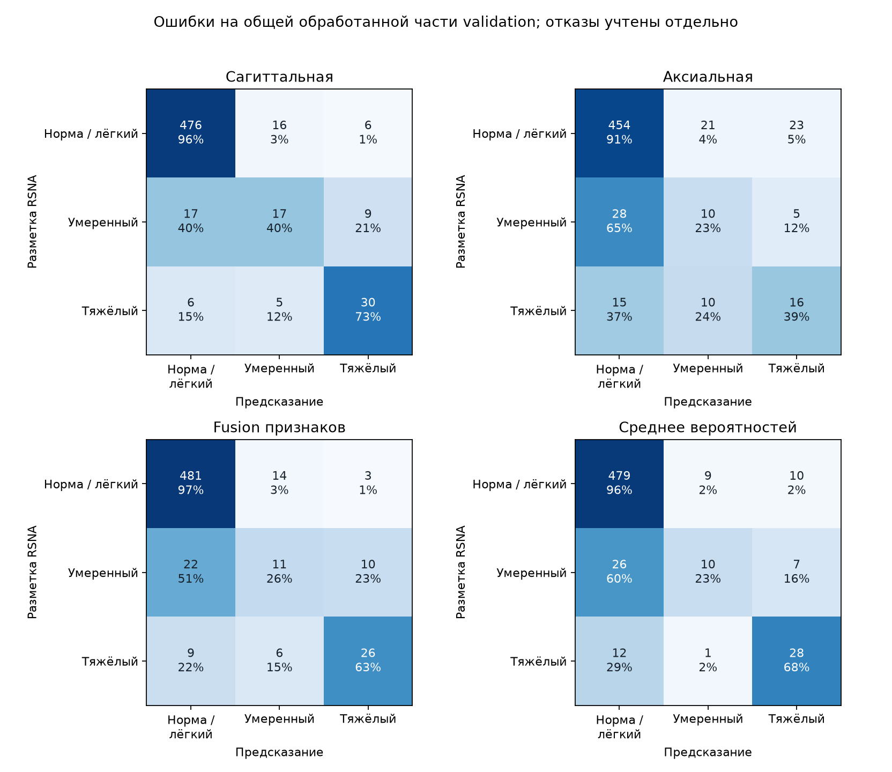
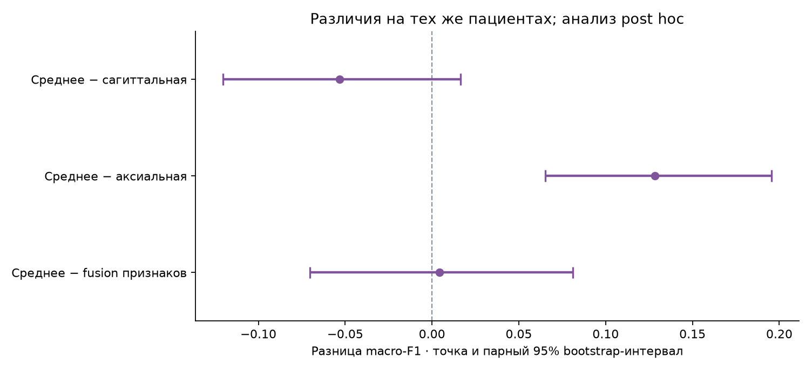

# Среднее вероятностей двух моделей

Я проверил простой способ совместить сагиттальную и аксиальную модели: усреднить их готовые вероятности с равными весами. Новую сеть не обучал. Сначала усреднил ответы трёх seed внутри каждой модальности, затем посчитал `p_mean(c) = 0.5 × p_sag(c) + 0.5 × p_axial(c)` и выбрал класс с наибольшей вероятностью. Усредняю вероятности, а не номера классов или logits. Веса и пороги по результатам не подбирал.



Это отличается от прежнего fusion: тот объединяет признаки и обучает собственный классификатор и внимание к срезам. Здесь использую уже сохранённые ответы двух отдельных моделей.

Эта проверка появилась после разбора отдельной ошибки fusion. Поэтому считаю её анализом post hoc на ранее использованной validation, а не независимым подтверждением улучшения. Новых тестовых пациентов не открывал.

## Результаты на общей выборке

Сравниваю четыре варианта на тех же 297 пациентах и 594 уровнях L4–L5 и L5–S1. Обработаны 582 уровня; 12 отказов сохраняю без класса и без вероятностей. Ни один отказ не заменяю нормой. Macro-F1 считаю по общей обработанной части для фиксированных трёх классов. При подсчёте найденных тяжёлых случаев оставляю отказы в полном знаменателе.

| Вариант | Macro-F1 | F1 умеренного | Тяжёлые: найдены / всего | Обработано / запрошено |
| --- | ---: | ---: | ---: | ---: |
| Сагиттальная | 0.691 | 0.420 | 30 / 42 | 582 / 594 |
| Аксиальная | 0.509 | 0.238 | 16 / 42 | 582 / 594 |
| Fusion признаков | 0.633 | 0.297 | 26 / 42 | 582 / 594 |
| Среднее вероятностей | 0.637 | 0.317 | 28 / 42 | 582 / 594 |




Разница macro-F1 среднего вероятностей и сагиттальной модели: **-0.053**, парный 95% bootstrap-интервал **[-0.120; +0.016]**. Интервал включает ноль: устойчивый прирост на этой выборке не установлен.



Bootstrap выполняю по пациентам, 2000 повторов с seed 2026. Оба уровня и отказы одного пациента попадают в повтор вместе. Интервалы относятся к фиксированным моделям и этой выборке. Они не учитывают неопределённость разметки, повторное обучение, перенос в другую клинику или выбор этого способа после просмотра результатов.

## Пропуски тяжёлого стеноза по уровням

В таблице ниже показано, во что превратились тяжёлые случаи по разметке RSNA. Последний столбец включает все запрошенные тяжёлые уровни, в том числе необработанные.

| Вариант | Уровень | → норма / лёгкий | → умеренный | Нет оценки | Найдено / всего тяжёлых |
| --- | --- | ---: | ---: | ---: | ---: |
| Сагиттальная | L4-L5 | 4 | 4 | 1 | 30 / 39 |
| Сагиттальная | L5-S1 | 2 | 1 | 0 | 0 / 3 |
| Аксиальная | L4-L5 | 12 | 10 | 1 | 16 / 39 |
| Аксиальная | L5-S1 | 3 | 0 | 0 | 0 / 3 |
| Fusion признаков | L4-L5 | 6 | 6 | 1 | 26 / 39 |
| Fusion признаков | L5-S1 | 3 | 0 | 0 | 0 / 3 |
| Среднее вероятностей | L4-L5 | 9 | 1 | 1 | 28 / 39 |
| Среднее вероятностей | L5-S1 | 3 | 0 | 0 | 0 / 3 |

На L5–S1 среднее вероятностей правильно определило **0 / 6 умеренных** и **0 / 3 тяжёлых** случаев. Преобладание нормы / лёгкой степени может скрывать эти ошибки при оценке общей accuracy. Редких классов на этом уровне мало, поэтому надёжную оценку чувствительности пока не делаю. Разметка RSNA служит исследовательским ориентиром, а не новым заключением врача.


На обработанных уровнях среднее вероятностей меняет ошибки так:

| По сравнению с | Исправлено ошибок | Добавлено ошибок |
| --- | ---: | ---: |
| Сагиттальная | 10 | 16 |
| Аксиальная | 48 | 11 |
| Fusion признаков | 12 | 13 |

Вероятности классов не откалиброваны; не трактую их как вероятность правильного клинического решения. Этот анализ помогает выбрать следующий эксперимент, но не подтверждает клиническую пригодность и не заменяет независимую проверку на новых пациентах.

Перед построением отчёта проверяю фиксированные веса, контрольную сумму нового CSV, корректность вероятностей и повторно считаю его метрики. Публичные [агрегированные результаты](probability-mean-results.json) не содержат снимков или идентификаторов пациентов. Старые результаты трёх моделей сохранены отдельно в [сравнении сагиттальных и аксиальных T2](multimodal.md).

## Как повторить

Использую сохранённые validation CSV исходных трёх ансамблей и [фиксированный протокол](../configs/probability-mean-v3.json). Повторное обучение и загрузка МРТ не нужны. Для нового расчёта выбираю ещё не существующий каталог внутри игнорируемого `reports/runs/`, чтобы сохранить предыдущие результаты:

```bash
ai-spine probability-mean --out reports/runs/probability-mean-v3-repeat
ai-spine report-probability-mean --experiment reports/runs/probability-mean-v3-repeat
```

Повторный арифметический расчёт проверяет воспроизводимость чисел. Он не создаёт новую независимую клиническую проверку.
