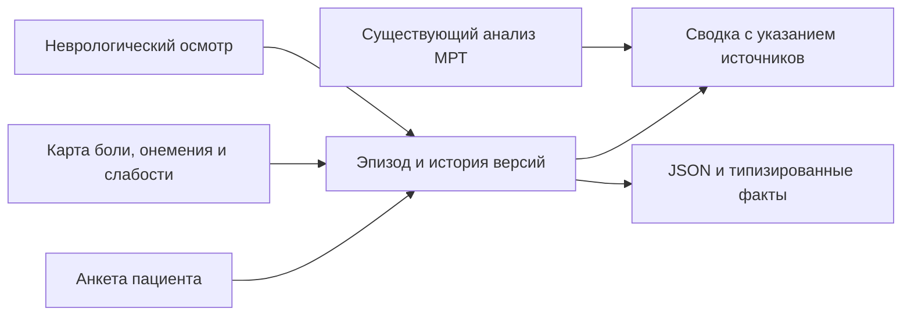

# PSP: анкета пациента и неврологический осмотр

Добавляю два подключаемых модуля по ТЗ Вадима от 22.11.2026. В PSP-01 записываю жалобы, анамнез и субъективную карту симптомов. В PSP-02 врач вручную заполняет двусторонний протокол осмотра. Оба модуля работают без МРТ; при наличии загрузки её можно связать с эпизодом после подтверждения принадлежности пациенту.



Вход — ссылка «PSP · анкета и осмотр» в шапке просмотрщика. В карточке загрузки есть переход с уже выбранной МРТ. Для нового эпизода использую условный код пациента, подтверждение личности, совершеннолетия и согласия. Полное имя пациента не требуется. Отдельные вкладки содержат анкету, карту, осмотр и сводку.

Карта — двумерная схема спереди и сзади. Это субъективные отметки пациента: боль, онемение и ощущение слабости хранятся раздельно. Для каждой сохраняю сторону пациента, интенсивность, координаты и версию схемы. Сторона не меняется при переходе между видами. По карте программа не определяет повреждённый корешок.

В осмотре сила MRC и сила в ньютонах — разные поля. Ноль сохраняется как реальное значение, пустое поле остаётся неизвестным. Для невыполненной пробы можно записать причину, в том числе отказ или невозможность безопасного выполнения. Фиксация осмотра сохраняет введённое имя проверяющего и версию записи; это пользовательское подтверждение проверки, а не проверенная электронная подпись врача.

## Хранение и API

Использую SQLite вне статического каталога. По умолчанию база находится в `$REVIEW_UPLOAD_ROOT/.psp`; путь можно задать отдельно через `REVIEW_PSP_ROOT`. Для работы PSP не требуются GPU, отдельные веса или внешняя модель текста. База сохраняется в существующем постоянном томе загрузок.

| Метод | Маршрут относительно закрытого URL | Назначение |
| --- | --- | --- |
| GET | `api/psp/catalog` | Версия вопросов, карта и протокол проб |
| GET / POST | `api/psp/episodes` | Список / создание эпизода |
| GET / POST | `api/psp/episodes/{id}` | Чтение / сохранение и действия |
| GET | `api/psp/episodes/{id}/export` | Запись, история и типизированные факты |

В POST передаю JSON, `X-PSP-Intent: clinical-record` и точный Origin сайта. Изменение существующего эпизода требует ожидаемой `revision` и `idempotency_key`. Повтор запроса не создаёт вторую запись, устаревшая версия возвращает конфликт. Исправления сохраняются в истории с цепочкой хешей. Это обнаружение изменений журнала, а не защита от администратора сервера, имеющего доступ ко всей базе.

Для тревожных ответов использую отдельное действие `record_safety`: оно сохраняет исходные события независимо от незавершённых полей осмотра. Если сеть пропала, события остаются в черновике текущей вкладки и отправляются после восстановления связи. Последующая правка «да» на «нет» не удаляет прежнее событие. До подтверждения сервером интерфейс показывает, что запись не доставлена. Локальные черновики разных эпизодов хранятся отдельно.

В API использую единое сохранение снимка эпизода вместо отдельных HTTP-маршрутов для каждого ответа из чернового OpenAPI Вадима. Каталог и источники фактов версионирую. Интеграция с просмотрщиком добавляет результаты МРТ отдельно: они не становятся жалобой пациента или заключением врача. Если связанное исследование удалено, ссылка помечается недоступной.

## Тревожные ответы и границы версии

Реализую проверяемые правила чернового протокола, без непрозрачного суммарного балла риска. Положительный тревожный ответ сохраняется и после последующего изменения ответа или нормального результата осмотра. Подтверждение прочтения не снимает сигнал. Пропуск критического вопроса не превращается в отрицательный ответ. Уведомления видны в приложении; отдельная служба доставки врачу не подключена.

Клинические формулировки нужно согласовать с Вадимом до применения на пациентах. При проверке источника ТЗ ссылка GIRFT перенаправляла на [редакцию марта 2026 года](https://gettingitrightfirsttime.co.uk/wp-content/uploads/2026/04/National-Suspected-Cauda-Equina-Pathway-March-2026.pdf). В частности, отрицательные физические пробы не используются для снятия ранее зарегистрированного тревожного симптома.

Это рабочая версия сбора и просмотра данных в существующем закрытом исследовательском сайте. Общая ссылка пока даёт всем её обладателям одинаковый доступ к эпизодам. Раздельные аккаунты пациента и врача, проверенные роли и подписи, промышленная синхронизация офлайн, FHIR/PACS, датчики и клинический CFAI остаются отдельными этапами. JSON-экспорт подготовлен для дальнейшего адаптера; диагноза, лечебных рекомендаций и команд аппаратам эти модули не формируют.

## Проверка

```sh
python -m pytest -q tests/test_psp.py tests/test_psp_http.py tests/test_review_uploads.py
node --test tests/review_web.test.cjs
```

На выпуске прошли все 896 Python-тестов проекта и 30 проверок прежнего интерфейса МРТ. В настоящем браузере отдельно прошёл сценарии создания двух эпизодов, нулевых и пропущенных значений, обоих видов карты, проверки осмотра, экспорта и перезагрузки. Проверил конфликт двух вкладок и тревожные ответы без сети: положительное событие остаётся после отрицательной правки и сохраняется на сервере после восстановления связи. Незавершённая проба осмотра не блокирует отдельную запись тревожного события. На рабочем сайте при обновлении сверил сохранность обеих МРТ-загрузок; синтетические клинические записи использовал только на локальном стенде.
