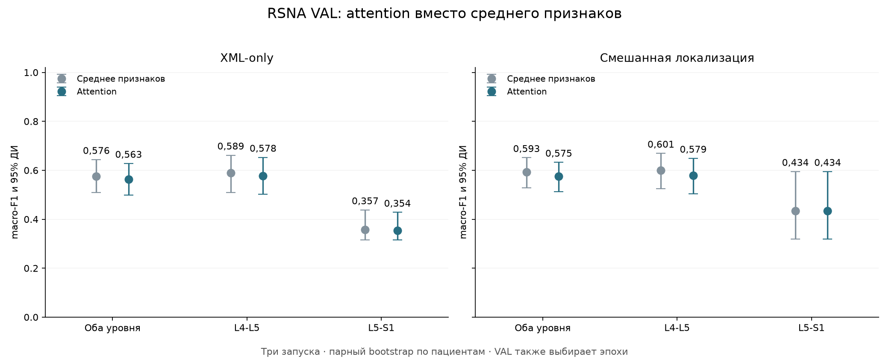
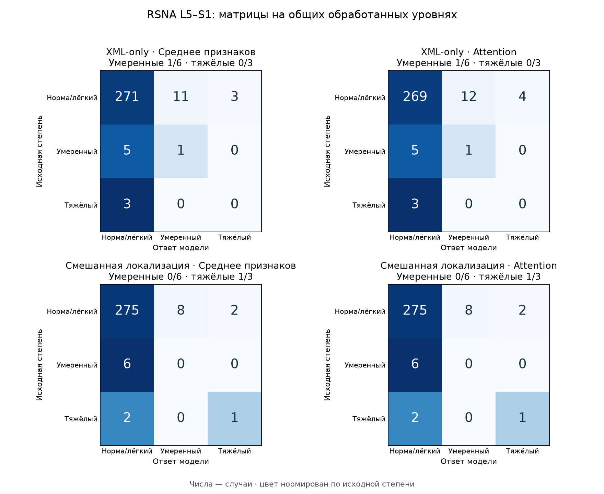
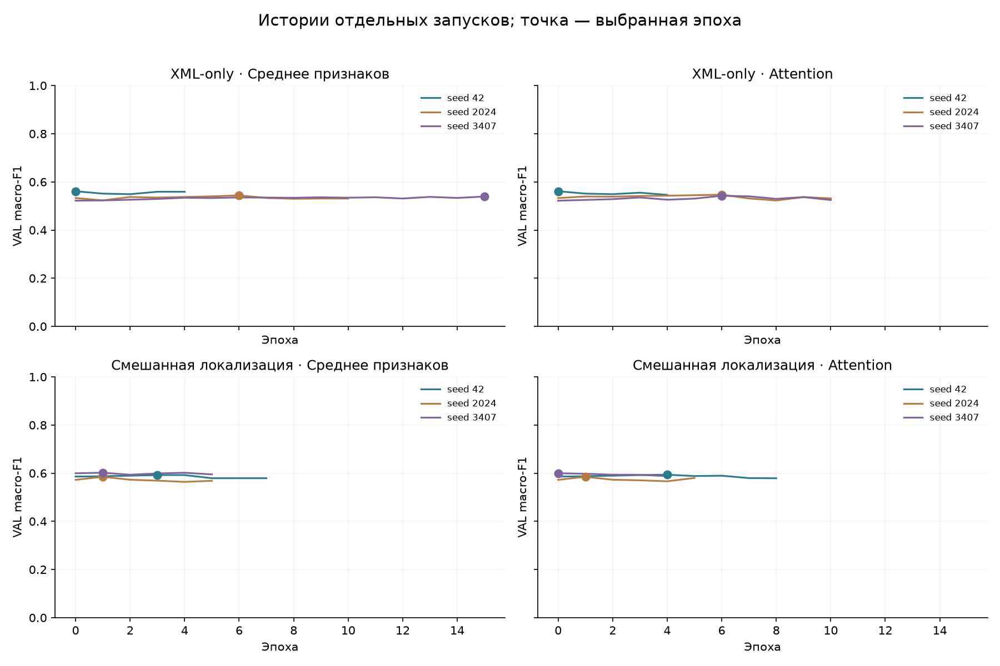

# Attention вместо усреднения признаков соседних областей

Сравнил простое среднее признаков с обучаемым attention. Для XML-only и смешанной локализации AISSLab + RSNA сделал по три запуска каждого варианта: 42, 2024 и 3407.

ResNet18 целиком оставил замороженным. Сохранил прежние уровни, центры канала, области 50×50 мм и соседние срезы. Attention взвешивает до трёх окон ROI; каждое окно уже содержит три исходных среза как каналы 2.5D. Это не отдельные веса для каналов и не новое сканирование всей серии.

Оба варианта начинал с классификатора v6 соответствующего seed и его прежних нормализаторов. Scorer attention получает нормализованные 512 признаков каждого окна: Linear(512,64) → Tanh → Linear(64,1). Последний слой без bias начал с нулевых весов, поэтому на эпохе 0 attention равен среднему по реальным окнам. Взвешенные исходные признаки затем поступают в тот же классификатор.

Для обучения использовал одинаковые 1380 пациентов и 2760 обработанных уровней RSNA TRAIN. Основное сравнение — 588 общих обработанных уровней у 294 пациентов RSNA VAL. Отказы сохраняю отдельно.

Контроль со средним точно повторил v9: совпали выбранные эпохи и вероятности всех шести запусков. Проверил это по сохранённым ответам.

Уверенного общего прироста от attention в этом опыте не получил: у обеих локализаций парный интервал разницы F1 включает ноль.

## Результаты на одинаковых уровнях

В таблице — равное среднее вероятностей трёх запусков. Разница рассчитана как `attention − среднее`, рядом парный 95% интервал.

| Уровень | Локализация | Среднее, macro-F1 | Attention, macro-F1 | Разница, 95% ДИ | Умеренные: среднее → attention | Тяжёлые: среднее → attention |
|---|---|---:|---:|---:|---:|---:|
| Оба уровня | XML-only | 0,576 | 0,563 | -0,013 [-0,039; 0,012] | 11/43 → 11/43 | 23/42 → 22/42 |
| Оба уровня | Смешанная локализация | 0,593 | 0,575 | -0,018 [-0,047; 0,000] | 10/43 → 8/43 | 26/42 → 26/42 |
| L4-L5 | XML-only | 0,589 | 0,578 | -0,011 [-0,042; 0,021] | 10/37 → 10/37 | 23/39 → 22/39 |
| L4-L5 | Смешанная локализация | 0,601 | 0,579 | -0,022 [-0,056; 0,000] | 10/37 → 8/37 | 25/39 → 25/39 |
| L5-S1 | XML-only | 0,357 | 0,354 | -0,003 [-0,013; 0,000] | 1/6 → 1/6 | 0/3 → 0/3 |
| L5-S1 | Смешанная локализация | 0,434 | 0,434 | 0,000 [0,000; 0,000] | 0/6 → 0/6 | 1/3 → 1/3 |



## L5–S1 отдельно

| Локализация | Вариант | Метки: норма / умеренный / тяжёлый | Умеренные найдены | Тяжёлые найдены | Тяжёлый → норма | Тяжёлый → умеренный | Ложный тяжёлый |
|---|---|---:|---:|---:|---:|---:|---:|
| XML-only | Среднее признаков | 285/6/3 | 1/6 | 0/3 | 3 | 0 | 3 |
| XML-only | Attention | 285/6/3 | 1/6 | 0/3 | 3 | 0 | 4 |
| Смешанная локализация | Среднее признаков | 285/6/3 | 0/6 | 1/3 | 2 | 0 | 2 |
| Смешанная локализация | Attention | 285/6/3 | 0/6 | 1/3 | 2 | 0 | 2 |

L5–S1, XML-only: attention исправил 0 ошибок и потерял 2 правильных ответов. Среди тяжёлых дополнительно найдено 0, потеряно 0; оба варианта пропустили 3.

L5–S1, Смешанная локализация: attention исправил 0 ошибок и потерял 0 правильных ответов. Среди тяжёлых дополнительно найдено 0, потеряно 0; оба варианта пропустили 2.



Строки — исходная степень, столбцы — ответ. Числа — случаи; цвет нормирован по исходной степени. На L5–S1 мало умеренных и тяжёлых случаев, поэтому отдельно смотрю их число и ложные тревоги.

## Запуски и обучение

В обоих вариантах AdamW, learning rate классификатора 0,0001. Attention обучал с learning rate 0,0001. Batch 64, weight decay 0,0001, максимум 15 эпох, patience 4. Порядок batch и веса классов одинаковые. Эпоху выбирал по общему macro-F1 RSNA VAL; при равенстве сохранял раннюю. Эпоха 0 тоже могла быть выбрана.

| Локализация | Вариант | Выбранные эпохи: 42 / 2024 / 3407 | F1 отдельных запусков: 42 / 2024 / 3407 |
|---|---|---:|---:|
| XML-only | Среднее признаков | 0/6/15 | 0,561/0,544/0,539 |
| XML-only | Attention | 0/6/6 | 0,561/0,547/0,543 |
| Смешанная локализация | Среднее признаков | 3/1/1 | 0,592/0,585/0,602 |
| Смешанная локализация | Attention | 4/1/0 | 0,594/0,585/0,600 |

В TRAIN L5–S1 число нормальных/лёгких, умеренных и тяжёлых меток: 1327/40/13. Классовые веса вычислены только по общему TRAIN. Нулевая выбранная эпоха означает сохранение исходного среднего. Выбор эпох отдельных seed не гарантирует прирост ансамбля.



## Что получилось с весами attention

Ниже только агрегаты по валидационным областям. Эффективное число окон равно `1 / sum(w²)`: оно ближе к 1 при выборе одного окна. На его величину влияет и исходное число доступных окон. Эти числа не использовал для выбора эпох.

| Локализация | Seed | Средний максимальный вес | Среднее эффективное число окон | Расстояние L1 от равномерных весов |
|---|---:|---:|---:|---:|
| XML-only | 42 | 0,357 | 2,855 | 0,000 |
| XML-only | 2024 | 0,402 | 2,811 | 0,105 |
| XML-only | 3407 | 0,413 | 2,792 | 0,125 |
| Смешанная локализация | 42 | 0,351 | 2,954 | 0,026 |
| Смешанная локализация | 2024 | 0,342 | 2,957 | 0,003 |
| Смешанная локализация | 3407 | 0,340 | 2,957 | 0,000 |

## Покрытие

| Уровень | Локализация | Запрошено | Без метки | Обработано с меткой | Не обработано с меткой | Общих у четырёх вариантов |
|---|---|---:|---:|---:|---:|---:|
| Оба уровня | XML-only | 594 | 0 | 588 | 6 | 588 |
| Оба уровня | Смешанная локализация | 594 | 0 | 588 | 6 | 588 |
| L4-L5 | XML-only | 297 | 0 | 294 | 3 | 294 |
| L4-L5 | Смешанная локализация | 297 | 0 | 294 | 3 | 294 |
| L5-S1 | XML-only | 297 | 0 | 294 | 3 | 294 |
| L5-S1 | Смешанная локализация | 297 | 0 | 294 | 3 | 294 |

Маски обработки среднего и attention совпадают. Полные и общие метрики, отдельные запуски и матрицы ошибок сохранены в JSON.

## Ограничения

Эта валидация уже использовалась в прошлых опытах и сейчас выбирает эпохи. Это результат разработки, а не независимое подтверждение. TEST в этом эксперименте не оценивал. Истинные координаты и степени не выбирают автоматические области. Веса attention сами по себе не доказывают клиническую важность среза.

95% интервалы рассчитаны 2000 парными bootstrap-повторами по пациентам; оба уровня одного пациента остаются вместе. Они описывают состав этой выборки при фиксированных моделях и не исправляют смещение от выбора эпох, ошибки разметки или различия между клиниками. Для итоговой проверки нужны новые не просмотренные пациенты.

[Численные результаты](roi-attention-results.json), [протокол](../configs/roi-attention-v12.json). Снимки, кэши, веса attention по случаям, индивидуальные ответы и модели остаются локально.

Пересобрать отчёт по сохранённым ответам:

```bash
python -m ai_spine_med.roi_attention_report
```
