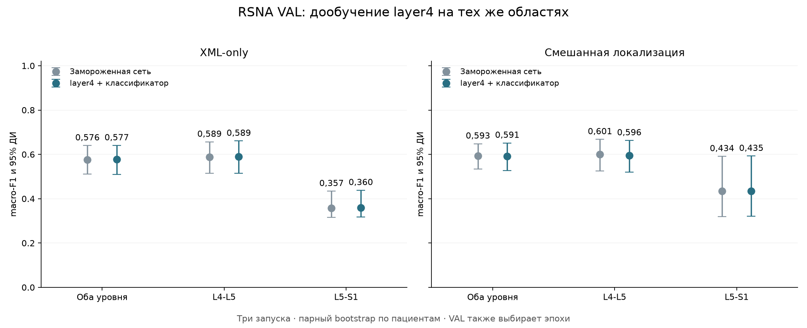
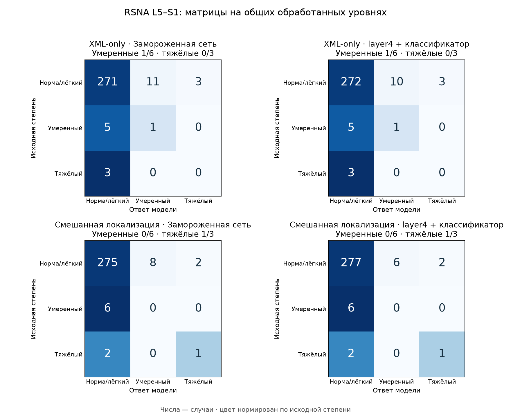
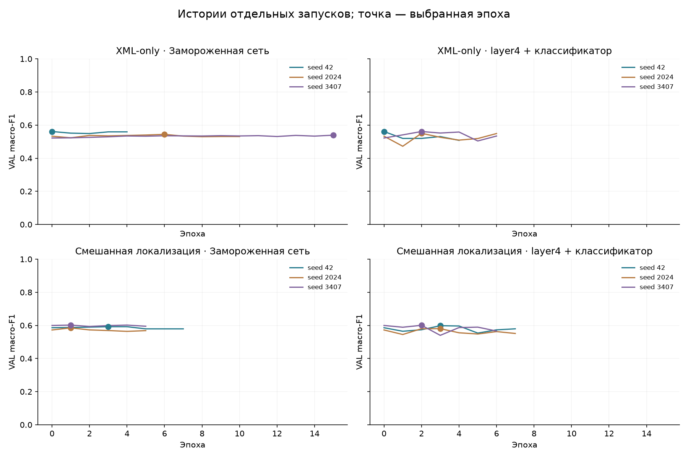

# Дообучение layer4 ResNet18 на прежних областях

Сравнил замороженный ResNet18 с вариантом, где дообучал его последний блок `layer4` вместе с классификатором степени стеноза. Проверил обе прежние локализации: XML-only и смешанную AISSLab + RSNA. Для каждой сделал три запуска: 42, 2024 и 3407.

Уверенного общего прироста от layer4 в этом опыте не получил: у обеих локализаций парный интервал разницы macro-F1 включает ноль.

Оба варианта начинал с одинаковых весов: исходный ImageNet ResNet18 и классификатор v6 соответствующего seed. Замороженный контроль обучил заново. Локализатор, центр, области 50×50 мм, соседние срезы и усреднение их признаков оставил прежними. Нормализацию признаков v6 и статистики BatchNorm не обновлял. Аугментации не добавлял.

Замороженный контроль точно повторил прежний опыт v9: совпали выбранные эпохи и все вероятности шести запусков. Это проверил отдельно по сохранённым ответам.

Для обучения использовал одни и те же 1380 пациентов и 2760 обработанных уровней RSNA TRAIN. Для сравнения оставил 588 общих обработанных уровней с меткой у 294 пациентов RSNA VAL. Отказы и отсутствующие метки учитываю отдельно; в норму их не превращаю.

## Результаты на одинаковых уровнях

В таблице — ансамбли равного среднего вероятностей трёх запусков. Разница F1 рассчитана как `layer4 − замороженная сеть`, рядом парный 95% интервал.

| Уровень | Локализация | Замороженная, macro-F1 | layer4, macro-F1 | Разница, 95% ДИ | Умеренные до → после | Тяжёлые до → после |
|---|---|---:|---:|---:|---:|---:|
| Оба уровня | XML-only | 0,576 | 0,577 | 0,001 [-0,019; 0,021] | 11/43 → 12/43 | 23/42 → 22/42 |
| Оба уровня | Смешанная локализация | 0,593 | 0,591 | -0,002 [-0,036; 0,033] | 10/43 → 10/43 | 26/42 → 25/42 |
| L4-L5 | XML-only | 0,589 | 0,589 | 0,001 [-0,022; 0,026] | 10/37 → 11/37 | 23/39 → 22/39 |
| L4-L5 | Смешанная локализация | 0,601 | 0,596 | -0,005 [-0,044; 0,035] | 10/37 → 10/37 | 25/39 → 24/39 |
| L5-S1 | XML-only | 0,357 | 0,360 | 0,003 [0,000; 0,013] | 1/6 → 1/6 | 0/3 → 0/3 |
| L5-S1 | Смешанная локализация | 0,434 | 0,435 | 0,001 [0,000; 0,003] | 0/6 → 0/6 | 1/3 → 1/3 |



## L5–S1 отдельно

| Локализация | Вариант | Метки: норма / умеренный / тяжёлый | Умеренные найдены | Тяжёлые найдены | Тяжёлый → норма | Тяжёлый → умеренный | Ложный тяжёлый |
|---|---|---:|---:|---:|---:|---:|---:|
| XML-only | Замороженная сеть | 285/6/3 | 1/6 | 0/3 | 3 | 0 | 3 |
| XML-only | layer4 + классификатор | 285/6/3 | 1/6 | 0/3 | 3 | 0 | 3 |
| Смешанная локализация | Замороженная сеть | 285/6/3 | 0/6 | 1/3 | 2 | 0 | 2 |
| Смешанная локализация | layer4 + классификатор | 285/6/3 | 0/6 | 1/3 | 2 | 0 | 2 |

L5–S1, XML-only: после дообучения исправлено ошибок: 1; правильных ответов потеряно: 0. Среди тяжёлых дополнительно найдено 0, потеряно 0; обе версии пропустили 3.
Все исправления относятся к исходной метке «норма/лёгкая степень». Число найденных умеренных и тяжёлых случаев не увеличилось.

L5–S1, Смешанная локализация: после дообучения исправлено ошибок: 2; правильных ответов потеряно: 0. Среди тяжёлых дополнительно найдено 0, потеряно 0; обе версии пропустили 2.
Все исправления относятся к исходной метке «норма/лёгкая степень». Число найденных умеренных и тяжёлых случаев не увеличилось.



Строки — исходная степень, столбцы — ответ. Числа — случаи; цвет нормирован по исходной степени. Малое число умеренных и тяжёлых L5–S1 делает F1 нестабильным, поэтому важны абсолютные счётчики и ложные тревоги.

## Запуски и обучение

В обоих вариантах AdamW, learning rate классификатора 0,0001. Для layer4 learning rate 0,00001. Batch 64, weight decay 0,0001, максимум 15 эпох, patience 4. Эпоху выбирал по общему macro-F1 RSNA VAL; при равенстве оставлял раннюю. Эпоха 0 тоже могла быть выбрана.

| Локализация | Вариант | Выбранные эпохи: 42 / 2024 / 3407 | F1 отдельных запусков: 42 / 2024 / 3407 |
|---|---|---:|---:|
| XML-only | Замороженная сеть | 0/6/15 | 0,561/0,544/0,539 |
| XML-only | layer4 + классификатор | 0/2/2 | 0,561/0,550/0,561 |
| Смешанная локализация | Замороженная сеть | 3/1/1 | 0,592/0,585/0,602 |
| Смешанная локализация | layer4 + классификатор | 3/3/2 | 0,598/0,580/0,601 |

В TRAIN L5–S1 число нормальных/лёгких, умеренных и тяжёлых меток: 1327/40/13. В обоих вариантах использовал одинаковые веса классов, вычисленные только по общему TRAIN. Нулевая выбранная эпоха означает сохранение исходных весов. Выбор эпох каждого seed не гарантирует улучшение их вероятностного ансамбля.



## Покрытие

| Уровень | Локализация | Запрошено | Без метки | Обработано с меткой | Не обработано с меткой | Общих у четырёх вариантов |
|---|---|---:|---:|---:|---:|---:|
| Оба уровня | XML-only | 594 | 0 | 588 | 6 | 588 |
| Оба уровня | Смешанная локализация | 594 | 0 | 588 | 6 | 588 |
| L4-L5 | XML-only | 297 | 0 | 294 | 3 | 294 |
| L4-L5 | Смешанная локализация | 297 | 0 | 294 | 3 | 294 |
| L5-S1 | XML-only | 297 | 0 | 294 | 3 | 294 |
| L5-S1 | Смешанная локализация | 297 | 0 | 294 | 3 | 294 |

Маски обработки замороженного и дообученного вариантов внутри каждой локализации совпадают. Полные и общие метрики, все отдельные запуски и матрицы ошибок сохранены в JSON.

## Ограничения

Эта валидация уже использовалась в предыдущих опытах и сейчас выбирает эпохи. Это результат разработки, а не независимое подтверждение. TEST в этом эксперименте не оценивал. Истинные координаты и степени не используются для автоматического выбора областей.

95% интервалы рассчитаны 2000 парными bootstrap-повторами по пациентам; оба уровня одного пациента остаются вместе. Они описывают состав этой выборки при фиксированных моделях и не исправляют смещение от выбора эпох на VAL, ошибки разметки или различия между клиниками. Для итоговой проверки нужны новые не просмотренные пациенты.

[Численные результаты](roi-layer4-results.json), [протокол](../configs/roi-layer4-v11.json). Снимки, кэши, индивидуальные ответы и веса остаются локально в игнорируемых папках.

Пересобрать отчёт по сохранённым ответам:

```bash
python -m ai_spine_med.roi_layer4_report
```
