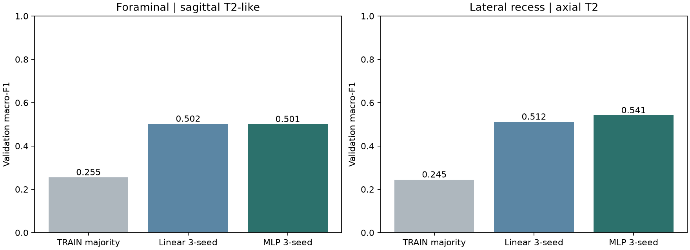
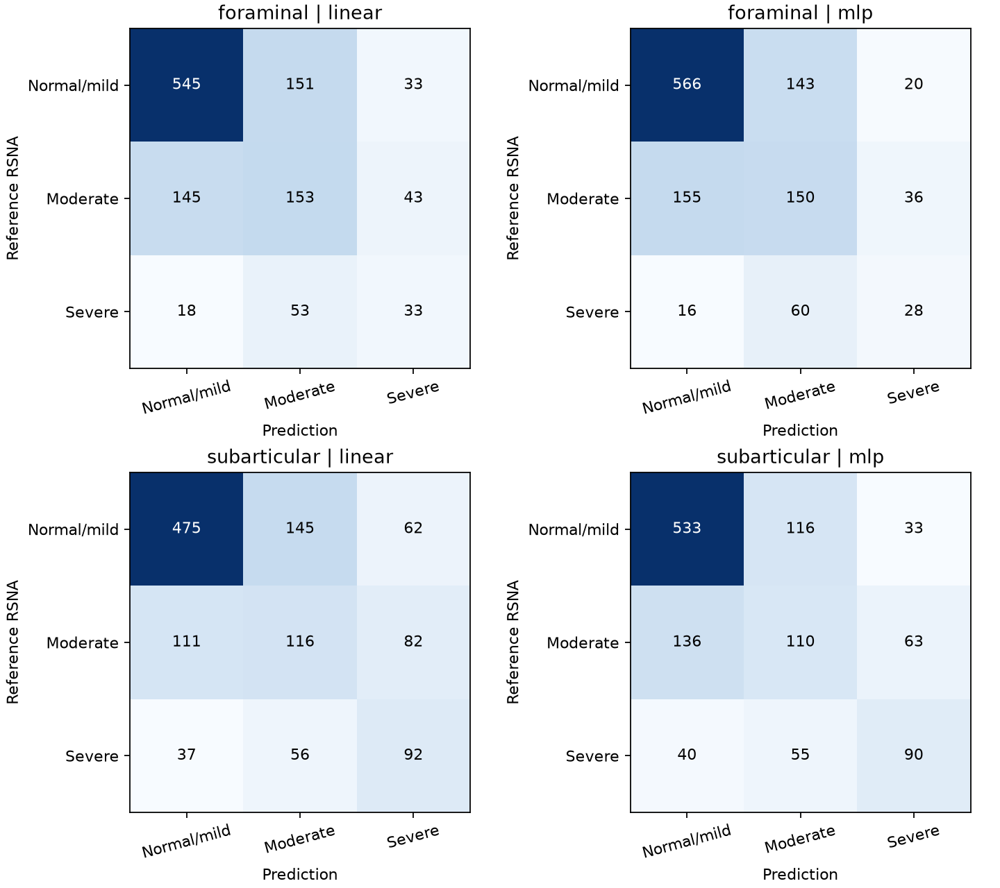

# Фораминальный стеноз и латеральные рецессусы по сторонам

В этом эксперименте добавил две отдельные задачи RSNA на L4–L5 и L5–S1: степень фораминального сужения и степень стеноза латерального рецессуса, слева и справа. В каждой задаче три класса: норма/лёгкий, умеренный, тяжёлый. Воздействие на конкретный корешок здесь не оцениваю.

Это первый эксперимент на доступных снимках. Для фораминальной задачи использую сагиттальные T2/STIR и исходный encoder SpineNet, а не T1. Для рецессусов — аксиальные T2 с прежней автоматической смешанной локализацией. Новый результат не заменяет основной центральный классификатор и пока не подключён к сайту.

## Данные и изображения

Сохранил прежнее разделение: 1382 исследования TRAIN и 297 validation. Тест не открывал. Использую все восемь целевых оценок исследования: две патологии × два уровня × две стороны. Нетипичные/необработанные области сохраняю как отказ, отсутствующую метку не заменяю нормой; прогноз без метки сохраняю, но точность по нему не считаю.

Фораминальные головы получают 512 исходных признаков SpineNet из прежней автоматически найденной области из девяти сагиттальных слоёв. Одинаковые признаки идут в отдельные выходы слева и справа. Область была разработана для оценки центрального стеноза, поэтому полного охвата фораминальных зон она не гарантирует; T1 и отдельная локализация отверстий остаются следующим опытом.

Аксиальный вход — прежняя область 50×50 мм и до трёх соседних центров с 2.5D-контекстом. Сеть ResNet18 заморожена. Из её карты layer4 сохраняю глобальное среднее и отдельные средние анатомических левой/правой половин. Это пространственный признак, не выделение отдельных рецессусов или корешков. Референсные координаты RSNA на validation для выбора области не использую.

## Обучение

Заранее зафиксировал две архитектуры: линейный классификатор и MLP с общим скрытым слоем 64, ReLU и dropout 0.2. У каждой четыре независимых трёхклассовых выхода для сочетаний уровня и стороны. Каждую архитектуру в обеих задачах обучил с seed 42, 2024, 3407: всего 12 запусков.

Нормализацию и веса классов считаю только по TRAIN; веса — обратный корень частот внутри каждого выхода. AdamW, learning rate 0.001, weight decay 0.0001, batch 128, до 25 эпох, patience 5. Эпоху выбираю по общему validation macro-F1; при равенстве оставляю более раннюю. Для каждой архитектуры усредняю вероятности трёх запусков. Базовый контроль — наиболее частый класс TRAIN отдельно для каждого уровня и стороны, с тем же покрытием обработки.

Это повторно используемая разработочная валидация, по ней же выбираются эпохи. Разницу моделей здесь нельзя выдавать за независимое подтверждение улучшения. Контрольные суммы данных, кэшей и кода сохранил до первого обучения в [протоколе](../configs/side-stenosis-v15.json).

## Результаты на validation

| Задача | Вариант | Macro-F1 | Тяжёлые: найдены / все | Тяжёлый → норма/лёгкий | Оценено / запрошено |
|---|---|---:|---:|---:|---:|
| Фораминальный | Контроль TRAIN | 0.255 | 0 / 106 | 104 | 1176 / 1188 |
| Фораминальный | linear | 0.502 | 33 / 106 | 18 | 1176 / 1188 |
| Фораминальный | mlp | 0.501 | 28 / 106 | 16 | 1176 / 1188 |
| Латеральный рецессус | Контроль TRAIN | 0.245 | 0 / 185 | 185 | 1176 / 1188 |
| Латеральный рецессус | linear | 0.512 | 92 / 185 | 37 | 1176 / 1188 |
| Латеральный рецессус | mlp | 0.541 | 90 / 185 | 40 | 1176 / 1188 |



На этом этапе линейный вариант для фораминального сужения дал macro-F1 0.502, MLP — 0.501. Для рецессусов MLP выше по общему F1: 0.541 против 0.512. При этом на L5–S1 линейная модель нашла 10 из 44 тяжёлых оценок рецессусов, MLP — 8 из 44. Поэтому улучшение общего F1 не считаю решением задачи тяжёлого стеноза на этом уровне.



## Уровни и стороны

| Задача | Уровень | Сторона | Вариант | Macro-F1 | Тяжёлые: найдены / все | Тяжёлый → норма/лёгкий | Метки 0 / 1 / 2 |
|---|---|---|---|---:|---:|---:|---:|
| Фораминальный | L4-L5 | слева | linear | 0.491 | 8 / 18 | 4 | 177 / 102 / 18 |
| Фораминальный | L4-L5 | справа | linear | 0.462 | 6 / 26 | 4 | 180 / 90 / 26 |
| Фораминальный | L5-S1 | слева | linear | 0.552 | 11 / 32 | 3 | 180 / 85 / 32 |
| Фораминальный | L5-S1 | справа | linear | 0.501 | 8 / 30 | 7 | 200 / 66 / 30 |
| Фораминальный | L4-L5 | слева | mlp | 0.478 | 4 / 18 | 2 | 177 / 102 / 18 |
| Фораминальный | L4-L5 | справа | mlp | 0.466 | 6 / 26 | 4 | 180 / 90 / 26 |
| Фораминальный | L5-S1 | слева | mlp | 0.573 | 11 / 32 | 5 | 180 / 85 / 32 |
| Фораминальный | L5-S1 | справа | mlp | 0.480 | 7 / 30 | 5 | 200 / 66 / 30 |
| Латеральный рецессус | L4-L5 | слева | linear | 0.555 | 48 / 77 | 12 | 132 / 88 / 77 |
| Латеральный рецессус | L4-L5 | справа | linear | 0.523 | 34 / 64 | 8 | 121 / 112 / 64 |
| Латеральный рецессус | L5-S1 | слева | linear | 0.427 | 5 / 18 | 7 | 215 / 62 / 18 |
| Латеральный рецессус | L5-S1 | справа | linear | 0.403 | 5 / 26 | 10 | 216 / 54 / 26 |
| Латеральный рецессус | L4-L5 | слева | mlp | 0.571 | 44 / 77 | 12 | 132 / 88 / 77 |
| Латеральный рецессус | L4-L5 | справа | mlp | 0.528 | 38 / 64 | 9 | 121 / 112 / 64 |
| Латеральный рецессус | L5-S1 | слева | mlp | 0.488 | 4 / 18 | 7 | 215 / 62 / 18 |
| Латеральный рецессус | L5-S1 | справа | mlp | 0.413 | 4 / 26 | 12 | 216 / 54 / 26 |

## Все запуски

| Задача | Архитектура | Seed | Эпоха | Macro-F1 |
|---|---|---:|---:|---:|
| Фораминальный | linear | 42 | 5 | 0.505 |
| Фораминальный | linear | 2024 | 7 | 0.507 |
| Фораминальный | linear | 3407 | 4 | 0.494 |
| Фораминальный | linear, среднее ± SD | — | — | 0.502 ± 0.007 |
| Фораминальный | mlp | 42 | 1 | 0.504 |
| Фораминальный | mlp | 2024 | 14 | 0.505 |
| Фораминальный | mlp | 3407 | 1 | 0.493 |
| Фораминальный | mlp, среднее ± SD | — | — | 0.501 ± 0.007 |
| Латеральный рецессус | linear | 42 | 4 | 0.506 |
| Латеральный рецессус | linear | 2024 | 4 | 0.521 |
| Латеральный рецессус | linear | 3407 | 6 | 0.510 |
| Латеральный рецессус | linear, среднее ± SD | — | — | 0.513 ± 0.008 |
| Латеральный рецессус | mlp | 42 | 2 | 0.535 |
| Латеральный рецессус | mlp | 2024 | 7 | 0.535 |
| Латеральный рецессус | mlp | 3407 | 3 | 0.545 |
| Латеральный рецессус | mlp, среднее ± SD | — | — | 0.538 ± 0.006 |

## Проверка сторон

Проверил геометрию 3343 фактически использованных исходных DICOM (TRAIN 2757, validation 586). После штатной канонизации и физического crop положительное направление оси X массива соответствует анатомической левой стороне: минимальная LPS-X компонента 0.894. Поэтому правая половина изображения относится к левой стороне пациента. Unit-тесты отдельно проверяют транспонирование, отражения и выбор пространственных половин. Это техническая проверка направлений, не врачебная проверка локализации рецессусов.

Четыре реальных примера с отметками R/L и подробный отчёт проверки оставил локально в `reports/runs/side-stenosis-v15/`; медицинские изображения и индивидуальные прогнозы в Git не включаю.

## Ограничения и следующие проверки

Три класса RSNA не дают полноценную Lee 0–3: норму и лёгкую степень здесь не разделить. Градации и нейросетевые признаки не являются измерением компрессии конкретного корешка. Для оценки фораминальной задачи по стандартному входу следующим отдельным опытом нужны сагиттальные T1 и локализация левого/правого отверстия. Для рецессусов нужна врачебная проверка охвата анатомии текущими 50-мм областями, особенно на L5–S1.

Исходные бинарные фораминальные выходы SpineNet не сравниваю по трёхклассовому macro-F1: у них другой набор классов и неподтверждённое соответствие порогов RSNA. Их нельзя автоматически превратить в оценки умеренной и тяжёлой степени.

## Повторение

```bash
python -m ai_spine_med.side_stenosis prepare
python -m ai_spine_med.side_stenosis train
python -m ai_spine_med.side_stenosis report
```

Подготовка требует прежних локальных image-only кэшей: `artifacts/features-v1` и `artifacts/roi-layer4-v11/mixed`. Их нельзя заменить координатами или вручную выбранными validation-срезами. Веса новых голов, TRAIN-нормализаторы, вероятности всех оценок и контрольные суммы находятся в локальном `reports/runs/side-stenosis-v15/`.
